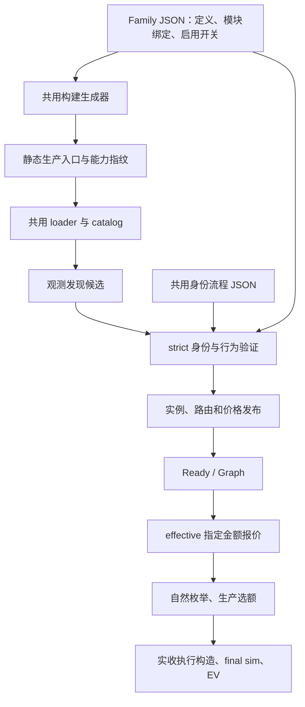

# Adapter Family Plugin：共用流程与 ERC4626 JSON

**Family 定义差异，共用代码执行流程，统一入口接入生产管线。**

本页按当前 ERC4626 试点重写。源码在云端 `/opt/mev-cloud/family-runtime-20261007`；下文文件路径均相对于 `listener/src/searcher/`。每个 JSON 文件单独展示，不混成一份配置。

当前完成了标准 ERC4626 的发现、身份声明和全部生产槽的统一装配。协议数学、Exact、执行编码仍使用原模块；Custodian、InfiniFi 的已有独立变体也保留。

## 1. 中央管线



| 层 | 实际文件 | 负责什么 |
|---|---|---|
| 构建装配 | `build-declarative-production.ts` | 读取 Family JSON，生成具名导入、原 domain constructor 和启用声明 |
| 静态审计 | `build-family-capability-manifest.ts` | 检查生成入口、模块导出、Family ID/domain、能力闭包与指纹 |
| 生产加载 | `venues/production-families/loader.ts`、`venues/production-family-composition.ts` | 统一加载静态目录，执行原注册、启用和 action 所有权检查 |
| 定义展开 | `venues/declarative-definition.ts` | 将 ABI、函数名和参数填入共用身份流程 |
| 发现解释 | `venues/declarative-discovery.ts` | 把 call/log/surface 定义转换成候选发现模式 |
| 身份解释 | `venues/declarative-identity.ts` | 执行受限表达式、阶段请求、解码和决策；不自行发 RPC 或授予准入权 |
| 生命周期 | `strict-family-lifecycle-runner.ts`、`strict-central-adapter-runtime.ts` | 调度请求、固定 source/actor、检查证据并发行可发布能力 |
| 报价与执行 | `strict-production-runtime-session.ts`、`venues/adapter-family-runtime.ts` | 调用已验证路由的 Exact、quoted、runtime 能力，保留安全门 |

中央不按协议名字分支，不持有协议 ABI 或数学。swap、protocol、credit 等原模板继续保留；Family 通过声明绑定这些合同。

## 2. 共用流程文件：`venues/sampled-conversion-flow.json`

此文件描述“先做什么、拿到结果后再做什么”。Family 提供 ABI、函数名、事件字段和参数。

一次身份验证按以下顺序推进，**不是把所有阶段无条件跑一遍**：

1. `base`：读取代码、资产、供给量及采样视图，判断是否具备继续验证的基础。
2. 必要的特殊类检查：只有命中相应代码形状，才进入 `getter-*` 或 `masked-*` 分支；用于维持已有身份归属边界。
3. `active`：使用已验证演员做行为探测，检查返回值、扣款、到账、供给变化和事件。
4. `deposit-retry`：只有流程要求补验的存入分支才进入；它不代表对所有 revert 盲目重试。
5. `decide`：根据独立方向的证据返回继续、通过或拒绝。

完整阶段结构由 `select → requirements / requests / decode → decide` 组成。为便于阅读，下面**只摘录原文件的阶段与能力要求**；字段和值均来自源码，不是可直接替换原文件的完整配置。[完整流程源码](https://github.com/EuniceLeeee/c0ffeebabe.eth/blob/5ceda4f5be9b8f6b080dc233602e3e4c17a60e8f/listener/src/searcher/venues/sampled-conversion-flow.json)包含请求、解码和行为证明表达式。

```json
{
  "version": 1,
  "abi": {
    "parameter": "abi"
  },
  "constants": {
    "parameter": "parameters.constants"
  },
  "identity": {
    "stages": {
      "base": {
        "requirements": {
          "transports": [
            "get-code",
            "eth-call"
          ]
        }
      },
      "getter-slot": {
        "requirements": {
          "transports": [
            "get-storage"
          ]
        }
      },
      "getter-code": {
        "requirements": {
          "transports": [
            "get-code"
          ]
        }
      },
      "getter-binding": {
        "requirements": {
          "transports": [
            "get-code",
            "eth-call"
          ]
        }
      },
      "masked-slot": {
        "requirements": {
          "transports": [
            "get-storage"
          ]
        }
      },
      "masked-code": {
        "requirements": {
          "transports": [
            "get-code"
          ]
        }
      },
      "active": {
        "requirements": {
          "transports": [
            "get-code",
            "eth-call",
            "effect-delta-simulation"
          ],
          "caller": "verified-actor",
          "effects": [
            "return-data",
            "revert-data",
            "token-delta",
            "total-supply-delta",
            "logs"
          ]
        }
      },
      "deposit-retry": {
        "requirements": {
          "transports": [
            "eth-call",
            "effect-delta-simulation"
          ],
          "caller": "verified-actor",
          "effects": [
            "return-data",
            "revert-data",
            "token-delta",
            "total-supply-delta",
            "logs"
          ]
        }
      }
    }
  }
}
```

`get-storage`、`get-code`、`eth-call`、`effect-delta-simulation` 是流程要求的通用能力。执行顺序和数据依赖由阶段推进表达；实际调度、RPC、source 校验及 issuer 权限仍由中央运行时负责。

## 3. Family 文件：`venues/protocols/erc4626-family/erc4626.json`

此文件描述“ERC4626 用哪些定义和模块”。下方是[完整 Family JSON](https://github.com/EuniceLeeee/c0ffeebabe.eth/blob/5ceda4f5be9b8f6b080dc233602e3e4c17a60e8f/listener/src/searcher/venues/protocols/erc4626-family/erc4626.json)，按原文件职责分块：

| 块 | 用途 |
|---|---|
| `production` | domain、默认启用值、环境覆盖开关 |
| `manifest`、`capture` | Family 合同与状态捕获模块 |
| `discovery` | 模块绑定，以及 call/log/surface 发现定义 |
| `identity` | 模块绑定，以及共用流程需要的 ABI、参数和证据字段 |
| `instance`、`routes` | 已验证实例和路由模块 |
| `pricing`、`exact` | 点价格与指定金额报价模块 |
| `execution`、`protocol`、`actionAdapters` | 执行编码、Protocol 语义与动作所有权 |

`binding` 引用现有模块的具名导出。只有当前实际声明化的 `discovery` 和 `identity` 带 `definition`；其他块不会通过一段未被消费的 JSON 假装已声明化。

**StakedUSDat 仍是另一个 Family。** 此处的 `stakedUsdatCheck`、代码指纹和 getter 绑定，是旧实现保留的重叠身份排除检查。确认候选属于该类后，普通 ERC4626 将本族 `baseValid` 设为 `false`；没有在这里执行 StakedUSDat 的报价或兑换，也没有自动转交。独立 Family 仍需自行发现和准入。这处跨 Family 归属约束尚未统一抽出，不能直接删除后声称行为等价。

```json
{
  "version": 1,
  "scope": {
    "family": "protocol:erc4626",
    "variant": "standalone-standard-behavior",
    "consumed": [
      "production",
      "discovery",
      "identity"
    ],
    "unchanged": [
      "custodian variant",
      "infinifi variant",
      "pricing",
      "exact",
      "execution",
      "settlement"
    ]
  },
  "production": {
    "domain": "protocol",
    "activation": {
      "enabled": true,
      "envKey": "SEARCHER_FAMILY_ERC4626_ENABLED"
    }
  },
  "manifest": {
    "binding": {
      "module": "./manifest.js",
      "export": "erc4626FamilyManifest"
    }
  },
  "capture": {
    "binding": {
      "module": "./capture.js",
      "export": "erc4626Capture"
    }
  },
  "discovery": {
    "binding": {
      "module": "./discovery.js",
      "export": "erc4626Discovery"
    },
    "definition": {
      "sources": [
        "observed-call",
        "landed-log",
        "address-surface"
      ],
      "candidateSources": [
        "dex-token-domain",
        "observed-interaction"
      ],
      "candidate": {
        "kind": "erc4626-vault",
        "addressField": "vault"
      },
      "calls": [
        {
          "id": "erc4626-deposit-call",
          "signature": "deposit(uint256,address)"
        },
        {
          "id": "erc4626-redeem-call",
          "signature": "redeem(uint256,address,address)"
        }
      ],
      "events": [
        {
          "id": "erc4626-deposit-log",
          "signature": "Deposit(address,address,uint256,uint256)"
        },
        {
          "id": "erc4626-withdraw-log",
          "signature": "Withdraw(address,address,address,uint256,uint256)"
        }
      ],
      "surface": {
        "id": "erc4626-standard-surface",
        "fingerprint": "erc4626-standard-behavior-v1"
      },
      "labels": [
        "erc4626",
        "protocol:erc4626"
      ]
    }
  },
  "identity": {
    "binding": {
      "module": "./identity.js",
      "export": "erc4626Identity"
    },
    "definition": {
      "version": 1,
      "workflow": "sampled-conversion-v1",
      "abi": {
        "vault": [
          "function asset() view returns (address)",
          "function totalAssets() view returns (uint256)",
          "function totalSupply() view returns (uint256)",
          "function convertToShares(uint256 assets) view returns (uint256)",
          "function convertToAssets(uint256 shares) view returns (uint256)",
          "function previewDeposit(uint256 assets) view returns (uint256)",
          "function previewRedeem(uint256 shares) view returns (uint256)",
          "function deposit(uint256 assets,address receiver) returns (uint256 shares)",
          "function redeem(uint256 shares,address receiver,address owner) returns (uint256 assets)",
          "event Deposit(address indexed sender,address indexed owner,uint256 assets,uint256 shares)",
          "event Withdraw(address indexed sender,address indexed receiver,address indexed owner,uint256 assets,uint256 shares)"
        ],
        "token": [
          "function balanceOf(address account) view returns (uint256)",
          "function decimals() view returns (uint8)",
          "function approve(address spender,uint256 amount) returns (bool)"
        ],
        "specialized": [
          "function asset() view returns(address)",
          "function getStrcOracle() view returns(address)",
          "function getWithdrawalQueue() view returns(address)"
        ]
      },
      "parameters": {
        "constants": {
          "actor": "0x000000000000000000000000000000000000face",
          "caller": {
            "kind": "verified-actor",
            "evidenceId": "erc4626-probe-actor"
          },
          "zero": "0x0000000000000000000000000000000000000000",
          "samples": [
            "1000000",
            "1000000000000000000"
          ],
          "implementationSlot": "0x360894a13ba1a3210667c828492db98dca3e2076cc3735a920a3ca505d382bbc",
          "maskedCodePattern": "^0x[0-9a-fA-F]{2976}$",
          "maskedAdminOffset": 16,
          "maskedAdminSize": 32,
          "sampleToleranceDivisor": "1000",
          "sampleToleranceAddend": "2",
          "getterProxyCode": "0x6080604052600a600c565b005b60186014601a565b6050565b565b5f604b7f360894a13ba1a3210667c828492db98dca3e2076cc3735a920a3ca505d382bbc546001600160a01b031690565b905090565b365f5f375f5f365f845af43d5f5f3e8080156069573d5ff35b3d5ffdfea264697066735822122062ba703e4a09017c3a3f8e56bd964d252d36fcc1692ec264f7c15b6c0b89424064736f6c634300081e0033",
          "getterImplementationHash": "0x555fcdfcc7e072b39cb27f6a0f4619c376a0d6b1f6d2b8d60216d5beaca8d2a2",
          "maskedTemplateHash": "0x834029e91a0eb94f478b72d8f8d0924a57de0dc6046e828a543fc421bd6270d7",
          "maskedImplementationHash": "0x51c008b264124ad667f58a8595b86745a657419baac327c1d1f335bc95b953a7",
          "getterBindings": [
            {
              "offsets": [
                11189,
                11230,
                11551
              ]
            },
            {
              "offsets": [
                3508,
                8461,
                9878,
                11665
              ],
              "getter": "getStrcOracle",
              "requestId": "standard-staked-getStrcOracle"
            },
            {
              "offsets": [
                1439,
                6190,
                6667,
                7579,
                7646,
                7723,
                7813,
                12524,
                12584
              ],
              "getter": "getWithdrawalQueue",
              "requestId": "standard-staked-getWithdrawalQueue"
            }
          ],
          "maskedByteChecks": [
            {
              "offset": 15,
              "size": 1,
              "value": "0x7f"
            }
          ]
        },
        "calls": {
          "inputAsset": "asset",
          "assetSupply": "totalAssets",
          "shareSupply": "totalSupply",
          "toShares": "convertToShares",
          "toAssets": "convertToAssets",
          "previewForward": "previewDeposit",
          "previewReverse": "previewRedeem",
          "forward": "deposit",
          "reverse": "redeem",
          "balance": "balanceOf",
          "approval": "approve"
        },
        "events": {
          "forward": "Deposit",
          "reverse": "Withdraw",
          "assetField": "assets",
          "shareField": "shares"
        },
        "errors": {
          "erc4626_identity_phase": "erc4626 identity phase",
          "erc4626_conflicting_identity_stages": "erc4626 conflicting identity stages",
          "erc4626_retry_phase": "erc4626 retry phase",
          "erc4626_implementation_stage": "erc4626 implementation stage",
          "erc4626_custodian_stage": "erc4626 custodian stage",
          "ERC4626_active_deposit_result_is_missing": "ERC4626 active-deposit result is missing",
          "ERC4626_deposit_retry_evidence_missing": "ERC4626 deposit retry evidence missing",
          "ERC4626_deposit_retry_result_missing": "ERC4626 deposit retry result missing",
          "StakedUSDat_malformed_address_word": "StakedUSDat malformed address word",
          "StakedUSDat_zero_binding": "StakedUSDat zero binding",
          "Custodian_malformed_implementation_slot": "Custodian malformed implementation slot",
          "Custodian_zero_binding": "Custodian zero binding",
          "StakedUSDat_missing_reverse_proxy_proof": "StakedUSDat missing reverse proxy proof",
          "StakedUSDat_immutable_disagreement": "StakedUSDat immutable disagreement",
          "StakedUSDat_UUPS_implementation_self_mismatch": "StakedUSDat UUPS implementation self mismatch",
          "StakedUSDat_getter_binding_mismatch": "StakedUSDat getter binding mismatch",
          "erc4626_standard_views_failed": "erc4626_standard_views_failed",
          "erc4626_erc20_surfaces_failed": "erc4626_erc20_surfaces_failed",
          "erc4626_execution_surfaces_failed": "erc4626_execution_surfaces_failed",
          "erc4626_standard_active_proof": "erc4626-standard-active-proof"
        },
        "fields": {
          "getterCheck": "stakedUsdatCheck",
          "maskedCheck": "custodianCheck",
          "maskedSource": "custodianCheckSource",
          "maskedImplementation": "custodianImplementation"
        },
        "requestPrefixes": {
          "getter": "standard-staked"
        },
        "execution": {
          "forwardArgs": [
            "$base.sampleAssets",
            {
              "op": "address",
              "args": [
                "$constants.actor"
              ]
            }
          ],
          "reverseArgs": [
            "$base.sampleShares",
            {
              "op": "address",
              "args": [
                "$constants.actor"
              ]
            },
            {
              "op": "address",
              "args": [
                "$constants.actor"
              ]
            }
          ]
        }
      }
    }
  },
  "instance": {
    "binding": {
      "module": "./instance.js",
      "export": "erc4626Instance"
    }
  },
  "routes": {
    "binding": {
      "module": "./routes.js",
      "export": "erc4626Routes"
    }
  },
  "pricing": {
    "binding": {
      "module": "./pricing.js",
      "export": "erc4626Pricing"
    }
  },
  "exact": {
    "binding": {
      "module": "./exact.js",
      "export": "erc4626Exact"
    }
  },
  "execution": {
    "binding": {
      "module": "./execution.js",
      "export": "erc4626Execution"
    }
  },
  "protocol": {
    "binding": {
      "module": "./protocol.js",
      "export": "erc4626Protocol"
    }
  },
  "actionAdapters": [
    {
      "module": "./action.js",
      "export": "erc4626DepositFamilyOwnedAction"
    },
    {
      "module": "./action.js",
      "export": "erc4626RedeemFamilyOwnedAction"
    }
  ]
}
```

## 4. 为什么还有生成的 `.production.ts`

维护入口只有 JSON。`venues/production-families/erc4626.production.ts` 现在由共用生成器产生，用于静态导入、既有 domain constructor 和能力审计；不再手工维护第二份注册声明。

构建链是：

```text
ERC4626 JSON
  → build-declarative-production.ts
  → 生成 erc4626.production.ts
  → 原 capability 审计与静态目录生成
  → 原 production loader / composition
  → catalog、action registry、strict 主流程
```

- 修改启用、模块绑定或 action 列表：改 Family JSON，再运行原 `family-capability-manifest:generate`。
- `family-capability-manifest:check` 只检查，不写文件；过期、缺失和孤儿入口均拒绝。
- 共用生成器不覆盖手写入口，不允许路径逃逸或动态代码注入；原审计继续核对具名导出和语义根。
- 实际存在的能力闭包纳入 Family JSON 与共用装配编译器；身份闭包继续追踪共用流程与解释器。不存在的能力保留原 absence 契约。
- JSON 指纹变化按原规则选择性重验；不手改 Ready、admitted 标记或旧 hash。

## 5. 报价、执行和归属边界

发现只提名候选，行为证据决定准入。JSON 不直接生成“已验证”权限。

ERC4626 继续使用原两个方向：存入的 `previewDeposit(amountIn)` 与赎回的 `previewRedeem(amountIn)`。生产输入金额不能被身份采样量覆盖。

quoted 路径仍用 `buildFragment`，runtime 路径仍用 `buildRuntimeLeg`。实收下一跳使用交易内真实到账；生产 sim 构造不调用链外逐跳 Exact，也不回退 quoted。付款方扣款、指定收款方到账、旧库存、原生币及最终偿还／利润／守恒检查保持原实现。

标准身份的薄 wrapper 还负责组合原 Custodian、InfiniFi 变体；原数学与执行模块仍是各自语义的实现位置。此次没有增加 ERC4626 延迟付款回调能力，也没有展开其他 Family 的 JSON 迁移。

## 6. 目前验证到了哪里

| 检查 | 结果 |
|---|---|
| 当前实际工作区生产 `build:live` | 通过 |
| ERC4626 原测试、声明测试、生产串接及生成合同 | 26/26 通过 |
| identity-flow | 3/3 通过 |
| 能力指纹、production loader、strict 声明、执行投影及生成一致性 | 通过 |
| 非作者独立复核 | 新生成合同 6/6；真实开关 1→0→1；冲突不覆写负例；检查前后源码指纹一致 |
| 只包含本次改动的提交包 | 生产 build、26 项 ERC 测试、3 项流程测试及生成检查通过 |
| 本次新增历史 Ready、真实 EVM、机会复现和性能测试 | 未运行；不得由离线接线结果推导通过 |

原 discovery/identity 定义搬迁前后逐值相等，10 个语义绑定和 2 个 action 指向原模块。初次新增测试的 fixture 缺文件，修正后通过，原失败记录保留。

提交包另补收原 HEAD 已引用但漏入 Git 的 `ready-transaction-input.ts`，采用工作区已有原字节；未改 Ready 接线，不能据此宣称整项 transaction-set 功能已验收。

证据目录：`/opt/mev-cloud/family-runtime-20261007/logs/erc4626-production-json-20261027/`。独立报告为 `independent-production-v2-review.json`；代码提交为 `5ceda4f5be9b8f6b080dc233602e3e4c17a60e8f`。已有历史证据仍按对应源码、方向和状态分别认定。
