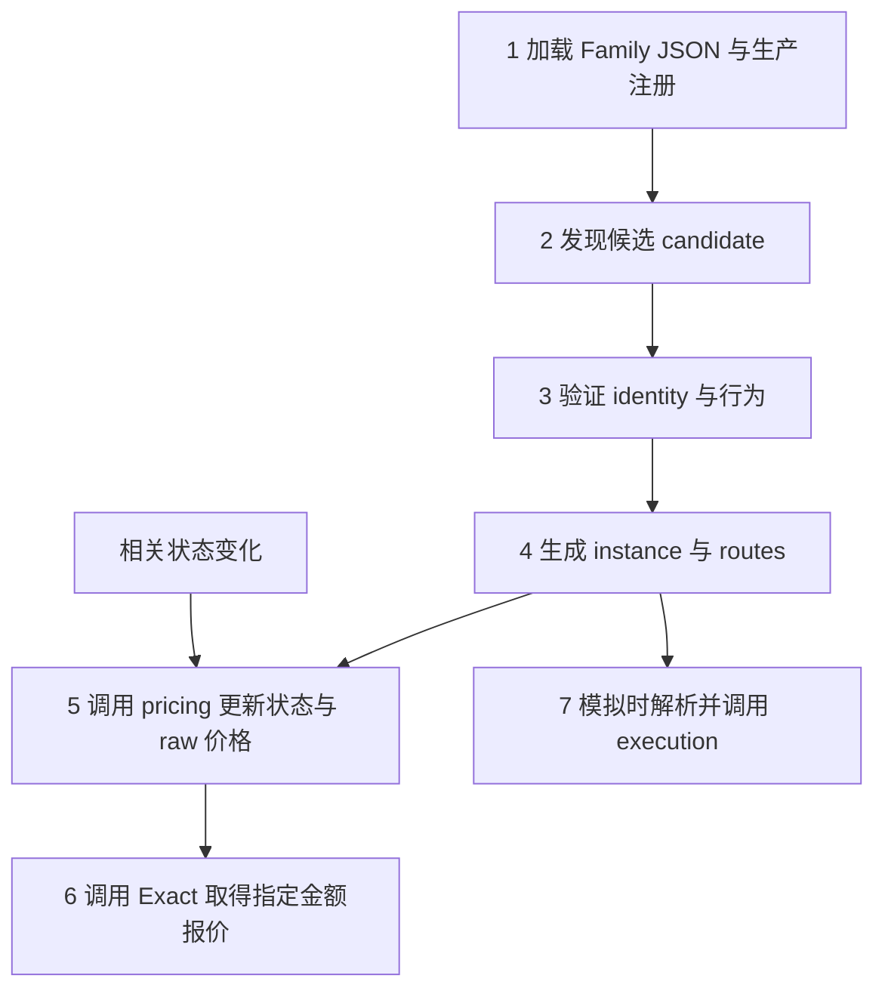

# Adapter Family Plugin：共用管线怎样读取并调用 Family 定义

这份文档围绕 **Family Plugin 的共用接入流程** 展开：中央怎样读 JSON、调用发现与身份能力、生成 instance 和 routes、更新价格，以及在需要模拟执行时取得 Family 的执行接口。用标准 ERC4626 的存入／赎回贯穿七步。

实际源码在云端 `/opt/mev-cloud/family-runtime-20261007`。下文相对路径以 `listener/src/searcher/` 为起点。正文 JSON 是对应文件的**局部摘录**，帮助对照每一步；完整 ERC4626 JSON 放在最后。

当前 JSON 有两类内容：`definition` 描述由共用解释器执行的规则；`binding` 指向提供能力的模块导出。标准 discovery／identity 已使用前一种方式；instance、routes、pricing、Exact、execution 当前使用后一种方式。两类都从同一个 Family JSON 接入，但不能把模块绑定理解成这些模块的内部语义也已经全部 JSON 化。

| 文件 | 职责 |
|---|---|
| `venues/protocols/erc4626-family/erc4626.json` | ERC4626 的发现定义、身份流程参数，以及各能力的模块绑定 |
| `venues/sampled-conversion-flow.json` | 可复用的分阶段身份流程，声明请求、解码和阶段选择 |
| 共用加载器与解释器 | 装配插件，执行声明，管理各阶段输入、结果和来源 |

正文每一步分别给出“中央怎样调用、Family 声明什么、返回什么”，JSON 按所属文件单独展示。



下面用 `V` 表示 vault，`A` 表示 `asset()` 返回的资产，`S` 表示份额。标准 ERC4626 中 `S` 的代币地址就是 `V`。这些符号是讲解用变量，不是硬编码准入地址。

## 1. 中央先加载定义，建立可调用的 Family

**中央做什么：** 共用构建入口扫描 Family JSON，生成静态生产入口；原 loader／composition 再检查合同、启用规则和 action 所有权，建立 catalog。运行时通过 catalog 找能力，不按协议名称写分支。

**ERC4626 提供什么：** domain、启用开关以及语义模块绑定。例如下面这段告诉中央使用原 Protocol 模板，以及从哪里取得 Family manifest。

文件：`venues/protocols/erc4626-family/erc4626.json`。

```json
{
  "production": {
    "domain": "protocol",
    "activation": {
      "enabled": true,
      "envKey": "SEARCHER_FAMILY_ERC4626_ENABLED"
    }
  },
  "manifest": {
    "binding": {
      "module": "./manifest.js",
      "export": "erc4626FamilyManifest"
    }
  }
}
```

实际调用链：

```text
build-declarative-production.ts
  → 生成 production-families/erc4626.production.ts
  → build-family-capability-manifest.ts 审计与生成指纹
  → production-families/loader.ts
  → production-family-composition.ts
  → catalog / action registry
```

生成的 `.production.ts` 是产物，不是第二个手工维护入口。修改定义后，使用原 `family-capability-manifest:generate`；`family-capability-manifest:check` 只核对、不写文件。swap、protocol、credit 等原模板保留。

**交给下一步：** 已注册、已校验的 discovery、identity、instance、pricing、execution 等能力。此时只是 Family 已装载，尚未证明任何 vault 可用。

## 2. 中央接收观测，Family 发现 candidate

**中央做什么：** 将链上 call、log、地址表面等观测送入 catalog 匹配，再调用匹配 Family 的 `decodeCandidate`。匹配只提名候选，不能直接变成已准入实例。

**ERC4626 提供什么：** deposit／redeem 的调用签名，Deposit／Withdraw 的事件签名，候选地址字段和 surface 定义。共用 `declarative-discovery.ts` 根据这些定义生成发现模式。

文件：`venues/protocols/erc4626-family/erc4626.json`。

```json
{
  "discovery": {
    "binding": {
      "module": "./discovery.js",
      "export": "erc4626Discovery"
    },
    "definition": {
      "sources": [
        "observed-call",
        "landed-log",
        "address-surface"
      ],
      "candidateSources": [
        "dex-token-domain",
        "observed-interaction"
      ],
      "candidate": {
        "kind": "erc4626-vault",
        "addressField": "vault"
      },
      "calls": [
        {
          "id": "erc4626-deposit-call",
          "signature": "deposit(uint256,address)"
        },
        {
          "id": "erc4626-redeem-call",
          "signature": "redeem(uint256,address,address)"
        }
      ],
      "events": [
        {
          "id": "erc4626-deposit-log",
          "signature": "Deposit(address,address,uint256,uint256)"
        },
        {
          "id": "erc4626-withdraw-log",
          "signature": "Withdraw(address,address,address,uint256,uint256)"
        }
      ],
      "surface": {
        "id": "erc4626-standard-surface",
        "fingerprint": "erc4626-standard-behavior-v1"
      },
      "labels": [
        "erc4626",
        "protocol:erc4626"
      ]
    }
  },
  "capture": {
    "binding": {
      "module": "./capture.js",
      "export": "erc4626Capture"
    }
  }
}
```

例如观测到对 `V` 的 `deposit(uint256,address)` 调用，发现阶段产出以 `vault=V` 为主体的 `erc4626-vault` 候选。`V` 仍须进入下一步验证；不能只凭 selector 或接口存在就判定 ERC4626 行为成立。

`capture` 绑定的 `capture.ts` 复用观测／捕获材料的物化能力，不负责计算 vault 价格，也不是后面按块刷新价格的实现。

**交给下一步：** candidate、观测来源与匹配依据。标准 ERC4626 不假设存在统一 factory 注册表，实际身份由后续链上读取与行为证明取得。

## 3. 中央执行分阶段请求，验证 identity

**中央做什么：** `runStrictFamilyLifecycle` 驱动身份阶段，`strict-central-adapter-runtime.ts` 处理传输、source、演员及权限边界。Family 声明要读什么、如何解码和判断；中央不把“调用返回了”自动解释成“身份通过”。

**ERC4626 提供什么：** 使用哪个共用流程，以及该流程中的函数与事件如何对应 ERC4626。下面省略 ABI 和常量，只展示命名映射；它们完整保留在文末 JSON 中。

文件：`venues/protocols/erc4626-family/erc4626.json`。

```json
{
  "identity": {
    "binding": {
      "module": "./identity.js",
      "export": "erc4626Identity"
    },
    "definition": {
      "version": 1,
      "workflow": "sampled-conversion-v1",
      "parameters": {
        "calls": {
          "inputAsset": "asset",
          "assetSupply": "totalAssets",
          "shareSupply": "totalSupply",
          "toShares": "convertToShares",
          "toAssets": "convertToAssets",
          "previewForward": "previewDeposit",
          "previewReverse": "previewRedeem",
          "forward": "deposit",
          "reverse": "redeem",
          "balance": "balanceOf",
          "approval": "approve"
        },
        "events": {
          "forward": "Deposit",
          "reverse": "Withdraw",
          "assetField": "assets",
          "shareField": "shares"
        }
      }
    }
  }
}
```

`declarative-definition.ts` 将这些参数填入 `sampled-conversion-flow.json`，再由 `declarative-identity.ts` 解释。流程实际按证据选择阶段：

| 阶段 | 做什么 | 为什么需要下一轮 |
|---|---|---|
| `base` | 读取运行时代码、asset、totalAssets、totalSupply，以及转换／preview 采样值 | 要先知道资产与份额域，才能构造有效行为探测 |
| 条件性的 `getter-*`／`masked-*` | 核对特定代理、实现与绑定，维持已有身份归属边界 | 后续读取依赖前一轮得到的实现地址；普通候选不无条件跑全部分支 |
| `active` | 使用已验证演员模拟存入／赎回，核对返回、扣款、到账、供给变化和事件 | 静态视图不足以证明实际执行语义 |
| 条件性的 `deposit-retry` | 按原流程补验特定存入情形 | 只在流程要求时进入，不是所有 revert 都自动重试 |
| `decide` | 综合证据，决定继续、通过或拒绝 | 存入与赎回方向分别认定 |

共用流程的 `active` 阶段通过以下 JSON 声明需要的中央能力。第一次 call 与依赖它的后续 call，由流程中的 `select / requests / decode / decide` 推进，不由各 Family 再手写一份调度器。

文件：`venues/sampled-conversion-flow.json`，仅摘录 `active.requirements`。

```json
{
  "identity": {
    "stages": {
      "active": {
        "requirements": {
          "transports": [
            "get-code",
            "eth-call",
            "effect-delta-simulation"
          ],
          "caller": "verified-actor",
          "effects": [
            "return-data",
            "revert-data",
            "token-delta",
            "total-supply-delta",
            "logs"
          ]
        }
      }
    }
  }
}
```

**StakedUSDat 为什么会出现在 ERC4626 定义里：** 它仍是独立 Family。这里保留旧版的重叠身份排除检查：确认属于该类后，将普通 ERC4626 的 `baseValid` 设为 `false`。这不等于在 ERC4626 下准入或执行 StakedUSDat，也不是自动转交；独立 Family 仍需自行发现和准入。跨 Family 的这条归属约束目前尚未统一抽出。

**交给下一步：** 带证据与 provenance 的 verified identity，包括 vault、asset、lineage 和 `verifiedDirections`。存入失败但赎回证据成立时，可以只保留赎回方向；两边失败或零扣款不能取得发布权限。

## 4. 用 verified identity 生成 instance 与 routes

**中央做什么：** 调用 instance 能力建立稳定描述，再调用 routes 能力投影方向；检查静态绑定与能力来源，供后续定价、发布和 Graph 使用。候选不会绕过 identity 直接成为 instance。

**ERC4626 提供什么：** 下面三项绑定原实例、路由与 Protocol 模块。目前具体投影规则仍在这些 TypeScript 模块中，JSON 负责统一接线。

文件：`venues/protocols/erc4626-family/erc4626.json`。

```json
{
  "instance": {
    "binding": {
      "module": "./instance.js",
      "export": "erc4626Instance"
    }
  },
  "routes": {
    "binding": {
      "module": "./routes.js",
      "export": "erc4626Routes"
    }
  },
  "protocol": {
    "binding": {
      "module": "./protocol.js",
      "export": "erc4626Protocol"
    }
  }
}
```

标准路径的实际规则：

| 材料 | ERC4626 当前如何产生 |
|---|---|
| `instanceKey` | vault 主体地址的小写形式 |
| descriptor | `vault=V`、`asset=A`、`share=V`，连同 provenance、lineage、已验证方向和 pinned-block 要求 |
| 存入 route | 仅当 `verifiedDirections.deposit` 成立，生成 `A → S` |
| 赎回 route | 仅当 `verifiedDirections.redeem` 成立，生成 `S → A` |
| binding fingerprint | 从原静态绑定投影生成，防止换实例、换资产或换方向后沿用旧能力 |

`erc4626Protocol.activeBehaviorProof` 仍为 `required`。Family 声明路由语义，中央 issuer 发行可用能力；生成一份普通对象不能代替 issuer 授权。

**返回中央：** descriptor、routes、定价所需的绑定。后续价格与执行调用都通过这些已验证的实例和方向定位 Family。

## 5. 中央调用 pricing，读取状态并更新价格

**中央怎样调用：** 从已装配插件取得 `pricing`，传入 instance 和 routes。共用流程负责执行声明的请求、传回结果，并管理状态复用；Family 负责说明读哪些合约数据、怎样解码、怎样形成价格。

**ERC4626 声明什么：** `module` 指向能力模块，`export` 指定其中的命名导出。构建时这段绑定成为插件的 `pricing` 属性；调用时中央已经持有 `erc4626Pricing` 对象，无须再次解析文件路径。

文件：`venues/protocols/erc4626-family/erc4626.json`。

```json
{
  "pricing": {
    "binding": {
      "module": "./pricing.js",
      "export": "erc4626Pricing"
    }
  }
}
```

共用流程通过固定接口使用这个对象：

| 接口 | 中央传入／处理 | ERC4626 的定义或实现 |
|---|---|---|
| `stateKey`、`compileDraft` | instance 与已验证 routes | 将同一 vault 的方向归到实例状态，校验资产和方向绑定 |
| `staticEvidence.buildRequests`／`decode` | 执行请求，再交还结果 | 读取资产与份额 decimals，得到 `oneAsset`、`oneShare` |
| `finalizePricingDescriptor` | draft 与静态材料 | 合并成可用于当前状态读取的定价描述 |
| `refreshPolicyForInstance`、`dependencies`、`mutation` | 根据依赖和观测判断哪些状态需更新 | 普通 vault 使用 `on-touch`；vault 日志映射回实例状态。Custodian／InfiniFi 保留自身 `each-block` 检查 |
| `current.buildRequests` | 按指定状态执行合约读取 | 存入方向 `previewDeposit(oneAsset)`；赎回方向 `previewRedeem(oneShare)` |
| `current.decodeSnapshot`／`deriveMids` | 将结果交还 Family，再接收价格 | 解码方向输出，由 `protocolMid` 产生 raw mid |

这些规则目前写在 `pricing.ts` 中，正文 JSON 负责把该模块接到共用接口。改变刷新策略或 preview 语义，仍需修改对应模块；不能只改一个尚不存在的 JSON 字段。

**返回中央：** 定价描述、状态快照、各 route 的 raw mid 及其来源。这里使用单单位采样；任意指定金额的报价由下一步 Exact 接口提供。

## 6. 中央调用 Exact，取得指定金额报价

**中央怎样调用：** 调用方已经给出 route、`amountIn` 和受测状态，中央通过同一插件取得 `exact`，按其声明执行报价方法。Family 回答这个方向、这个金额、这个状态对应的输出。

**ERC4626 声明什么：** 使用 `exact.ts` 导出的 `erc4626Exact`。报价方法及其请求、解码规则仍在该模块内。

文件：`venues/protocols/erc4626-family/erc4626.json`。

```json
{
  "exact": {
    "binding": {
      "module": "./exact.js",
      "export": "erc4626Exact"
    }
  }
}
```

```text
JSON exact.binding
  → 装配为 plugin.exact = erc4626Exact
  → 共用报价流程读取 methods()
  → 使用 erc4626-preview 请求程序
  → buildRequests() 生成该金额的 preview 调用
  → 中央执行请求
  → decode() 返回 amountOut 与报价证据
```

对标准存入，模块编码 `previewDeposit(amountIn)`；对标准赎回，编码 `previewRedeem(amountIn)`。返回证据包含输入、输出、方向、状态来源与绑定指纹。中央核对请求与结果的金额、来源，供 effective 价格等调用方使用。

**返回中央：** 指定金额的 `amountOut`、证据，或明确的失败结果。raw mid 与 Exact 共用实例身份，但用途不同：前者是状态价格，后者是真正针对本次输入金额的报价。参考金额怎样选择不属于这个 Family 的定义。

## 7. 模拟执行时，中央怎样从 JSON 找到 Family 函数

**中央怎样调用：** 根据已验证 route 所属的 Family 取得插件，调用其统一 `execution` 接口。JSON 负责指出能力在哪里；模拟调用使用已经装配好的函数对象。

**ERC4626 声明什么：** `execution` 绑定执行能力，`actionAdapters` 绑定该 Family 拥有的存入、赎回 action。两部分都来自同一个定义文件。

文件：`venues/protocols/erc4626-family/erc4626.json`。

```json
{
  "execution": {
    "binding": {
      "module": "./execution.js",
      "export": "erc4626Execution"
    }
  },
  "actionAdapters": [
    {
      "module": "./action.js",
      "export": "erc4626DepositFamilyOwnedAction"
    },
    {
      "module": "./action.js",
      "export": "erc4626RedeemFamilyOwnedAction"
    }
  ]
}
```

这里的解析与调用关系是：

```text
execution.binding.module = ./execution.js
execution.binding.export = erc4626Execution
  → 共用生成器生成命名 import
  → 插件装配为 plugin.execution = erc4626Execution
  → loader / catalog 保存并校验该 Family 能力
  → 模拟调用通过已验证 route 取得对应 Family
  → 共用 runtime 调用 execution.buildRuntimeLeg(input)
```

实际共用入口在 `venues/adapter-family-runtime.ts`：`buildFamilyRuntimeAmountLeg` 取得 `family.plugin.execution.buildRuntimeLeg`，传入已核对的 descriptor、route、source、executor 等上下文。指定金额路径则通过 `buildFamilyExecutionFragment` 调用 `execution.buildFragment`。

| 共用入口 | 最终调用的 Family 函数 | 用途 |
|---|---|---|
| `buildFamilyRuntimeAmountLeg` | `erc4626Execution.buildRuntimeLeg` | 提供交易内实收路径所需的执行能力 |
| `buildFamilyExecutionFragment` | `erc4626Execution.buildFragment` | 提供带指定金额及 Exact 证据的执行能力 |

`actionAdapters` 中的两个导出也由共用生成器导入，随插件进入 action registry；route 的 action ID 必须归属于该 Family。它们不是额外手写的生产入口。

**这里没有从 JSON 直接执行任意函数名：** JSON 绑定的是命名导出的能力对象，中央按固定合同调用对象上的方法。`deposit`／`redeem` 的合约 ABI 编码仍由 ERC4626 执行模块负责；identity 中的 `calls.forward` 等映射只供身份流程使用，不会自动替代执行模块。

**返回中央：** 该 Family 的执行能力产物，或者不支持／失败结果。本文在这个接口边界结束。

## 完整 ERC4626 JSON

以下是 `venues/protocols/erc4626-family/erc4626.json` 的完整文件。正文各步只是从同一文件摘出相关块，没有第二套定义。

共用流程的完整表达式较长，见[完整 sampled-conversion-flow.json](https://github.com/EuniceLeeee/c0ffeebabe.eth/blob/5ceda4f5be9b8f6b080dc233602e3e4c17a60e8f/listener/src/searcher/venues/sampled-conversion-flow.json)。它负责阶段推进，Family JSON 负责参数与绑定；数学／特殊语义模块按实际边界保留。

```json
{
  "version": 1,
  "scope": {
    "family": "protocol:erc4626",
    "variant": "standalone-standard-behavior",
    "consumed": [
      "production",
      "discovery",
      "identity"
    ],
    "unchanged": [
      "custodian variant",
      "infinifi variant",
      "pricing",
      "exact",
      "execution",
      "settlement"
    ]
  },
  "production": {
    "domain": "protocol",
    "activation": {
      "enabled": true,
      "envKey": "SEARCHER_FAMILY_ERC4626_ENABLED"
    }
  },
  "manifest": {
    "binding": {
      "module": "./manifest.js",
      "export": "erc4626FamilyManifest"
    }
  },
  "capture": {
    "binding": {
      "module": "./capture.js",
      "export": "erc4626Capture"
    }
  },
  "discovery": {
    "binding": {
      "module": "./discovery.js",
      "export": "erc4626Discovery"
    },
    "definition": {
      "sources": [
        "observed-call",
        "landed-log",
        "address-surface"
      ],
      "candidateSources": [
        "dex-token-domain",
        "observed-interaction"
      ],
      "candidate": {
        "kind": "erc4626-vault",
        "addressField": "vault"
      },
      "calls": [
        {
          "id": "erc4626-deposit-call",
          "signature": "deposit(uint256,address)"
        },
        {
          "id": "erc4626-redeem-call",
          "signature": "redeem(uint256,address,address)"
        }
      ],
      "events": [
        {
          "id": "erc4626-deposit-log",
          "signature": "Deposit(address,address,uint256,uint256)"
        },
        {
          "id": "erc4626-withdraw-log",
          "signature": "Withdraw(address,address,address,uint256,uint256)"
        }
      ],
      "surface": {
        "id": "erc4626-standard-surface",
        "fingerprint": "erc4626-standard-behavior-v1"
      },
      "labels": [
        "erc4626",
        "protocol:erc4626"
      ]
    }
  },
  "identity": {
    "binding": {
      "module": "./identity.js",
      "export": "erc4626Identity"
    },
    "definition": {
      "version": 1,
      "workflow": "sampled-conversion-v1",
      "abi": {
        "vault": [
          "function asset() view returns (address)",
          "function totalAssets() view returns (uint256)",
          "function totalSupply() view returns (uint256)",
          "function convertToShares(uint256 assets) view returns (uint256)",
          "function convertToAssets(uint256 shares) view returns (uint256)",
          "function previewDeposit(uint256 assets) view returns (uint256)",
          "function previewRedeem(uint256 shares) view returns (uint256)",
          "function deposit(uint256 assets,address receiver) returns (uint256 shares)",
          "function redeem(uint256 shares,address receiver,address owner) returns (uint256 assets)",
          "event Deposit(address indexed sender,address indexed owner,uint256 assets,uint256 shares)",
          "event Withdraw(address indexed sender,address indexed receiver,address indexed owner,uint256 assets,uint256 shares)"
        ],
        "token": [
          "function balanceOf(address account) view returns (uint256)",
          "function decimals() view returns (uint8)",
          "function approve(address spender,uint256 amount) returns (bool)"
        ],
        "specialized": [
          "function asset() view returns(address)",
          "function getStrcOracle() view returns(address)",
          "function getWithdrawalQueue() view returns(address)"
        ]
      },
      "parameters": {
        "constants": {
          "actor": "0x000000000000000000000000000000000000face",
          "caller": {
            "kind": "verified-actor",
            "evidenceId": "erc4626-probe-actor"
          },
          "zero": "0x0000000000000000000000000000000000000000",
          "samples": [
            "1000000",
            "1000000000000000000"
          ],
          "implementationSlot": "0x360894a13ba1a3210667c828492db98dca3e2076cc3735a920a3ca505d382bbc",
          "maskedCodePattern": "^0x[0-9a-fA-F]{2976}$",
          "maskedAdminOffset": 16,
          "maskedAdminSize": 32,
          "sampleToleranceDivisor": "1000",
          "sampleToleranceAddend": "2",
          "getterProxyCode": "0x6080604052600a600c565b005b60186014601a565b6050565b565b5f604b7f360894a13ba1a3210667c828492db98dca3e2076cc3735a920a3ca505d382bbc546001600160a01b031690565b905090565b365f5f375f5f365f845af43d5f5f3e8080156069573d5ff35b3d5ffdfea264697066735822122062ba703e4a09017c3a3f8e56bd964d252d36fcc1692ec264f7c15b6c0b89424064736f6c634300081e0033",
          "getterImplementationHash": "0x555fcdfcc7e072b39cb27f6a0f4619c376a0d6b1f6d2b8d60216d5beaca8d2a2",
          "maskedTemplateHash": "0x834029e91a0eb94f478b72d8f8d0924a57de0dc6046e828a543fc421bd6270d7",
          "maskedImplementationHash": "0x51c008b264124ad667f58a8595b86745a657419baac327c1d1f335bc95b953a7",
          "getterBindings": [
            {
              "offsets": [
                11189,
                11230,
                11551
              ]
            },
            {
              "offsets": [
                3508,
                8461,
                9878,
                11665
              ],
              "getter": "getStrcOracle",
              "requestId": "standard-staked-getStrcOracle"
            },
            {
              "offsets": [
                1439,
                6190,
                6667,
                7579,
                7646,
                7723,
                7813,
                12524,
                12584
              ],
              "getter": "getWithdrawalQueue",
              "requestId": "standard-staked-getWithdrawalQueue"
            }
          ],
          "maskedByteChecks": [
            {
              "offset": 15,
              "size": 1,
              "value": "0x7f"
            }
          ]
        },
        "calls": {
          "inputAsset": "asset",
          "assetSupply": "totalAssets",
          "shareSupply": "totalSupply",
          "toShares": "convertToShares",
          "toAssets": "convertToAssets",
          "previewForward": "previewDeposit",
          "previewReverse": "previewRedeem",
          "forward": "deposit",
          "reverse": "redeem",
          "balance": "balanceOf",
          "approval": "approve"
        },
        "events": {
          "forward": "Deposit",
          "reverse": "Withdraw",
          "assetField": "assets",
          "shareField": "shares"
        },
        "errors": {
          "erc4626_identity_phase": "erc4626 identity phase",
          "erc4626_conflicting_identity_stages": "erc4626 conflicting identity stages",
          "erc4626_retry_phase": "erc4626 retry phase",
          "erc4626_implementation_stage": "erc4626 implementation stage",
          "erc4626_custodian_stage": "erc4626 custodian stage",
          "ERC4626_active_deposit_result_is_missing": "ERC4626 active-deposit result is missing",
          "ERC4626_deposit_retry_evidence_missing": "ERC4626 deposit retry evidence missing",
          "ERC4626_deposit_retry_result_missing": "ERC4626 deposit retry result missing",
          "StakedUSDat_malformed_address_word": "StakedUSDat malformed address word",
          "StakedUSDat_zero_binding": "StakedUSDat zero binding",
          "Custodian_malformed_implementation_slot": "Custodian malformed implementation slot",
          "Custodian_zero_binding": "Custodian zero binding",
          "StakedUSDat_missing_reverse_proxy_proof": "StakedUSDat missing reverse proxy proof",
          "StakedUSDat_immutable_disagreement": "StakedUSDat immutable disagreement",
          "StakedUSDat_UUPS_implementation_self_mismatch": "StakedUSDat UUPS implementation self mismatch",
          "StakedUSDat_getter_binding_mismatch": "StakedUSDat getter binding mismatch",
          "erc4626_standard_views_failed": "erc4626_standard_views_failed",
          "erc4626_erc20_surfaces_failed": "erc4626_erc20_surfaces_failed",
          "erc4626_execution_surfaces_failed": "erc4626_execution_surfaces_failed",
          "erc4626_standard_active_proof": "erc4626-standard-active-proof"
        },
        "fields": {
          "getterCheck": "stakedUsdatCheck",
          "maskedCheck": "custodianCheck",
          "maskedSource": "custodianCheckSource",
          "maskedImplementation": "custodianImplementation"
        },
        "requestPrefixes": {
          "getter": "standard-staked"
        },
        "execution": {
          "forwardArgs": [
            "$base.sampleAssets",
            {
              "op": "address",
              "args": [
                "$constants.actor"
              ]
            }
          ],
          "reverseArgs": [
            "$base.sampleShares",
            {
              "op": "address",
              "args": [
                "$constants.actor"
              ]
            },
            {
              "op": "address",
              "args": [
                "$constants.actor"
              ]
            }
          ]
        }
      }
    }
  },
  "instance": {
    "binding": {
      "module": "./instance.js",
      "export": "erc4626Instance"
    }
  },
  "routes": {
    "binding": {
      "module": "./routes.js",
      "export": "erc4626Routes"
    }
  },
  "pricing": {
    "binding": {
      "module": "./pricing.js",
      "export": "erc4626Pricing"
    }
  },
  "exact": {
    "binding": {
      "module": "./exact.js",
      "export": "erc4626Exact"
    }
  },
  "execution": {
    "binding": {
      "module": "./execution.js",
      "export": "erc4626Execution"
    }
  },
  "protocol": {
    "binding": {
      "module": "./protocol.js",
      "export": "erc4626Protocol"
    }
  },
  "actionAdapters": [
    {
      "module": "./action.js",
      "export": "erc4626DepositFamilyOwnedAction"
    },
    {
      "module": "./action.js",
      "export": "erc4626RedeemFamilyOwnedAction"
    }
  ]
}
```
