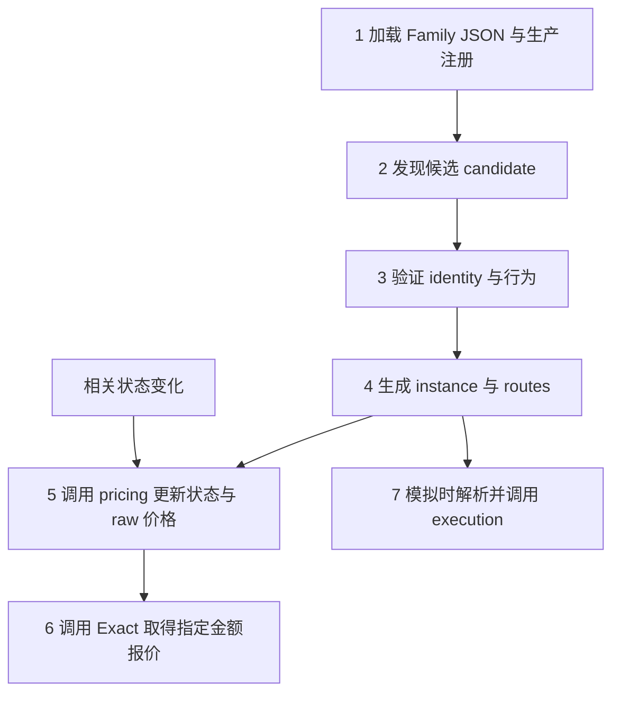

# Adapter Family Plugin：共用管线怎样读取并调用 Family 定义

这份文档围绕 **Family Plugin 的共用接入流程** 展开：中央怎样读 JSON、调用发现与身份能力、生成 instance 和 routes、更新价格，以及在需要模拟执行时取得 Family 的执行接口。用标准 ERC4626 的存入／赎回贯穿前七步，第八步逐文件核对 JSON 覆盖。

实际源码在云端 `/opt/mev-cloud/family-runtime-20261007`。下文相对路径以 `listener/src/searcher/` 为起点。正文 JSON 是对应文件的**局部摘录**，帮助对照每一步；正文之后给出完整 ERC4626 JSON，文末整理函数调用顺序。

当前 JSON 有两类内容：`definition` 描述由共用解释器执行的规则；`binding` 指向提供能力的模块导出。标准 discovery／identity 已使用前一种方式；instance、routes、pricing、Exact、execution 当前使用后一种方式。两类都从同一个 Family JSON 接入，但不能把模块绑定理解成这些模块的内部语义也已经全部 JSON 化。

| 文件 | 职责 |
|---|---|
| `venues/protocols/erc4626-family/erc4626.json` | ERC4626 的发现定义、身份流程参数，以及各能力的模块绑定 |
| `venues/sampled-conversion-flow.json` | 可复用的分阶段身份流程，声明请求、解码和阶段选择 |
| 共用加载器与解释器 | 装配插件，执行声明，管理各阶段输入、结果和来源 |

正文每一步分别给出“中央怎样调用、Family 声明什么、返回什么”，同时放入对应 JSON 和共用调用代码。代码是当前源码摘录，省略处有标记，不是新造的示例实现；完整 JSON 后附函数调用索引。



下面用 `V` 表示 vault，`A` 表示 `asset()` 返回的资产，`S` 表示份额。标准 ERC4626 中 `S` 的代币地址就是 `V`。这些符号是讲解用变量，不是硬编码准入地址。

## 1. 中央先加载定义，建立可调用的 Family

**中央做什么：** 共用构建入口扫描 Family JSON，生成静态生产入口；原 loader／composition 再检查合同、启用规则和 action 所有权，建立 catalog。运行时通过 catalog 找能力，不按协议名称写分支。

**ERC4626 提供什么：** domain、启用开关以及语义模块绑定。例如下面这段告诉中央使用原 Protocol 模板，以及从哪里取得 Family manifest。

文件：`venues/protocols/erc4626-family/erc4626.json`。

```json
{
  "production": {
    "domain": "protocol",
    "activation": {
      "enabled": true,
      "envKey": "SEARCHER_FAMILY_ERC4626_ENABLED"
    }
  },
  "manifest": {
    "binding": {
      "module": "./manifest.js",
      "export": "erc4626FamilyManifest"
    }
  }
}
```

### Family 公共管线怎样处理这份 JSON

**处理分成装配和调用两个时点。** 装配时把 JSON 变成统一的插件能力对象；调用时，中央通过这些对象上的固定接口推进发现、身份、定价与执行。不同 Family 更换定义和语义模块，共用流程保持同一套入口。

| 处理环节 | 共用代码读取什么 | 做了什么 | 产物交给谁 |
|---|---|---|---|
| 读取文件 | `syncDeclarativeProductionEntries()` 扫描 `<name>-family/<name>.json` | `readFile()` → `JSON.parse()`；没有 `production` 块的文件不作为声明式生产入口 | 定义校验与入口生成器 |
| 校验定义 | `renderDeclarativeProductionEntry()` 读取 `version`、`scope.family`、`production` 和能力块 | 根据 swap／protocol／funding／credit 模板检查必需槽、允许字段、绑定形式与启用声明；共用扫描器核对引用文件、重复入口及旧生成文件 | 可生成的 Family 声明 |
| 装配能力 | 生成器读取每个 `binding.module`、`binding.export` 及 `actionAdapters` | 生成静态命名导入，将导出对象放到 `plugin.discovery`、`plugin.identity`、`plugin.pricing` 等固定槽位 | 共用 loader／catalog |
| 编译发现定义 | `compileDeclarativeDiscovery()` 读取 `discovery.definition` | 签名转 selector／topic，字段转候选构造规则，再复用 `compileAddressDiscovery()` | `discovery` 能力对象 |
| 展开身份流程 | `expandConversionDefinition()` 读取 `identity.definition` | 根据当前支持的 `workflow`，用本族 ABI、函数／事件映射和常量填入共用 `sampled-conversion-flow.json` | 展开后的身份流程文档 |
| 编译身份接口 | `compileDeclarativeIdentity()` 读取展开文档的 `select`、`stages`、`requests`、`decode`、`decide` | 将声明包装成统一的 `requirements()`、`buildRequests()`、`decode()`、`decide()` 方法；表达式由共用解释器求值 | Family 的标准 identity variant |
| 运行时调用 | catalog 中已装配的插件与已验证 route | 中央通过固定接口传入观测、实例、状态、金额；执行 Family 声明的请求，再将结果交还其解码／判定方法 | candidate、identity、instance、价格或执行能力产物 |

这里不是运行时任意解析 `workflow` 为文件路径：当前 `expandConversionDefinition()` 明确支持 `sampled-conversion-v1`，导入的是固定的共用流程文件。增加一种通用流程，需要共用实现明确提供它；Family 仅选择已有流程并填写定义。

### 看两个字段怎样一路变成调用

**发现例子：`discovery.definition.calls[].signature`**

```text
JSON: deposit(uint256,address)
  → compileDeclarativeDiscovery(): id(signature).slice(0, 10)
  → compileAddressDiscovery(): 建立 call 匹配与候选构造规则
  → catalog.matches(observation): 找到匹配的 Family / pattern
  → coalesceCandidateMatches(): 调用该插件 decodeCandidate()
  → 返回 vault 来自 call target 的 candidate
```

此时得到的是候选地址。它进入身份流程后，才能形成被准入的 instance；selector 匹配本身不负责准入。

**身份例子：`identity.definition.parameters.calls.inputAsset = "asset"`**

```text
Family JSON: calls.inputAsset = asset
  → expandConversionDefinition(): 将共用流程的 {{calls.inputAsset}} 换成 asset
  → compileDeclarativeIdentity(): 从 identity.definition.abi 建立 Interface
  → buildRequests(): 对当前阶段的 requests 求值
  → 共用 encode 操作生成对 candidate.vault 的 asset() 调用数据
  → executeAdapterWork(): 在指定 source 下执行请求
  → variant.decode(): 解释结果并形成新证据
  → resolveIdentity(): 携带新证据再次调用 decide()，按声明继续或结束
```

流程知道“这一轮要读取输入资产”，具体 getter 由 Family 参数提供。后续阶段可以引用这一轮的结果，再声明下一轮需要的请求。每个 Family 不必自己写一套“发第一次请求、等待、再发第二次请求”的调度循环。

### 统一装配之后，中央实际调用什么

| JSON 位置 | 中央最终调用的接口 | 当前 JSON 化程度 |
|---|---|---|
| `discovery.definition` | `plugin.discovery.decodeCandidate()` 等 | 发现规则由声明编译 |
| `identity.definition` | `variant.buildRequests()`／`decode()`／`decide()` 等 | 标准身份流程由声明编译 |
| `instance.binding`、`routes.binding` | `plugin.instance.compileDraft()`／`finalizeDescriptor()`、`plugin.routes.project()` | 当前只声明模块绑定，投影规则仍由代码提供 |
| `pricing.binding` | `plugin.pricing.current.buildRequests()`／`decodeSnapshot()`／`deriveMids()` | 当前只声明模块绑定，读取与计算仍由代码提供 |
| `exact.binding` | `plugin.exact.methods()`，再调用方法的请求程序 | 当前只声明模块绑定 |
| `execution.binding` | `plugin.execution.buildRuntimeLeg()` 或 `buildFragment()` | 当前只声明模块绑定 |
| `actionAdapters` | 注册后的 `adapter.encode()` | 当前只声明 action 导出，编码仍由代码提供 |

**定义错误和业务结果分开处理。** 不支持的字段／版本、缺少必需能力、无效引用等在装配与检查阶段失败；运行时请求结果则交回 Family 的解码／判定接口。共用管线不会仅因“请求返回”就判身份通过，也不会把所有 revert 自行解释为同一种准入结论。

下面的核心代码展示这条处理链的实际实现；后续各步继续对照同一份 JSON 的相应块。

实际调用链：

```text
build-declarative-production.ts
  → 生成 production-families/erc4626.production.ts
  → build-family-capability-manifest.ts 审计与生成指纹
  → production-families/loader.ts
  → production-family-composition.ts
  → catalog / action registry
```

生成的 `.production.ts` 是产物，不是第二个手工维护入口。修改定义后，使用原 `family-capability-manifest:generate`；`family-capability-manifest:check` 只核对、不写文件。swap、protocol、credit 等原模板保留。

**交给下一步：** 已注册、已校验的 discovery、identity、instance、pricing、execution 等能力。此时只是 Family 已装载，尚未证明任何 vault 可用。


**共用代码：真正读取 JSON 的位置**

源码：`build-declarative-production.ts`（136–138 行，核心摘录）。

```ts
const document = JSON.parse(text);
if (!Object.hasOwn(object(document, "Family definition"), "production")) continue;
const entry = renderDeclarativeProductionEntry({ rootDirectory: root, productionDirectory, definitionFile, document });
```

**共用代码：把 module/export 变成静态导入和插件属性**

源码：`build-declarative-production.ts`（88–107 行，核心摘录）。

```ts
const imports: string[] = [], assignments: string[] = [];
function importBinding(b: Binding, alias: string): void {
  const module = resolve(dirname(definitionFile), b.module);
  localPath(sourceRoot, module);
  let path = relative(dirname(entryFile), module).split(sep).join("/");
  if (!path.startsWith(".")) path = `./${path}`;
  imports.push(`import { ${b.export} as ${alias} } from ${JSON.stringify(path)};`);
}
for (const key of Object.keys(bindings).sort()) {
  importBinding(bindings[key], `binding_${key}`);
  assignments.push(`  ${key}: binding_${key},`);
}
declarations.actionAdapters.forEach((b, i) => importBinding(b, `action${i}`));
const source = [MARKER, `// Definition: ${localPath(root, definitionFile)}`,
  '// Regenerate with: npm run family-capability-manifest:generate',
  'import { defineFamilyActivation } from "./activation.js";',
  `import { ${CONSTRUCTORS[domain]} } from "../adapter-family-plugin.js";`,
  ...imports, "", `export const activation = defineFamilyActivation(${JSON.stringify(activation)});`, "",
  `export const plugin = ${CONSTRUCTORS[domain]}({`, ...assignments,
  `  actionAdapters: [${declarations.actionAdapters.map((_b, i) => `action${i}`).join(", ")}],`, "});", ""].join("\n");
```

**生成结果：各 JSON 块成为同一个插件对象**

源码：`venues/production-families/erc4626.production.ts`（21–33 行，核心摘录）。

```ts
export const plugin = defineProtocolFamily({
  capture: binding_capture,
  discovery: binding_discovery,
  exact: binding_exact,
  execution: binding_execution,
  identity: binding_identity,
  instance: binding_instance,
  manifest: binding_manifest,
  pricing: binding_pricing,
  protocol: binding_protocol,
  routes: binding_routes,
  actionAdapters: [action0, action1],
});
```

**共用代码：统一加载，再建立 catalog 与 action registry**

源码：`venues/production-family-composition.ts`（140–143 行，核心摘录）。

```ts
const strictLoad = await loadStrictProductionFamilyPlugins({
  sharedInfraActionAdapterIds: PRODUCTION_INFRA_ACTION_ADAPTER_IDS,
});
const composition = composeProductionFamilyActivation({ load: strictLoad, artifact: capabilityShadowArtifact });
```

因此生产接入仍有生成文件，但维护入口是 Family JSON。代码生成发生在构建阶段；运行时读取的是已经装配的插件，不是每次调用再动态加载 JSON 指定的模块。

## 2. 中央接收观测，Family 发现 candidate

**中央做什么：** 将链上 call、log、地址表面等观测送入 catalog 匹配，再调用匹配 Family 的 `decodeCandidate`。匹配只提名候选，不能直接变成已准入实例。

**ERC4626 提供什么：** deposit／redeem 的调用签名，Deposit／Withdraw 的事件签名，候选地址字段和 surface 定义。共用 `declarative-discovery.ts` 根据这些定义生成发现模式。

文件：`venues/protocols/erc4626-family/erc4626.json`。

```json
{
  "discovery": {
    "binding": {
      "module": "./discovery.js",
      "export": "erc4626Discovery"
    },
    "definition": {
      "sources": [
        "observed-call",
        "landed-log",
        "address-surface"
      ],
      "candidateSources": [
        "dex-token-domain",
        "observed-interaction"
      ],
      "candidate": {
        "kind": "erc4626-vault",
        "addressField": "vault"
      },
      "calls": [
        {
          "id": "erc4626-deposit-call",
          "signature": "deposit(uint256,address)"
        },
        {
          "id": "erc4626-redeem-call",
          "signature": "redeem(uint256,address,address)"
        }
      ],
      "events": [
        {
          "id": "erc4626-deposit-log",
          "signature": "Deposit(address,address,uint256,uint256)"
        },
        {
          "id": "erc4626-withdraw-log",
          "signature": "Withdraw(address,address,address,uint256,uint256)"
        }
      ],
      "surface": {
        "id": "erc4626-standard-surface",
        "fingerprint": "erc4626-standard-behavior-v1"
      },
      "labels": [
        "erc4626",
        "protocol:erc4626"
      ]
    }
  },
  "capture": {
    "binding": {
      "module": "./capture.js",
      "export": "erc4626Capture"
    }
  }
}
```

例如观测到对 `V` 的 `deposit(uint256,address)` 调用，发现阶段产出以 `vault=V` 为主体的 `erc4626-vault` 候选。`V` 仍须进入下一步验证；不能只凭 selector 或接口存在就判定 ERC4626 行为成立。

`capture` 绑定的 `capture.ts` 复用观测／捕获材料的物化能力，不负责计算 vault 价格，也不是后面按块刷新价格的实现。

**交给下一步：** candidate、观测来源与匹配依据。标准 ERC4626 不假设存在统一 factory 注册表，实际身份由后续链上读取与行为证明取得。


**Family 薄入口：把本族 discovery.definition 交给共用解释器**

源码：`venues/protocols/erc4626-family/discovery.ts`（1–5 行，核心摘录）。

```ts
import { compileDeclarativeDiscovery } from "../../declarative-discovery.js";
import type { Erc4626Candidate } from "./types.js";
import definition from "./erc4626.json";

export const erc4626Discovery = compileDeclarativeDiscovery<Erc4626Candidate>(definition.discovery.definition);
```

**共用代码：由签名生成匹配条件，由地址字段生成 candidate**

源码：`venues/declarative-discovery.ts`（21–32 行，核心摘录）。

```ts
return compileAddressDiscovery<C>({
  evidenceChannel: "nominate", sources: d.sources as DiscoverySemantics<C>["sources"],
  candidateSources: d.candidateSources as DiscoverySemantics<C>["candidateSources"],
  callPatterns: d.calls.map(c => ({ ...c, selector: id(c.signature).slice(0, 10) as `0x${string}`,
    candidateAddress: { from: "call-target" as const } })),
  logPatterns: d.events.map(e => ({ ...e, topic: id(e.signature) as `0x${string}` })),
  addressSurfaces: [{ ...d.surface, kind: "interface" }],
  candidate: address => ({ candidateKind: d.candidate.kind, [d.candidate.addressField]: address } as unknown as C),
  candidateKey: candidate => getAddress((candidate as unknown as Record<string, string>)[d.candidate.addressField]).toLowerCase(),
  nominate: createAddressSurfaceNomination({ opaqueLabels: d.labels, interfaceFingerprints: [d.surface.fingerprint] }),
  reverseBinding: explicitReverseBindingUnsupported("no reverse-binding registry declared (explicit unsupported)"),
});
```

**共用代码：匹配之后调用插件的 decodeCandidate**

源码：`venues/adapter-family-runtime.ts`（2985–2988 行，核心摘录）。

```ts
candidate = family.plugin.discovery.decodeCandidate({
  observation: match.observation,
  matchedPatternId: match.matchedPatternId,
});
```

`FamilyCapabilityCatalog.matches(observation)` 先按已编译模式匹配；`coalesceCandidateMatches()` 再调用上面的 `decodeCandidate` 并归并候选。新增普通 vault 无须添加地址清单，候选地址来自观测，身份留到下一步。

## 3. 中央执行分阶段请求，验证 identity

**中央做什么：** `runStrictFamilyLifecycle` 驱动身份阶段，`strict-central-adapter-runtime.ts` 处理传输、source、演员及权限边界。Family 声明要读什么、如何解码和判断；中央不把“调用返回了”自动解释成“身份通过”。

**ERC4626 提供什么：** 使用哪个共用流程，以及该流程中的函数与事件如何对应 ERC4626。下面省略 ABI 和常量，只展示命名映射；它们完整保留在文末 JSON 中。

文件：`venues/protocols/erc4626-family/erc4626.json`。

```json
{
  "identity": {
    "binding": {
      "module": "./identity.js",
      "export": "erc4626Identity"
    },
    "definition": {
      "version": 1,
      "workflow": "sampled-conversion-v1",
      "parameters": {
        "calls": {
          "inputAsset": "asset",
          "assetSupply": "totalAssets",
          "shareSupply": "totalSupply",
          "toShares": "convertToShares",
          "toAssets": "convertToAssets",
          "previewForward": "previewDeposit",
          "previewReverse": "previewRedeem",
          "forward": "deposit",
          "reverse": "redeem",
          "balance": "balanceOf",
          "approval": "approve"
        },
        "events": {
          "forward": "Deposit",
          "reverse": "Withdraw",
          "assetField": "assets",
          "shareField": "shares"
        }
      }
    }
  }
}
```

`declarative-definition.ts` 将这些参数填入 `sampled-conversion-flow.json`，再由 `declarative-identity.ts` 解释。流程实际按证据选择阶段：

| 阶段 | 做什么 | 为什么需要下一轮 |
|---|---|---|
| `base` | 读取运行时代码、asset、totalAssets、totalSupply，以及转换／preview 采样值 | 要先知道资产与份额域，才能构造有效行为探测 |
| 条件性的 `getter-*`／`masked-*` | 核对特定代理、实现与绑定，维持已有身份归属边界 | 后续读取依赖前一轮得到的实现地址；普通候选不无条件跑全部分支 |
| `active` | 使用已验证演员模拟存入／赎回，核对返回、扣款、到账、供给变化和事件 | 静态视图不足以证明实际执行语义 |
| 条件性的 `deposit-retry` | 按原流程补验特定存入情形 | 只在流程要求时进入，不是所有 revert 都自动重试 |
| `decide` | 综合证据，决定继续、通过或拒绝 | 存入与赎回方向分别认定 |

共用流程的 `active` 阶段通过以下 JSON 声明需要的中央能力。第一次 call 与依赖它的后续 call，由流程中的 `select / requests / decode / decide` 推进，不由各 Family 再手写一份调度器。

文件：`venues/sampled-conversion-flow.json`，仅摘录 `active.requirements`。

```json
{
  "identity": {
    "stages": {
      "active": {
        "requirements": {
          "transports": [
            "get-code",
            "eth-call",
            "effect-delta-simulation"
          ],
          "caller": "verified-actor",
          "effects": [
            "return-data",
            "revert-data",
            "token-delta",
            "total-supply-delta",
            "logs"
          ]
        }
      }
    }
  }
}
```

**StakedUSDat 为什么会出现在 ERC4626 定义里：** 它仍是独立 Family。这里保留旧版的重叠身份排除检查：确认属于该类后，将普通 ERC4626 的 `baseValid` 设为 `false`。这不等于在 ERC4626 下准入或执行 StakedUSDat，也不是自动转交；独立 Family 仍需自行发现和准入。跨 Family 的这条归属约束目前尚未统一抽出。

**交给下一步：** 带证据与 provenance 的 verified identity，包括 vault、asset、lineage 和 `verifiedDirections`。存入失败但赎回证据成立时，可以只保留赎回方向；两边失败或零扣款不能取得发布权限。


**Family 薄入口：展开身份定义，再编译成共用接口**

源码：`venues/protocols/erc4626-family/identity.ts`（22–26 行，核心摘录）。

```ts
return compileDeclarativeIdentity<Erc4626Candidate, Erc4626Identity>(
  expandConversionDefinition(definition.identity.definition), { id: profile.id, familyId: profile.familyId, lineageId: profile.lineageId,
    parameters: { excludeSpecialized: profile.excludeSpecialized !== false, hasEventMath: !!profile.depositEventAssets } },
  profile.depositEventAssets ? { depositEventAssets: profile.depositEventAssets } : {},
);
```

**共用代码：展开的是共用流程 JSON**

源码：`venues/declarative-definition.ts`（1–1、58–58 行，核心摘录）。

```ts
import flow from "./sampled-conversion-flow.json";
// ……同一文件内省略的代码……
return expand(flow) as DeclarativeIdentityDocument;
```

`expand()` 用 Family 的 `parameters.calls`、`parameters.events`、ABI 与常量替换流程占位符。例如 `{{calls.inputAsset}}` 得到 `asset`。同族第一次读取与依赖结果后的下一次读取，都由展开后的流程声明选择。

**共用解释器：从流程 JSON 取得阶段、请求、解码与判定**

源码：`venues/declarative-identity.ts`（227–251 行，核心摘录）。

```ts
  const stage = (step: Value) => {
    budget = 0;
    const id = run(doc.identity.select, environment(step));
    if (!Object.prototype.hasOwnProperty.call(doc.identity.stages, id)) throw new Error("unknown declared identity stage");
    return doc.identity.stages[id];
  };
  return {
    id: profile.id, kind: "standalone-contract", lineageId: profile.lineageId, applies: () => true,
    requirements: step => stage(step).requirements,
    buildRequests: step => {
      const selected = stage(step);
      const requests = evaluate(selected.requests, environment(step)) as AdapterRequest[];
      if (!Array.isArray(requests) || new Set(requests.map(r => r.id)).size !== requests.length) throw new Error("duplicate declared request id");
      return freeze(requests);
    },
    decode: ({ step, results }) => {
      const selected = stage(step);
      for (const result of results) if (!result.ok && !selected.optionalFailures?.includes(result.id)) throw new RequiredAdapterRequestError(result);
      return freeze(run(selected.decode, environment(step, results)));
    },
    decide: step => { budget = 0; return freeze(run(doc.identity.decide, environment(step))); },
  };
}
```

**共用 runtime：把声明编译出的函数接到统一请求执行**

源码：`venues/adapter-family-runtime.ts`（3710–3736 行，核心摘录）。

```ts
const program: RequestProgram<typeof stepInput, IdentityProgramEvidence> = {
  requirements: (programInput) => {
    const base = variant.requirements(programInput);
    return assets === undefined ? base : assets.requirements(base);
  },
  buildRequests: (programInput) => {
    const base = variant.buildRequests(programInput);
    return assets === undefined ? base : assets.append(base);
  },
  decode: ({ programInput, results }) => ({
    evidence: variant.decode({ step: programInput, results,
      ...(assets === undefined ? {} : { assets: assets.decode(results) }) }),
    // Chain metadata does not stand in for the protocol's identity proof.
    successfulResultCount: results.filter((result) => result.ok && !assets?.isMetadataResult(result.id)).length,
  }),
};
const work = await executeAdapterWork({
  intent: {
    stage: "identity",
    familyId: plugin.manifest.familyId,
    source: input.source,
    generation: input.generation,
    program,
    programInput: stepInput,
  },
  runtime: input.runtime,
});
```

`resolveIdentity()` 循环调用 `variant.decide(stepInput)`：需要更多证据时执行该请求程序，把 `decode` 的结果带入下一轮；验证成立或明确拒绝时结束。读链与请求执行由中央承担，协议判定由声明编译出的 Family 接口承担。

## 4. 用 verified identity 生成 instance 与 routes

**中央做什么：** 调用 instance 能力建立稳定描述，再调用 routes 能力投影方向；检查静态绑定与能力来源，供后续定价、发布和 Graph 使用。候选不会绕过 identity 直接成为 instance。

**ERC4626 提供什么：** 下面三项绑定原实例、路由与 Protocol 模块。目前具体投影规则仍在这些 TypeScript 模块中，JSON 负责统一接线。

文件：`venues/protocols/erc4626-family/erc4626.json`。

```json
{
  "instance": {
    "binding": {
      "module": "./instance.js",
      "export": "erc4626Instance"
    }
  },
  "routes": {
    "binding": {
      "module": "./routes.js",
      "export": "erc4626Routes"
    }
  },
  "protocol": {
    "binding": {
      "module": "./protocol.js",
      "export": "erc4626Protocol"
    }
  }
}
```

标准路径的实际规则：

| 材料 | ERC4626 当前如何产生 |
|---|---|
| `instanceKey` | vault 主体地址的小写形式 |
| descriptor | `vault=V`、`asset=A`、`share=V`，连同 provenance、lineage、已验证方向和 pinned-block 要求 |
| 存入 route | 仅当 `verifiedDirections.deposit` 成立，生成 `A → S` |
| 赎回 route | 仅当 `verifiedDirections.redeem` 成立，生成 `S → A` |
| binding fingerprint | 从原静态绑定投影生成，防止换实例、换资产或换方向后沿用旧能力 |

`erc4626Protocol.activeBehaviorProof` 仍为 `required`。Family 声明路由语义，中央 issuer 发行可用能力；生成一份普通对象不能代替 issuer 授权。

**返回中央：** descriptor、routes、定价所需的绑定。后续价格与执行调用都通过这些已验证的实例和方向定位 Family。


**共用代码：prepareCandidate 调用 instance 和 routes**

源码：`venues/adapter-family-runtime.ts`（3345–3348、3396–3404、3499–3503 行，核心摘录）。

```ts
draft = requireObject(
  input.family.plugin.instance.compileDraft(identity),
  "instance draft",
);
// ……同一文件内省略的代码……
preliminaryDescriptor = requireObject(
  input.family.plugin.instance.finalizeDescriptor({
    identity,
    draft,
    staticEvidence: instanceStaticEvidence,
    sharedBindings: Object.freeze([]),
  }),
  "preliminary instance descriptor",
) as CompiledInstanceDescriptor;
// ……同一文件内省略的代码……
routes = validateRoutes(
  input.family.plugin.routes.project({ descriptor }),
  descriptor,
  input.family,
);
```

上面三处是同一共用准备流程中的关键调用，省略了静态证据、共享绑定与校验分支。JSON 的 `instance.binding` 和 `routes.binding` 决定方法来自哪里；`identity`、`draft`、`descriptor` 是中央逐阶段传递的输入。

## 5. 中央调用 pricing，读取状态并更新价格

**中央怎样调用：** 从已装配插件取得 `pricing`，传入 instance 和 routes。共用流程负责执行声明的请求、传回结果，并管理状态复用；Family 负责说明读哪些合约数据、怎样解码、怎样形成价格。

**ERC4626 声明什么：** `module` 指向能力模块，`export` 指定其中的命名导出。构建时这段绑定成为插件的 `pricing` 属性；调用时中央已经持有 `erc4626Pricing` 对象，无须再次解析文件路径。

文件：`venues/protocols/erc4626-family/erc4626.json`。

```json
{
  "pricing": {
    "binding": {
      "module": "./pricing.js",
      "export": "erc4626Pricing"
    }
  }
}
```

共用流程通过固定接口使用这个对象：

| 接口 | 中央传入／处理 | ERC4626 的定义或实现 |
|---|---|---|
| `stateKey`、`compileDraft` | instance 与已验证 routes | 将同一 vault 的方向归到实例状态，校验资产和方向绑定 |
| `staticEvidence.buildRequests`／`decode` | 执行请求，再交还结果 | 读取资产与份额 decimals，得到 `oneAsset`、`oneShare` |
| `finalizePricingDescriptor` | draft 与静态材料 | 合并成可用于当前状态读取的定价描述 |
| `refreshPolicyForInstance`、`dependencies`、`mutation` | 根据依赖和观测判断哪些状态需更新 | 普通 vault 使用 `on-touch`；vault 日志映射回实例状态。Custodian／InfiniFi 保留自身 `each-block` 检查 |
| `current.buildRequests` | 按指定状态执行合约读取 | 存入方向 `previewDeposit(oneAsset)`；赎回方向 `previewRedeem(oneShare)` |
| `current.decodeSnapshot`／`deriveMids` | 将结果交还 Family，再接收价格 | 解码方向输出，由 `protocolMid` 产生 raw mid |

这些规则目前写在 `pricing.ts` 中，正文 JSON 负责把该模块接到共用接口。改变刷新策略或 preview 语义，仍需修改对应模块；不能只改一个尚不存在的 JSON 字段。

**返回中央：** 定价描述、状态快照、各 route 的 raw mid 及其来源。这里使用单单位采样；任意指定金额的报价由下一步 Exact 接口提供。


**共用代码：executePreparedPricingCurrent 请求当前状态**

源码：`venues/adapter-family-runtime.ts`（4054–4061 行，核心摘录）。

```ts
const initialProgram: RequestProgram<typeof currentInput, ResultSetEvidence> = {
  requirements: (programInput) =>
    input.family.plugin.pricing.current.requirements(programInput),
  buildRequests: (programInput) =>
    input.family.plugin.pricing.current.buildRequests(programInput),
  decode: ({ results }) => ({ results }),
};
const initial = await executeCurrentWork(input, initialProgram, currentInput);
```

**共用代码：结果交还同一个 pricing 能力解码并产出价格**

源码：`venues/adapter-family-runtime.ts`（4173–4190 行，核心摘录）。

```ts
snapshot = requireObject(
  input.family.plugin.pricing.current.decodeSnapshot({
    descriptor: input.pricingDescriptor,
    initialResults,
    dependentEvidence: Object.freeze([...dependentEvidence]),
  }),
  "pricing snapshot",
);
deepFreezeOpaqueRuntimeValue(snapshot, "pricing snapshot");
mids = validateRouteMap(
  input.family.plugin.pricing.current.deriveMids({
    descriptor: input.pricingDescriptor,
    snapshot,
    routes: input.routes,
  }),
  input.routes,
  "mid",
) as ReadonlyMap<RouteKey, RouteVenueMid>;
```

首次实例准备由 `preparePricingState()` 建好定价描述，再进入当前状态读取；后续刷新通过 `refreshPreparedFamilyInstancePricing()` 复用同一能力。共用调用点始终是 `plugin.pricing`，不写 ERC4626 专属中央分支。

## 6. 中央调用 Exact，取得指定金额报价

**中央怎样调用：** 调用方已经给出 route、`amountIn` 和受测状态，中央通过同一插件取得 `exact`，按其声明执行报价方法。Family 回答这个方向、这个金额、这个状态对应的输出。

**ERC4626 声明什么：** 使用 `exact.ts` 导出的 `erc4626Exact`。报价方法及其请求、解码规则仍在该模块内。

文件：`venues/protocols/erc4626-family/erc4626.json`。

```json
{
  "exact": {
    "binding": {
      "module": "./exact.js",
      "export": "erc4626Exact"
    }
  }
}
```

```text
JSON exact.binding
  → 装配为 plugin.exact = erc4626Exact
  → 共用报价流程读取 methods()
  → 使用 erc4626-preview 请求程序
  → buildRequests() 生成该金额的 preview 调用
  → 中央执行请求
  → decode() 返回 amountOut 与报价证据
```

对标准存入，模块编码 `previewDeposit(amountIn)`；对标准赎回，编码 `previewRedeem(amountIn)`。返回证据包含输入、输出、方向、状态来源与绑定指纹。中央核对请求与结果的金额、来源，供 effective 价格等调用方使用。

**返回中央：** 指定金额的 `amountOut`、证据，或明确的失败结果。raw mid 与 Exact 共用实例身份，但用途不同：前者是状态价格，后者是真正针对本次输入金额的报价。参考金额怎样选择不属于这个 Family 的定义。


**共用代码：按 exact 槽声明取得报价方法**

源码：`venues/adapter-family-runtime.ts`（1338–1338 行，核心摘录）。

```ts
const methods = declareExactMethods(invocation.family.plugin.exact.methods(programInput));
```

**共用代码：请求程序提供 requirements 和 buildRequests**

源码：`venues/adapter-family-runtime.ts`（2257–2270 行，核心摘录）。

```ts
function declareInitialExactRound(
  program: ExactRequestProgram<
    CompiledInstanceDescriptor,
    FamilyRouteDescriptor,
    unknown
  >,
  programInput: RuntimeExactQuoteInput,
): DeclaredExactRound {
  return declareExactRound({
    requirements: program.requirements(programInput),
    requests: program.buildRequests(programInput),
  });
}

```

**共用代码：请求结束后调用同一程序的 decode**

源码：`venues/adapter-family-runtime.ts`（1882–1890 行，核心摘录）。

```ts
quote = requireSynchronousExactValue(
  input.program.decode({
    programInput: input.programInput,
    initialResults,
    dependentEvidence: Object.freeze([...dependentEvidence]),
  }),
  "exact request program decode",
);
validateExactQuote(quote);
```

这些调用属于 `executeFamilyExactQuote()` 的共用流程。`erc4626Exact.methods()` 返回标准 `erc4626-preview` 请求程序；协议函数选择留在 Family 的 `exact.ts`，中央只执行请求并接收报价证据。

## 7. 模拟执行时，中央怎样从 JSON 找到 Family 函数

**中央怎样调用：** 根据已验证 route 所属的 Family 取得插件，调用其统一 `execution` 接口。JSON 负责指出能力在哪里；模拟调用使用已经装配好的函数对象。

**ERC4626 声明什么：** `execution` 绑定执行能力，`actionAdapters` 绑定该 Family 拥有的存入、赎回 action。两部分都来自同一个定义文件。

文件：`venues/protocols/erc4626-family/erc4626.json`。

```json
{
  "execution": {
    "binding": {
      "module": "./execution.js",
      "export": "erc4626Execution"
    }
  },
  "actionAdapters": [
    {
      "module": "./action.js",
      "export": "erc4626DepositFamilyOwnedAction"
    },
    {
      "module": "./action.js",
      "export": "erc4626RedeemFamilyOwnedAction"
    }
  ]
}
```

这里的解析与调用关系是：

```text
execution.binding.module = ./execution.js
execution.binding.export = erc4626Execution
  → 共用生成器生成命名 import
  → 插件装配为 plugin.execution = erc4626Execution
  → loader / catalog 保存并校验该 Family 能力
  → 模拟调用通过已验证 route 取得对应 Family
  → 共用 runtime 调用 execution.buildRuntimeLeg(input)
```

实际共用入口在 `venues/adapter-family-runtime.ts`：`buildFamilyRuntimeAmountLeg` 取得 `family.plugin.execution.buildRuntimeLeg`，传入已核对的 descriptor、route、source、executor 等上下文。指定金额路径则通过 `buildFamilyExecutionFragment` 调用 `execution.buildFragment`。

| 共用入口 | 最终调用的 Family 函数 | 用途 |
|---|---|---|
| `buildFamilyRuntimeAmountLeg` | `erc4626Execution.buildRuntimeLeg` | 提供交易内实收路径所需的执行能力 |
| `buildFamilyExecutionFragment` | `erc4626Execution.buildFragment` | 提供带指定金额及 Exact 证据的执行能力 |

`actionAdapters` 中的两个导出也由共用生成器导入，随插件进入 action registry；route 的 action ID 必须归属于该 Family。它们不是额外手写的生产入口。

**这里没有从 JSON 直接执行任意函数名：** JSON 绑定的是命名导出的能力对象，中央按固定合同调用对象上的方法。`deposit`／`redeem` 的合约 ABI 编码仍由 ERC4626 执行模块负责；identity 中的 `calls.forward` 等映射只供身份流程使用，不会自动替代执行模块。

**返回中央：** 该 Family 的执行能力产物，或者不支持／失败结果。模拟部分的正文停在这个接口边界。


**共用 session：从 edge 解析出 Family 与已验证 route**

源码：`strict-production-runtime-session.ts`（1430–1442 行，核心摘录）。

```ts
buildRuntimeAmountLeg(input: {
  readonly edge: TokenEdge;
  readonly executor: string;
  readonly runtimeEvidence: readonly RuntimeEvidence[];
  readonly settlement?: import("../adapters/runtime-amount-program.js").RuntimeSettlementRequest;
}): import("../adapters/runtime-amount-program.js").RuntimeAmountLeg | null {
  this.#runtime.generationFence.assertCurrent(this.source.generation, this.source);
  const route = this.#resolve(input.edge);
  if (route.kind === "credit") return null;
  return buildFamilyRuntimeAmountLeg({ family: route.family, route: route.handle,
    source: this.source, runtime: this.#runtime, executor: input.executor,
    runtimeEvidence: input.runtimeEvidence, settlement: input.settlement, actionOwnership: this.#catalog });
}
```

**共用 runtime：取出 JSON 所绑定对象的方法并调用**

源码：`venues/adapter-family-runtime.ts`（2787–2796 行，核心摘录）。

```ts
const builder = input.family.plugin.execution.buildRuntimeLeg;
if (!builder) return null;
executionNativeSides(record.route);
const requested = mapRuntimeAssetSettlementRequest({ route: record.route, executor: input.executor, request: input.settlement });
if (requested === null) return null;
const leg = builder(Object.freeze({ descriptor: record.instance.descriptor, route: record.route,
  source: Object.freeze({ ...input.source }),
  executor: input.executor, runtimeEvidence: Object.freeze([...input.runtimeEvidence]),
  ...(requested === undefined ? {} : { settlement: Object.freeze({ ...requested }) }),
  ...(caller.transactionOrigin === undefined ? {} : { transactionOrigin: caller.transactionOrigin }) }));
```

**指定金额分支：调用同一 execution 对象的 buildFragment**

源码：`venues/adapter-family-runtime.ts`（2850–2865 行，核心摘录）。

```ts
const fragment = input.family.plugin.execution.buildFragment(Object.freeze({
  descriptor: routeRecord.instance.descriptor,
  route: routeRecord.route,
  amountIn: exactRecord.amountIn,
  quotedAmountOut: exactRecord.amountOut,
  minAmountOut: input.minAmountOut,
  ...(input.quoteToleranceRawUnits === undefined ? {} : {
    quoteToleranceRawUnits: input.quoteToleranceRawUnits,
  }),
  exactEvidence: exactRecord.evidence,
  executor: exactRecord.executor,
  ...(exactRecord.callerContext.transactionOrigin === undefined ? {} : {
    transactionOrigin: exactRecord.callerContext.transactionOrigin,
  }),
  runtimeEvidence: exactRecord.runtimeEvidence,
}));
```

这里展示到 Family 函数调用为止。`buildRuntimeLeg` 与 `buildFragment` 是两条接口，不能画成先后必经步骤。当前选择器优先尝试 runtime；`runtimeAmounts === false`、没有 runtime 方法或任一 leg 返回 `null` 时，现有代码会走 quoted 分支。因此这里只描述调用接线，不把它写成所有模拟都保证零 Exact 或绝无 quoted 回退。

## 8. 逐文件核对：哪些已有 JSON，哪些仍是代码

**目前没有做到“每个原文件的语义都有对应 JSON”。** 已完成的是一个 Family JSON 统一装配生产能力，以及标准 discovery／identity 的声明驱动。`binding` 只回答“调用哪个模块导出”，不能算该文件逻辑已经迁入 JSON。

以下逐项覆盖当前 `venues/protocols/erc4626-family/` 的全部 **20 个顶层 TypeScript 文件**。共用管线与测试文件另列，避免把测试资料当成运行定义。

| 原文件 | 对应 JSON 位置 | 当前程度 | 实际保留内容 |
|---|---|---|---|
| `manifest.ts` | `manifest.binding` | 仅绑定 | Family ID、lineage、action 所有权等仍由代码导出 |
| `capture.ts` | `capture.binding` | 仅绑定 | 复用观测材料物化函数；不等于价格读取定义 |
| `discovery.ts` | `discovery.binding` + `discovery.definition` | 声明驱动 | call／event／surface 与候选字段交给共用编译器 |
| `identity.ts` | `identity.binding` + `identity.definition` | 部分声明驱动 | 标准变体使用流程 JSON；variants 组装及非标变体仍有代码 |
| `instance.ts` | `instance.binding` | 仅绑定 | 实例描述投影规则仍在代码 |
| `routes.ts` | `routes.binding` | 仅绑定 | 方向和 route 投影仍在代码 |
| `pricing.ts` | `pricing.binding` | 仅绑定 | 请求、刷新策略、快照与 mid 派生仍在代码 |
| `exact.ts` | `exact.binding` | 仅绑定 | 指定金额请求及解码仍在代码 |
| `execution.ts` | `execution.binding` | 仅绑定 | 执行接口与协议编码仍在代码 |
| `protocol.ts` | `protocol.binding` | 仅绑定 | Protocol 槽的合同声明仍在代码 |
| `action.ts` | `actionAdapters[0]`、`actionAdapters[1]` | 仅绑定 | 绑定两个 action 导出；encode 实现仍在代码 |
| `abi.ts` | 标准 identity 的 ABI 另有 `identity.definition.abi` | 部分重复定义，未替代文件 | pricing／exact 等仍导入 TypeScript ABI；不能说 ABI 已统一只读 JSON |
| `binding.ts` | 无独立 JSON 块 | 代码保留 | 实例、方向、资产和静态指纹校验由能力模块调用 |
| `types.ts` | 无独立 JSON 块 | 代码保留 | 编译期类型，不是运行期 Family 定义 |
| `custodian.ts` | 无独立 JSON 块 | 未声明化 | Custodian 的绑定、读取与规则仍在模块 |
| `custodian-identity.ts` | 由 `identity.ts` 引入；无独立 definition | 未声明化 | 非标身份逻辑仍在代码 |
| `custodian-execution.ts` | 由 execution／action 等引用；无独立 definition | 未声明化 | Custodian 执行逻辑仍在代码 |
| `infinifi.ts` | 无独立 JSON 块 | 未声明化 | InfiniFi 的绑定、读取与规则仍在模块 |
| `infinifi-identity.ts` | 由 `identity.ts` 引入；无独立 definition | 未声明化 | 非标身份逻辑仍在代码 |
| `infinifi-execution.ts` | 由 execution／action 等引用；无独立 definition | 未声明化 | InfiniFi 执行逻辑仍在代码 |

另外三类文件的对应关系：

| 文件／类别 | JSON 关系 |
|---|---|
| `production-families/erc4626.production.ts` | 由 Family JSON 生成；不是第二份手工维护定义 |
| `declarative-discovery.ts`、`declarative-definition.ts`、`declarative-identity.ts` 及 loader/runtime | 共用解释器和调用流程，负责消费定义；不要求给这些解释器再各造一份 Family JSON |
| `sampled-conversion-flow.json` | 独立的共用身份流程；由 Family 的 `identity.definition.workflow` 和参数展开 |
| 本族 `test/` 下的 24 份文件 | 测试、样本或证据；其中已有的 JSON 是测试输入，不是该 Family 的生产定义 |

目前 **11 个顶层代码文件有直接绑定，9 个没有直接绑定**；有绑定的文件中，只有 discovery 与标准 identity 已将相应规则交给共用解释器。一个 Family 可以用一个 JSON 内的不同块对应原能力文件，不必机械地拆成 20 个 JSON 文件。若目标是“Family 只给声明，流程统一执行”，上述“仅绑定／未声明化”项仍是待迁移内容，本次文档更新没有把它们伪装成已完成。

## 完整 ERC4626 JSON

以下是 `venues/protocols/erc4626-family/erc4626.json` 的完整文件。正文各步只是从同一文件摘出相关块，没有第二套定义。

共用流程的完整表达式较长，见[完整 sampled-conversion-flow.json](https://github.com/EuniceLeeee/c0ffeebabe.eth/blob/5ceda4f5be9b8f6b080dc233602e3e4c17a60e8f/listener/src/searcher/venues/sampled-conversion-flow.json)。它负责阶段推进，Family JSON 负责参数与绑定；数学／特殊语义模块按实际边界保留。

```json
{
  "version": 1,
  "scope": {
    "family": "protocol:erc4626",
    "variant": "standalone-standard-behavior",
    "consumed": [
      "production",
      "discovery",
      "identity"
    ],
    "unchanged": [
      "custodian variant",
      "infinifi variant",
      "pricing",
      "exact",
      "execution",
      "settlement"
    ]
  },
  "production": {
    "domain": "protocol",
    "activation": {
      "enabled": true,
      "envKey": "SEARCHER_FAMILY_ERC4626_ENABLED"
    }
  },
  "manifest": {
    "binding": {
      "module": "./manifest.js",
      "export": "erc4626FamilyManifest"
    }
  },
  "capture": {
    "binding": {
      "module": "./capture.js",
      "export": "erc4626Capture"
    }
  },
  "discovery": {
    "binding": {
      "module": "./discovery.js",
      "export": "erc4626Discovery"
    },
    "definition": {
      "sources": [
        "observed-call",
        "landed-log",
        "address-surface"
      ],
      "candidateSources": [
        "dex-token-domain",
        "observed-interaction"
      ],
      "candidate": {
        "kind": "erc4626-vault",
        "addressField": "vault"
      },
      "calls": [
        {
          "id": "erc4626-deposit-call",
          "signature": "deposit(uint256,address)"
        },
        {
          "id": "erc4626-redeem-call",
          "signature": "redeem(uint256,address,address)"
        }
      ],
      "events": [
        {
          "id": "erc4626-deposit-log",
          "signature": "Deposit(address,address,uint256,uint256)"
        },
        {
          "id": "erc4626-withdraw-log",
          "signature": "Withdraw(address,address,address,uint256,uint256)"
        }
      ],
      "surface": {
        "id": "erc4626-standard-surface",
        "fingerprint": "erc4626-standard-behavior-v1"
      },
      "labels": [
        "erc4626",
        "protocol:erc4626"
      ]
    }
  },
  "identity": {
    "binding": {
      "module": "./identity.js",
      "export": "erc4626Identity"
    },
    "definition": {
      "version": 1,
      "workflow": "sampled-conversion-v1",
      "abi": {
        "vault": [
          "function asset() view returns (address)",
          "function totalAssets() view returns (uint256)",
          "function totalSupply() view returns (uint256)",
          "function convertToShares(uint256 assets) view returns (uint256)",
          "function convertToAssets(uint256 shares) view returns (uint256)",
          "function previewDeposit(uint256 assets) view returns (uint256)",
          "function previewRedeem(uint256 shares) view returns (uint256)",
          "function deposit(uint256 assets,address receiver) returns (uint256 shares)",
          "function redeem(uint256 shares,address receiver,address owner) returns (uint256 assets)",
          "event Deposit(address indexed sender,address indexed owner,uint256 assets,uint256 shares)",
          "event Withdraw(address indexed sender,address indexed receiver,address indexed owner,uint256 assets,uint256 shares)"
        ],
        "token": [
          "function balanceOf(address account) view returns (uint256)",
          "function decimals() view returns (uint8)",
          "function approve(address spender,uint256 amount) returns (bool)"
        ],
        "specialized": [
          "function asset() view returns(address)",
          "function getStrcOracle() view returns(address)",
          "function getWithdrawalQueue() view returns(address)"
        ]
      },
      "parameters": {
        "constants": {
          "actor": "0x000000000000000000000000000000000000face",
          "caller": {
            "kind": "verified-actor",
            "evidenceId": "erc4626-probe-actor"
          },
          "zero": "0x0000000000000000000000000000000000000000",
          "samples": [
            "1000000",
            "1000000000000000000"
          ],
          "implementationSlot": "0x360894a13ba1a3210667c828492db98dca3e2076cc3735a920a3ca505d382bbc",
          "maskedCodePattern": "^0x[0-9a-fA-F]{2976}$",
          "maskedAdminOffset": 16,
          "maskedAdminSize": 32,
          "sampleToleranceDivisor": "1000",
          "sampleToleranceAddend": "2",
          "getterProxyCode": "0x6080604052600a600c565b005b60186014601a565b6050565b565b5f604b7f360894a13ba1a3210667c828492db98dca3e2076cc3735a920a3ca505d382bbc546001600160a01b031690565b905090565b365f5f375f5f365f845af43d5f5f3e8080156069573d5ff35b3d5ffdfea264697066735822122062ba703e4a09017c3a3f8e56bd964d252d36fcc1692ec264f7c15b6c0b89424064736f6c634300081e0033",
          "getterImplementationHash": "0x555fcdfcc7e072b39cb27f6a0f4619c376a0d6b1f6d2b8d60216d5beaca8d2a2",
          "maskedTemplateHash": "0x834029e91a0eb94f478b72d8f8d0924a57de0dc6046e828a543fc421bd6270d7",
          "maskedImplementationHash": "0x51c008b264124ad667f58a8595b86745a657419baac327c1d1f335bc95b953a7",
          "getterBindings": [
            {
              "offsets": [
                11189,
                11230,
                11551
              ]
            },
            {
              "offsets": [
                3508,
                8461,
                9878,
                11665
              ],
              "getter": "getStrcOracle",
              "requestId": "standard-staked-getStrcOracle"
            },
            {
              "offsets": [
                1439,
                6190,
                6667,
                7579,
                7646,
                7723,
                7813,
                12524,
                12584
              ],
              "getter": "getWithdrawalQueue",
              "requestId": "standard-staked-getWithdrawalQueue"
            }
          ],
          "maskedByteChecks": [
            {
              "offset": 15,
              "size": 1,
              "value": "0x7f"
            }
          ]
        },
        "calls": {
          "inputAsset": "asset",
          "assetSupply": "totalAssets",
          "shareSupply": "totalSupply",
          "toShares": "convertToShares",
          "toAssets": "convertToAssets",
          "previewForward": "previewDeposit",
          "previewReverse": "previewRedeem",
          "forward": "deposit",
          "reverse": "redeem",
          "balance": "balanceOf",
          "approval": "approve"
        },
        "events": {
          "forward": "Deposit",
          "reverse": "Withdraw",
          "assetField": "assets",
          "shareField": "shares"
        },
        "errors": {
          "erc4626_identity_phase": "erc4626 identity phase",
          "erc4626_conflicting_identity_stages": "erc4626 conflicting identity stages",
          "erc4626_retry_phase": "erc4626 retry phase",
          "erc4626_implementation_stage": "erc4626 implementation stage",
          "erc4626_custodian_stage": "erc4626 custodian stage",
          "ERC4626_active_deposit_result_is_missing": "ERC4626 active-deposit result is missing",
          "ERC4626_deposit_retry_evidence_missing": "ERC4626 deposit retry evidence missing",
          "ERC4626_deposit_retry_result_missing": "ERC4626 deposit retry result missing",
          "StakedUSDat_malformed_address_word": "StakedUSDat malformed address word",
          "StakedUSDat_zero_binding": "StakedUSDat zero binding",
          "Custodian_malformed_implementation_slot": "Custodian malformed implementation slot",
          "Custodian_zero_binding": "Custodian zero binding",
          "StakedUSDat_missing_reverse_proxy_proof": "StakedUSDat missing reverse proxy proof",
          "StakedUSDat_immutable_disagreement": "StakedUSDat immutable disagreement",
          "StakedUSDat_UUPS_implementation_self_mismatch": "StakedUSDat UUPS implementation self mismatch",
          "StakedUSDat_getter_binding_mismatch": "StakedUSDat getter binding mismatch",
          "erc4626_standard_views_failed": "erc4626_standard_views_failed",
          "erc4626_erc20_surfaces_failed": "erc4626_erc20_surfaces_failed",
          "erc4626_execution_surfaces_failed": "erc4626_execution_surfaces_failed",
          "erc4626_standard_active_proof": "erc4626-standard-active-proof"
        },
        "fields": {
          "getterCheck": "stakedUsdatCheck",
          "maskedCheck": "custodianCheck",
          "maskedSource": "custodianCheckSource",
          "maskedImplementation": "custodianImplementation"
        },
        "requestPrefixes": {
          "getter": "standard-staked"
        },
        "execution": {
          "forwardArgs": [
            "$base.sampleAssets",
            {
              "op": "address",
              "args": [
                "$constants.actor"
              ]
            }
          ],
          "reverseArgs": [
            "$base.sampleShares",
            {
              "op": "address",
              "args": [
                "$constants.actor"
              ]
            },
            {
              "op": "address",
              "args": [
                "$constants.actor"
              ]
            }
          ]
        }
      }
    }
  },
  "instance": {
    "binding": {
      "module": "./instance.js",
      "export": "erc4626Instance"
    }
  },
  "routes": {
    "binding": {
      "module": "./routes.js",
      "export": "erc4626Routes"
    }
  },
  "pricing": {
    "binding": {
      "module": "./pricing.js",
      "export": "erc4626Pricing"
    }
  },
  "exact": {
    "binding": {
      "module": "./exact.js",
      "export": "erc4626Exact"
    }
  },
  "execution": {
    "binding": {
      "module": "./execution.js",
      "export": "erc4626Execution"
    }
  },
  "protocol": {
    "binding": {
      "module": "./protocol.js",
      "export": "erc4626Protocol"
    }
  },
  "actionAdapters": [
    {
      "module": "./action.js",
      "export": "erc4626DepositFamilyOwnedAction"
    },
    {
      "module": "./action.js",
      "export": "erc4626RedeemFamilyOwnedAction"
    }
  ]
}
```


## 函数调用整理

以下按“文件.函数”列出入口和主要被调用函数。箭头是调用或产物流向；带缩进的是同一阶段内部步骤。Family 目录下的函数属于 ERC4626，共用文件不根据协议名分支。

**加载 JSON 与装配**

```text
1. build-declarative-production.syncDeclarativeProductionEntries()
   → visit() / readFile() / JSON.parse() 读取 <family>-family/<family>.json
2. build-declarative-production.renderDeclarativeProductionEntry()
   → importBinding() 读取 binding.module / binding.export
   → 生成 production-families/erc4626.production.ts
3. production-families/erc4626.production.ts（生成产物）
   → adapter-family-plugin.defineProtocolFamily({...})
   → manifest / discovery / identity / instance / routes / pricing / exact / execution 等槽
4. production-families/loader.loadStrictProductionFamilyPlugins()
5. production-family-composition.composeProductionFamilyActivation()
   → FamilyCapabilityCatalog + action registry
```

**发现、身份与实例**

```text
1. erc4626-family/discovery.erc4626Discovery
   ← declarative-discovery.compileDeclarativeDiscovery(definition.discovery.definition)
2. erc4626-family/identity.createErc4626StandardIdentityVariant() [装配时]
   → declarative-definition.expandConversionDefinition()
   → declarative-identity.compileDeclarativeIdentity()
3. family-capability-catalog.FamilyCapabilityCatalog.matches(observation) [接收观测后]
4. adapter-family-runtime.coalesceCandidateMatches()
   → plugin.discovery.decodeCandidate()
5. adapter-family-runtime.prepareCandidate()
   → resolveIdentity()
     → 已装配 variant 的 decide() / requirements() / buildRequests() / decode()
6. adapter-family-runtime.prepareCandidate()
   → erc4626Instance.compileDraft() / finalizeDescriptor()
   → erc4626Routes.project()
```

**状态价格与指定金额报价**

```text
1. adapter-family-runtime.preparePricingState()             [首次准备]
   → erc4626Pricing.compileDraft()
   → staticEvidence.buildRequests() / decode()
   → finalizePricingDescriptor()
2. adapter-family-runtime.executePreparedPricingCurrent()
   → erc4626Pricing.current.buildRequests()
   → 中央执行请求
   → erc4626Pricing.current.decodeSnapshot() / deriveMids()
3. adapter-family-runtime.refreshPreparedFamilyInstancePricing()  [后续刷新入口]
   → 同一 current 能力
4. strict-production-runtime-session.StrictProductionRuntimeSession.issueExact()
   → adapter-family-runtime.executeFamilyExactQuote()
     → erc4626Exact.methods()
     → 请求程序 buildRequests() / decode()
```

**模拟需要执行能力时：实收分支**

```text
1. simulator/blockscan-sim-amount-selector.createBlockScanSimAmountSelector()
2. strict-production-runtime-session.StrictProductionRuntimeSession.buildRuntimeAmountLeg()
3. venues/adapter-family-runtime.buildFamilyRuntimeAmountLeg()
4. erc4626-family/execution.erc4626Execution.buildRuntimeLeg()
   → 返回该 Family 的 RuntimeAmountLeg
```

**指定金额分支，以及后续消费接口**

```text
1. simulator/blockscan-sim-amount-selector.createBlockScanSimAmountSelector()
   → quoted 分支取得金额与 Exact handles
2. solver/plan-builder.buildResolvedPlanFromPath()
   → 内部 buildFragment()
3. strict-production-runtime-session.StrictProductionRuntimeSession.buildExecution()
4. venues/adapter-family-runtime.buildFamilyExecutionFragment()
5. erc4626-family/execution.erc4626Execution.buildFragment()
   → 返回 Family fragment
6. solver/plan-fragment-requirements.planFragmentNodes()
   → 回到 buildResolvedPlanFromPath()
7. strict-production-runtime-session.StrictProductionRuntimeSession.buildFundingRoot()
   → adapter-funding-runtime.buildFundingBorrowFragment()  [资金来源的独立能力]
8. 后续编译入口：listener/src/compiler.compilePlan()
   → compileNode() → registry.get(node.adapterId) → adapter.encode()
   → 对 ERC4626 action：erc4626-family/action.ts 内 encode(node, executor, inner)
```

最后两项只标出下游怎样消费插件产物，不展开整条计划或模拟构造。`fluidCreditExecution.buildFragment()`、`curvePlainExecution.buildFragment()` 是其他 Family 在相应接口上的实现，不是 ERC4626 路径中会依次调用的函数；`fluidVaultAdapter.encode()` 也不能作为所有 Family 共用的编码终点。
