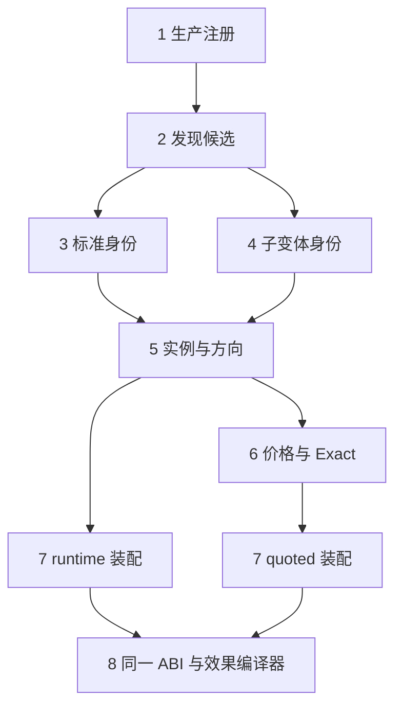

# Adapter Family Plugin：公共文件如何读取 Family JSON

本文按 Family 实际接入顺序说明：**公共代码读哪些声明、怎样处理、产出哪个既有接口**。以标准 ERC4626 为主定义，Custodian、InfiniFi 为两个子定义。覆盖生产注册、发现、身份、实例、方向、价格、Exact、quoted／runtime 执行及结算动作；不展开 live 枚举、Solver 或 EV。

每章只指定一个主公共文件。TypeScript 为实际源码核心片段，仅调整空白与换行；被省略的校验或周边代码在正文说明。片段不是可独立编译的完整模块。JSON 块从对应文件取字段节选，省略字段不表示可删除它们。

源码以云端 `/opt/mev-cloud/family-runtime-20261007` 为基线，本文对应代码提交 `ec4e9b7a490611d59b827b692cddb9145da3244e`。以下路径均相对 `listener/src/searcher/`。

| Family 作者维护的定义 | 职责 |
|---|---|
| `venues/protocols/erc4626-family/erc4626.json` | 主入口、标准身份参数、实例／方向、价格、标准报价与执行 |
| `venues/protocols/erc4626-family/custodian.json` | Custodian 代理身份、外部 share、权限／容量及转换语义 |
| `venues/protocols/erc4626-family/infinifi.json` | InfiniFi Registry／Gateway 身份、关联依赖、报价与转换语义 |

Family 作者不再提供 `module/export/handler` 形式的专用代码绑定。声明中的 ABI、字段、条件、读取与效果由公共层解释；需要数学时保留独立数学能力。规范化生成的 `stages`、`let/assert/return` 是公共编译器的内部表示，不由 Family 作者编写。

StakedUSDat 仍是另一个 Family。ERC4626 定义中的特殊实现识别资料用于避免重复准入；StakedUSDat 的 `standard-base.ts` 复用共用转换能力，但其身份、刷新、Family ID 与生产入口仍独立。本次三个 JSON 不包括它的整体薄化。

本次使用 v2 protocol 声明格式；其他 Family 的 v1 入口和 swap／protocol／credit domain 模板继续保留。



## 1. 生产注册：主 JSON 与子 JSON 生成同一个公共入口

**主公共文件：** `build-declarative-production.ts`。

**核心函数：** `syncDeclarativeProductionEntries()` → `renderDeclarativeProductionEntry()` → `renderProtocolEntry()`。

**输入：** 主 JSON 路径、定义内容和 `variantFiles` 指定的子文件。

**公共核心代码：** v2 分支首先要求完整能力槽，并核对主定义与 manifest 的身份。以下为 `renderProtocolEntry()` 内片段。

```ts
const required = [
  "version", "scope", "production", "manifest", "discovery", "identity", "instance", "routes",
  "pricing", "protocol", "standard", "actionAdapters", "variantFiles"
];
keys(doc, [...required, ...(Object.hasOwn(doc, "types") ? ["types"] : [])], "declarative protocol");
if (Object.hasOwn(doc, "types")) {
  validateDeclarativeTypeMetadata(doc.types);
  const contracts = object(doc.types.contracts, "protocol type contracts");
  keys(contracts, [
    "candidate", "identity", "descriptor", "route",
    "pricingDraft", "pricingDescriptor", "pricingStatic", "exactEvidence",
    ...(Object.hasOwn(contracts, "identityEvidence") ? ["identityEvidence"] : [])
  ], "protocol type contracts");
}
if (doc.production.domain !== "protocol")
  throw new Error("declarative v2 supports protocol domain only");
for (const key of [
  "manifest", "discovery", "identity", "instance", "routes", "pricing", "protocol", "standard"
])
  object(doc[key], `${key} declaration`);
const manifest = doc.manifest;
if (manifest.familyId !== doc.scope.family || manifest.domain !== "protocol")
  throw new Error("JSON Family/domain disagrees with its semantic manifest");
```

同一函数读取子文件引用，拒绝重复或自引用，并要求子定义数量与声明的 lineage 对齐：

```ts
const childFiles = doc.variantFiles.map((name: string) =>
  resolve(dirname(definitionFile), name)
);
if (childFiles.includes(definitionFile) || new Set(childFiles).size !== childFiles.length)
  throw new Error("duplicate or cyclic child JSON reference");
if (lineages.length !== childFiles.length + 1)
  throw new Error("variant references do not cover declared lineages");
```

**对应 JSON：** `erc4626.json`。标准变体直接放在主文件的 `standard`，两个非标准变体是同目录子文件。

```json
{
  "version": 2,
  "scope": {
    "family": "protocol:erc4626"
  },
  "production": {
    "domain": "protocol",
    "activation": {
      "enabled": true,
      "envKey": "SEARCHER_FAMILY_ERC4626_ENABLED"
    }
  },
  "variantFiles": [
    "./custodian.json",
    "./infinifi.json"
  ]
}
```

```json
{
  "manifest": {
    "familyId": "protocol:erc4626",
    "domain": "protocol",
    "ownedActionAdapterIds": [
      "erc4626-deposit",
      "erc4626-redeem"
    ],
    "requiredInfraActionAdapterIds": [
      "erc20-approve"
    ],
    "supportedLineages": [
      "erc4626:standalone-standard-behavior",
      "erc4626:frax-custodian-sync-conversion",
      "erc4626:infinifi-gateway-staking"
    ]
  },
  "protocol": {
    "candidateKinds": [
      "observed-call",
      "address-surface",
      "standalone-contract"
    ],
    "activeBehaviorProof": "required"
  }
}
```

**公共层怎样消费：** `production` 决定 domain 和启用声明；`manifest` 给出 action 所有权、lineage 与公共准入合同；`variantFiles` 只允许静态同目录 JSON。同步入口还检查真实文件、符号链接、越界路径、子定义格式及重复 ID；这些检查未全部展开在上面的片段里。

生成的 `venues/production-families/erc4626.production.ts` 只导入公共构造器、公共编译器、三个 JSON 和自动生成的编译期类型，核心调用是：

```ts
export const plugin = defineProtocolFamily(
  compileDeclarativeProtocol<FamilyTypes>(definition, [child0, child1])
);
```

这一行是生成产物的调用结构，换行后的 token 与实际生成源码一致。它没有导入 ERC4626 的 `instance.ts`、`exact.ts` 或 `execution.ts` 来装配生产能力。

注册时，`compileDeclarativeProtocol()` 调用 `createDeclarativeProtocolRuntime()`；公共格式展开器规范化主／子定义，公共值解释器校验字段引用和允许的操作，再组装全部能力对象。既有能力指纹生成流程同时纳入主／子 JSON、公共编译器及其代码依赖，声明变更不会沿用旧指纹。

**输出：** `defineProtocolFamily` 消费的完整插件，包含 manifest、capture、discovery、identity、instance、routes、pricing、exact、execution、protocol、actionAdapters。


原来的兼容出口已删除，调用方直接使用生成插件的 `plugin.identity`、`plugin.pricing`、`plugin.exact`、`plugin.execution` 等能力。ERC4626 Family 根目录只保留三个 JSON 和 `test/`，不再保留 `abi.ts`、`types.ts` 或执行转发文件。

**编译期类型也来自同一份定义。** 主／子 JSON 的 `types.definitions` 描述必填字段、可选字段、字面值和公共基类；`types.contracts` 把这些结构对应到公共能力槽。公共 `venues/declarative-types.ts` 统一生成类型文件，Family 不维护手写类型副本。以下节选主 JSON：

```json
{
  "types": {
    "version": 1,
    "definitions": {
      "Erc4626Candidate": {
        "type": "object",
        "extends": [
          "FamilyCandidate"
        ],
        "fields": {
          "candidateKind": {
            "literal": "erc4626-vault"
          },
          "vault": {
            "type": "string"
          }
        }
      }
    },
    "contracts": {
      "candidate": "Erc4626Candidate",
      "identityEvidence": "Erc4626IdentityEvidence",
      "identity": "Erc4626Identity",
      "descriptor": "Erc4626Descriptor",
      "route": "Erc4626Route",
      "pricingDraft": "Erc4626PricingDraft",
      "pricingDescriptor": "Erc4626PricingDescriptor",
      "pricingStatic": "Erc4626PricingStatic",
      "exactEvidence": "Erc4626ExactEvidence"
    }
  }
}
```

生成过程复用 `syncDeclarativeProductionEntries()`，同时写入生产入口和 `generated/declarative-family-types/erc4626.generated.ts`。`--check` 会检查缺失或过期产物；未知引用、循环、任意 TypeScript 文本和越界输出都会被拒绝。生成文件中的 `FamilyTypes` 只在编译时使用，不作为链上身份或行为证明。

公共 `declarative-protocol.ts` 负责把现有能力合同与生成结构相连：

```ts
export function compileDeclarativeProtocol<
  T extends DeclarativeFamilyTypes
>(
  raw: Data,
  children?: readonly Data[]
): TypedDeclarativeProtocol<T>;
```

因此新功能仍改公共 Family 管线；协议定义只提供字段和行为声明。生成类型本身不增加权限、不会使未验证实例获得准入。Custodian／InfiniFi 的类型结构由各自子 JSON 合并；StakedUSDat 的独立类型不再混入 ERC4626 的 descriptor、route 或 execution evidence。

## 2. 发现：从 selector、事件和地址资料生成候选

**主公共文件：** `venues/declarative-discovery.ts`。

**核心函数：** `compileDeclarativeDiscovery()`。

**输入：** `discovery.definition` 与已有观测提供的 call、log、地址资料。

**公共核心代码：** 以下位于 `compileAddressDiscovery()` 的参数对象内，展示声明怎样变成真实发现接口。

```ts
callPatterns: d.calls.map(c => ({
  ...c,
  selector: id(c.signature).slice(0, 10) as `0x${string}`,
  candidateAddress: { from: "call-target" as const }
})),
logPatterns: d.events.map(e => ({
  ...e,
  topic: id(e.signature) as `0x${string}`
})),
addressSurfaces: [{ ...d.surface, kind: "interface" }],
candidate: address => ({
  candidateKind: d.candidate.kind,
  [d.candidate.addressField]: address
} as unknown as C),
```

**对应 JSON：** `erc4626.json → discovery.definition`。

```json
{
  "definition": {
    "sources": [
      "observed-call",
      "landed-log",
      "address-surface"
    ],
    "candidateSources": [
      "dex-token-domain",
      "observed-interaction"
    ],
    "candidate": {
      "kind": "erc4626-vault",
      "addressField": "vault"
    },
    "calls": [
      {
        "id": "erc4626-deposit-call",
        "signature": "deposit(uint256,address)"
      },
      {
        "id": "erc4626-redeem-call",
        "signature": "redeem(uint256,address,address)"
      }
    ],
    "events": [
      {
        "id": "erc4626-deposit-log",
        "signature": "Deposit(address,address,uint256,uint256)"
      },
      {
        "id": "erc4626-withdraw-log",
        "signature": "Withdraw(address,address,address,uint256,uint256)"
      }
    ],
    "surface": {
      "id": "erc4626-standard-surface",
      "fingerprint": "erc4626-standard-behavior-v1"
    },
    "labels": [
      "erc4626",
      "protocol:erc4626"
    ]
  }
}
```

**公共层怎样消费：** `calls[].signature` 生成 selector；`events[].signature` 生成 topic；命中后取 call target 或日志来源作为候选地址。`candidate.kind/addressField` 决定候选结构，`surface` 与 `labels` 交给公共地址提名器。编译器同时检查候选字段与 pattern ID，不允许不同声明静默覆盖。

例如命中 deposit 后可以得到 `{ candidateKind: "erc4626-vault", vault }`，但这仍是候选，不代表已证明 ERC4626。`capture` 由公共装配层对同一 discovery 调用 `createRouteCaptureMaterialization()` 派生，Family 不再提供第二套捕获逻辑。该发现定义未声明反向注册表能力，公共接口保留明确的 unsupported 结果，不伪造身份来源。

**输出：** 可去重、可追溯的候选及发现证据，进入下一步身份验证。

## 3. 标准身份：公共验证器执行主 JSON 选择的采样流程

**主公共文件：** `venues/declarative-identity.ts`。

**核心函数：** `compileDeclarativeIdentity()` 生成 `requirements / buildRequests / decode / decide`。

**输入：** 标准主定义展开后的身份描述、候选、固定状态 source 和上一轮证据。

**公共核心代码：** 每轮选择当前阶段，构造请求，再解码并决定继续、拒绝或完成。以下为返回对象内的真实片段。

```ts
requirements: step => stage(step).requirements,
buildRequests: step => {
  const selected = stage(step);
  const requests = evaluate(selected.requests, environment(step)) as AdapterRequest[];
  if (!Array.isArray(requests) || new Set(requests.map(r => r.id)).size !== requests.length)
    throw new Error("duplicate declared request id");
  return freeze(requests);
},
decode: ({ step, results }) => {
  const selected = stage(step);
  for (const result of results)
    if (!result.ok && !selected.optionalFailures?.includes(result.id))
      throw new RequiredAdapterRequestError(result);
  return freeze(run(selected.decode, environment(step, results)));
},
decide: step => { return freeze(run(doc.identity.decide, environment(step))); },
```

**对应 JSON：** `erc4626.json → identity` 选择共用模板，并提供函数／事件参数。下面省略 ABI、常量和模板的其余参数。

```json
{
  "identity": {
    "definition": {
      "version": 1,
      "workflow": "sampled-conversion-v1",
      "parameters": {
        "calls": {
          "inputAsset": "asset",
          "assetSupply": "totalAssets",
          "shareSupply": "totalSupply",
          "toShares": "convertToShares",
          "toAssets": "convertToAssets",
          "previewForward": "previewDeposit",
          "previewReverse": "previewRedeem",
          "forward": "deposit",
          "reverse": "redeem",
          "balance": "balanceOf",
          "approval": "approve"
        },
        "events": {
          "forward": "Deposit",
          "reverse": "Withdraw",
          "assetField": "assets",
          "shareField": "shares"
        }
      }
    },
    "memoReuse": "recheck-identity",
    "key": {
      "op": "lower",
      "args": [
        {
          "op": "address",
          "args": [
            "$identity.subject"
          ]
        }
      ]
    }
  }
}
```

**公共层怎样消费：** `workflow: sampled-conversion-v1` 先由公共 `expandConversionDefinition()` 展开；模板在 `venues/sampled-conversion-flow.json`。`calls` 告诉它用哪个函数读取资产、供给、换算、预览和执行；`events` 指定验证哪个事件及金额字段。主定义的 `memoReuse` 和 `key` 被公共装配层接成既有身份复用／索引接口。

此处有两层 JSON，职责不同：Family 作者只维护主定义参数；共享采样流程由公共层维护。`declarative-identity.ts` 实际消费的是展开后的 stages，因此不会要求每个 Family 再写 `let/assert/return` 流程。`compileDeclarativeValues()` 负责有限操作的求值，不执行 Family 提供的 JavaScript。

实际请求由既有请求执行器执行。必要请求失败会先抛出 `RequiredAdapterRequestError`，不能被定义解释成成功。ABI 存在、预览有返回、类代码相同都不够；标准模板仍要求该方向的主动转换结果、独立扣款／到账和事件约束成立。

**输出：** 标准 `VerifiedIdentity` 与 `verifiedDirections`，或可追踪原因的 continue／retryable／chain-proven-rejected 结论。

## 4. 子变体身份：公共准入编译器展开 Custodian 与 InfiniFi

**主公共文件：** `venues/declarative-conversion-admission.ts`。

**核心函数：** `expandConversionAdmission()`，内部共用 `effectPrograms()`。

**输入：** 子 JSON 的 `admission`，以及由 `models / requestSets / reads` 规范化得到的字段与请求描述。

**公共核心代码：** 公共层固定推进 base → 匹配后资料 → dependencies → probe。下面是内部表示的构造片段，不是 Family 作者要填写的 JSON。

```ts
const stage = (requirements: V, requests: V, decode: V[]) => ({
  requirements, requests, decode
});
const identity = {
  select: [result("base", not(o("defined", "$evidence"))), result("$evidence.phase")],
  stages: {
    base: stage(m.requirements, m.requests, recovery(matchBody, spec, m.sourceFailure, true)),
    [m.phase]: stage(
      spec.surface.requirements,
      spec.surface.requests,
      recovery(surfaceBody, spec, spec.surface.sourceFailure, true)
    ),
    surface: stage(
      spec.dependencies.requirements,
      spec.dependencies.requests,
      recovery(dependenciesBody, spec, spec.dependencies.sourceFailure, true)
    ),
    probe: stage(
      spec.active.requirements,
      spec.active.requests,
      recovery(activeBody, spec, spec.active.sourceFailure, true)
    ),
  },
```

行为证明也统一展开；下面仅截取返回值和 token／supply 效果部分，事件与 proof hash 的处理仍在同一公共实现中。

```ts
verifyEffects: [
  letValue("deposit", eq("$sample.direction", spec.samples.directions[0])),
  check(eq(active.returnValue, active.expectedReturn), active.returnError),
  ...active.tokenDeltas.map(delta =>
    run(call("exactTokenDelta", { result: "$result", ...delta }))
  ),
  ...active.supplyDeltas.map(delta =>
    run(call("exactSupplyDelta", { result: "$result", ...delta }))
  ),
```

**对应 JSON：** `custodian.json` 用 runtime template 匹配候选代理，并读该候选的实际代码。

```json
{
  "id": "frax-custodian-sync-conversion",
  "lineageId": "erc4626:frax-custodian-sync-conversion",
  "admission": {
    "match": {
      "phase": "proxy",
      "kind": "runtime-template",
      "requirements": {
        "transports": [
          "get-code"
        ]
      },
      "sourceFailure": "retry",
      "codeRequestId": "custodian-proxy",
      "candidateValue": "$candidate.vault",
      "mismatchReason": "custodian_proxy_not_matched",
      "templateProgram": "proxy",
      "reads": [
        {
          "id": "custodian-proxy",
          "code": "$candidate.vault"
        }
      ]
    }
  }
}
```

`infinifi.json` 在相同槽位声明 Registry 反向指针；下面省略该槽的错误文案和 source 策略，保留真实读取定义。

```json
{
  "admission": {
    "match": {
      "kind": "registry-pointer",
      "candidateValue": "$candidate.vault",
      "valueRequestId": "infinifi-registry",
      "abi": "vault",
      "function": "getAddress",
      "reads": [
        {
          "id": "infinifi-registry-code",
          "code": "$constants.gateway"
        },
        {
          "id": "infinifi-registry",
          "call": {
            "abi": "vault",
            "function": "getAddress",
            "args": [
              "stakedToken"
            ]
          },
          "target": "$constants.gateway",
          "required": false,
          "completion": "return-or-revert-data"
        }
      ]
    }
  }
}
```

子 JSON 还声明主动验证的独立余额效果。以下为 Custodian 的一个 share 效果；完整声明同时保留 asset、supply 和事件约束。

```json
{
  "admission": {
    "active": {
      "expectedReturn": "$sample.expected",
      "returnValue": {
        "$word": [
          "$result.data"
        ]
      },
      "tokenDeltas": [
        {
          "token": "$surface.share",
          "account": {
            "$address": [
              "$constants.actor"
            ]
          },
          "delta": {
            "$if": [
              "$deposit",
              "$sample.expected",
              {
                "$sub": [
                  {
                    "$uint": [
                      "0"
                    ]
                  },
                  "$sample.amount"
                ]
              }
            ]
          }
        }
      ]
    }
  }
}
```

**公共层怎样消费：** 公共格式展开器 `normalizeDeclarativeVariant()` 先把 `reads` 转成通用请求描述，把 `models.fields/checks/output` 与 `readPrograms.result` 转成内部解码表示，然后调用本章编译器。`match` 决定类／Registry 关系，`surface` 定义实例资料，`dependencies` 定义依赖和权限，`samples` 定义可用方向／金额，`active` 定义执行返回、独立余额与事件证明，`identity` 定义验证后的字段投影。

Custodian 的 proxy template 不是池地址白名单，匹配后仍读取真实 implementation、admin、asset、share、容量和权限并验证行为。InfiniFi 必须验证 Gateway 返回的 stakedToken 与候选一致，再检查关联依赖及转换结果。

错误码保留在 `mismatchReason`、`unavailableReason`、`error` 等声明字段。公共层按实际来源、返回和行为分类；`sourceFailure` 的 retry／propagate 边界仍由声明约束，不能把错误结果当成已验证身份。

这些子变体最终仍交给第 3 章的同一个 `compileDeclarativeIdentity()`，没有再加载 Custodian／InfiniFi 专用身份函数。

**输出：** 带独立 lineage、关联绑定、行为证明 hash 和 `verifiedDirections` 的身份；或该实例当前状态的明确拒绝／待处理原因。

## 5. 实例与方向：从已验证身份生成描述和绑定

**主公共文件：** `venues/declarative-protocol.ts`。

**核心函数：** `createDeclarativeProtocolRuntime()` 中的 `instance`、`routes`、`assertInvocation()`。

**输入：** 第 3／4 章的已验证身份。

**公共核心代码：** 实例对象完全从主定义映射，不再调用专用 `instance.ts`。

```ts
const instance: InstanceSemantics<Identity, Descriptor> = {
  instanceKey: identity => instanceKey(evalRoot(document.instance.key, { identity })),
  compileDraft: identity => frozen(evalRoot(document.instance.draft, { identity })),
  finalizeDescriptor: ({ draft }) => draft,
  staticBindingProjection: projection,
};
```

方向投影只选已证明的方向，并把资产、目标、action 和绑定指纹放到路由上。以下是 `routes.project()` 内片段。

```ts
const fingerprint = hashCanonical(projection(descriptor));
return Object.freeze(document.routes.directions
  .filter((d: Data) => evalRoot(d.enabled, env))
  .map((d: Data) => frozen({
    routeKey: routeKey([
      descriptor.familyId, evalRoot(document.routes.bindingKey, env), d.id
    ].join("\u001f")),
    familyId: descriptor.familyId,
    lineageId: descriptor.lineageId,
    instanceKey: descriptor.instanceKey,
    tokenIn: evalRoot(d.tokenIn, env),
    tokenOut: evalRoot(d.tokenOut, env),
    taxonomy: d.taxonomy,
    bindingRef: {
      bindingKey: evalRoot(document.routes.bindingKey, env), fingerprint
    },
    runtimeRequirements: descriptor.runtimeRequirements,
    target: env.target,
    direction: d.id,
    adapterId: evalRoot(d.adapterId, env),
  }))
);
```

**对应 JSON：** `erc4626.json → instance` 的字段节选。

```json
{
  "instance": {
    "key": {
      "op": "lower",
      "args": [
        {
          "op": "address",
          "args": [
            "$identity.subject"
          ]
        }
      ]
    },
    "draft": {
      "familyId": "$identity.familyId",
      "lineageId": "$identity.lineageId",
      "vault": {
        "op": "address",
        "args": [
          "$identity.subject"
        ]
      },
      "asset": {
        "op": "address",
        "args": [
          "$identity.asset"
        ]
      },
      "share": {
        "op": "address",
        "args": [
          {
            "op": "coalesce",
            "args": [
              "$identity.custodian.share",
              "$identity.subject"
            ]
          }
        ]
      },
      "custodian": "$identity.custodian",
      "infinifi": "$identity.infinifi",
      "verifiedDirections": "$identity.verifiedDirections"
    },
    "bindingProjection": {
      "vault": {
        "op": "lower",
        "args": [
          {
            "op": "address",
            "args": [
              "$descriptor.vault"
            ]
          }
        ]
      },
      "asset": {
        "op": "lower",
        "args": [
          {
            "op": "address",
            "args": [
              "$descriptor.asset"
            ]
          }
        ]
      },
      "share": {
        "op": "lower",
        "args": [
          {
            "op": "address",
            "args": [
              "$descriptor.share"
            ]
          }
        ]
      },
      "verifiedDirections": "$descriptor.verifiedDirections",
      "standardPayout": "asset()",
      "custodian": "$descriptor.custodian",
      "infinifi": "$descriptor.infinifi"
    }
  }
}
```

同一主文件的 `routes` 定义两个方向；此处保留方向、目标与绑定键。

```json
{
  "routes": {
    "target": "$descriptor.vault",
    "bindingKey": {
      "op": "lower",
      "args": [
        {
          "op": "address",
          "args": [
            "$descriptor.vault"
          ]
        }
      ]
    },
    "directions": [
      {
        "id": "deposit",
        "enabled": "$descriptor.verifiedDirections.deposit",
        "tokenIn": "$descriptor.asset",
        "tokenOut": "$descriptor.share",
        "adapterId": "erc4626-deposit",
        "taxonomy": {
          "slotKind": "protocol",
          "protocolAction": "wrap"
        }
      },
      {
        "id": "redeem",
        "enabled": "$descriptor.verifiedDirections.redeem",
        "tokenIn": "$descriptor.share",
        "tokenOut": "$descriptor.asset",
        "adapterId": "erc4626-redeem",
        "taxonomy": {
          "slotKind": "protocol",
          "protocolAction": "redeem"
        }
      }
    ]
  }
}
```

**公共层怎样消费：** `instance.key` 生成稳定实例键；`draft` 从已验证身份取字段，Custodian 的 share 来自真实外部 share，标准 share 才是 vault 本身。`bindingProjection` 固定后续身份绑定的资产、变体与方向信息。

`routes.directions[].enabled` 读取 `verifiedDirections`，未证明的方向不出边；`tokenIn/tokenOut/adapterId` 决定输入、输出与动作。`graphVenue` 由同一个 `routes.projectGraph()` 投影，`routes.effects` 留给执行接口提供预期效果。

后续价格、Exact 与执行入口都会调用 `assertInvocation()`：交叉检查 Family、lineage、instanceKey、target、binding key／fingerprint、token 和 action，再执行主／子声明的 `assertions`。图边不能靠替换地址或方向绕过已证明身份。

**输出：** `CompiledInstanceDescriptor`、可入图方向和绑定指纹，供价格与执行阶段复用。

## 6. 价格与 Exact：同一读取声明用于刷新和指定金额报价

**主公共文件：** `venues/declarative-protocol.ts`。

**核心函数：** `pricing`、`quoteRequests()`、`guard()`、`program()`、`exact.methods()`。

**输入：** 已绑定实例／方向、当前 source；Exact 另有调用方指定的完整输入金额与 executor。

**公共核心代码：** 先通过统一的 `program()` 读取本变体的命名请求程序。

```ts
function program(v: Variant, name: string, env: Data, mode: "requests" | "decode"): any {
  const p = v.document.readPrograms?.[name];
  if (!p) throw new Error(`undefined declarative read program: ${name}`);
  return mode === "requests"
    ? v.values.evaluate(p.requests, env)
    : v.values.run(p.decode, env);
}
```

静态价格资料也来自主 JSON。以下为 `pricing.staticEvidence`：

```ts
staticEvidence: {
  reusePolicy: {
    kind: "dependency-proof",
    dependencyKeys: draft => uniqueAddresses(
      evalRoot(document.pricing.static.dependencies, { draft })
    )
  },
  requirements: () => document.pricing.static.requirements,
  buildRequests: draft => evalRoot(document.pricing.static.requests, { draft }),
  decode: input => rootRun(document.pricing.static.decode, input),
},
```

Exact 使用同一 quote 与 guard，不人为扣减输入。以下为 `exact` 的请求构造核心；解码阶段还检查实际 source、正输出、guard 结果和输出约束。

```ts
buildRequests(input) {
  assertInvocation(input.descriptor, input.route);
  if (input.amountIn < 0n) throw new Error("exact input cannot be negative");
  if (input.amountIn === 0n) return [];
  const v = select(input.descriptor), env = environment(v, input);
  v.values.run(v.document.exact.checks ?? [], env);
  if (v.document.exact.protectedAddresses)
    runtimeExecutor(
      input.executor,
      ...v.values.evaluate(v.document.exact.protectedAddresses, env)
    );
  return frozen([...guard(v, input, true), ...quoteRequests(v, input, "exact-preview")]);
},
```

**对应 JSON：** 标准的触碰刷新和命名报价声明都在 `erc4626.json → standard`。

```json
{
  "standard": {
    "pricing": {
      "mutationAddresses": [
        "$descriptor.vault"
      ],
      "refreshPolicy": "on-touch",
      "requirements": {
        "transports": [
          "eth-call"
        ]
      },
      "dependencies": [
        "$descriptor.vault",
        "$descriptor.asset",
        "$descriptor.share"
      ]
    },
    "readPrograms": {
      "quote": {
        "requests": [
          {
            "id": "$requestId",
            "kind": "eth-call",
            "to": "$descriptor.vault",
            "data": {
              "op": "encode",
              "args": [
                "vault",
                {
                  "op": "if",
                  "args": [
                    {
                      "op": "eq",
                      "args": [
                        "$direction",
                        "deposit"
                      ]
                    },
                    "previewDeposit",
                    "previewRedeem"
                  ]
                },
                [
                  "$amountIn"
                ]
              ]
            },
            "completion": "return-data"
          }
        ],
        "result": {
          "op": "uint",
          "args": [
            {
              "op": "decode",
              "args": [
                "vault",
                {
                  "op": "if",
                  "args": [
                    {
                      "op": "eq",
                      "args": [
                        "$direction",
                        "deposit"
                      ]
                    },
                    "previewDeposit",
                    "previewRedeem"
                  ]
                },
                {
                  "op": "get",
                  "args": [
                    {
                      "op": "returned",
                      "args": [
                        "$requestId"
                      ]
                    },
                    "data"
                  ]
                },
                0
              ]
            }
          ]
        }
      }
    }
  }
}
```

静态价格字段来自主定义。下面截取 `assetDecimals` 读取及解码模型；完整定义还有 share 精度、价格描述 finalize 和兼容性投影。

```json
{
  "pricing": {
    "static": {
      "requests": [
        {
          "id": "static-asset-decimals",
          "kind": "eth-call",
          "to": "$draft.asset",
          "data": {
            "op": "encode",
            "args": [
              "token",
              "decimals",
              []
            ]
          },
          "completion": "return-data"
        }
      ],
      "decode": {
        "fields": [
          {
            "name": "assetDecimals",
            "value": {
              "op": "word",
              "args": [
                {
                  "op": "get",
                  "args": [
                    {
                      "op": "returned",
                      "args": [
                        "static-asset-decimals"
                      ]
                    },
                    "data"
                  ]
                }
              ]
            },
            "checks": [
              {
                "condition": {
                  "op": "lte",
                  "args": [
                    "$assetDecimals",
                    {
                      "op": "uint",
                      "args": [
                        "77"
                      ]
                    }
                  ]
                },
                "error": "protocol token decimals exceed uint256 scale"
              }
            ]
          }
        ]
      }
    }
  }
}
```

Custodian／InfiniFi 的每块 guard、quote、Exact caller／容量约束在各自子 JSON。以下节选 InfiniFi 的实际刷新声明与 Exact 相关字段。

```json
{
  "pricing": {
    "refreshPolicy": "each-block",
    "guardProgram": "guard",
    "guardPrefix": "current-infinifi",
    "mutationAddresses": [
      "$descriptor.vault",
      "$binding.gateway",
      "$binding.yieldSharing",
      "$binding.core"
    ]
  },
  "exact": {
    "methodId": "erc4626-preview",
    "guardProgram": "guard",
    "guardPrefix": "exact-infinifi",
    "caller": {
      "kind": "executor"
    },
    "protectedAddresses": [
      "$descriptor.vault",
      "$binding.gateway"
    ]
  }
}
```

**公共层怎样消费：** `pricing.static.requests` 生成 decimals 等读取；`decode.fields/checks/output` 先规范化，随后由统一解码器执行。`pricing.finalize` 生成已绑定价格描述，兼容性投影用于既有缓存机制。

当前价格先构造 guard，再针对各方向选取 `pricing.sampleAmount`，调用 `readPrograms.quote`，验证同 source 的返回并派生 mid。Exact 调用同一 quote，但使用调用方提供的完整 `amountIn`；`exact.checks/outputChecks/protectedAddresses/evidence` 分别提供边界、输出、actor 保护和证据映射。标准 Exact 的零输入只返回本地零报价，不会允许零扣款进入执行。

`refreshPolicy` 声明 on-touch 或 each-block。`dependencies` 用于证据依赖；`mutationAddresses` 决定哪些地址的事件触发刷新。标准 ERC4626 只触碰 vault 时刷新，避免普通资产转账触发全部 vault；Custodian／InfiniFi 继续每块检查权限、容量和外部状态。公共 mutation 编译器消费同一字段，Family 不再维护专用刷新函数。

`models` 和 `readPrograms.result` 是作者格式；第一个代码片段中的 `p.decode` 是规范化后的内部结果，不表示作者还要另写解码脚本。

**输出：** 静态价格描述、绑定 source 的当前价格快照／mid，或指定金额的 `{ amountOut, evidence }`。这一步提供报价，不替代下一步真实执行效果检查。

## 7. quoted／runtime 装配：同一执行定义生成两种外层接口

**主公共文件：** `venues/declarative-protocol.ts`。

**核心函数：** `executionProgram()`、`execution.buildRuntimeLeg()`、`execution.buildFragment()`。

**输入：** 已绑定方向、executor、source 与收款要求；quoted 入口另有指定输入及 Exact evidence。

**公共核心代码：** 两个接口最终选择同一变体的 `execution`，交给同一个公共执行编译器。

```ts
function executionProgram(input: Data) {
  const v = select(input.descriptor), env = environment(v, input);
  const spec = v.document.execution;
  if (!spec) throw new Error("missing declared execution direction");
  return buildDeclarativeExecutionProgram(spec, env, v.values);
}
```

runtime 入口只传实际执行上下文，未读取链外 `amountIn`、quotedAmountOut 或 Exact evidence：

```ts
const program = executionProgram({
  descriptor: input.descriptor,
  route: input.route,
  executor: input.executor,
  source: input.source,
  runtimeEvidence: input.runtimeEvidence,
  settlement: input.settlement,
  recipient,
  minAmountOut: 1n,
  settlementRequested: input.settlement !== undefined
});
return {
  ...runtimeLeg(input.route.adapterId, program),
  settlement: { directOutput: settlement.directOutput },
  ...(input.settlement ? { settlementRequest: input.settlement } : {})
};
```

quoted 入口先校验 executor、输入、输出与 Exact evidence 一致，随后生成携带同一程序的 action 节点。以下为校验后的片段：

```ts
const program = executionProgram({
  ...input, source: e.source, recipient: input.executor, settlementRequested: false
});
return {
  requirements: [],
  nodes: [{
    adapterId: input.route.adapterId,
    target: input.route.target,
    tokenIn: input.route.tokenIn,
    tokenOut: input.route.tokenOut,
    amount: input.amountIn,
    params: { runtimeAmountProgram: hexlify(program.bytes()) },
    children: []
  }]
};
```

**对应 JSON：** 主定义或子定义通过 `match/context/boundState` 选择和绑定变体，通过 `execution.settlement` 声明能力。下面取标准变体的真实字段。

```json
{
  "standard": {
    "match": {
      "op": "and",
      "args": [
        {
          "op": "not",
          "args": [
            {
              "op": "defined",
              "args": [
                "$descriptor.custodian"
              ]
            }
          ]
        },
        {
          "op": "not",
          "args": [
            {
              "op": "defined",
              "args": [
                "$descriptor.infinifi"
              ]
            }
          ]
        }
      ]
    },
    "context": {
      "vault": "$descriptor.vault"
    },
    "boundState": "$descriptor",
    "execution": {
      "settlement": {
        "directOutput": true
      }
    }
  }
}
```

action 身份与 trace 匹配同样来自主 JSON，公共层用 `createDeclarativeProgramAction()` 装配。下面为 deposit action 的节选，完整主定义还包括 Gateway 调用与 redeem action。

```json
{
  "actionAdapters": [
    {
      "descriptor": {
        "adapterId": "erc4626-deposit",
        "lineage": "erc4626",
        "edgeKind": "protocol",
        "action": "deposit",
        "canSendValue": false,
        "leavesStandingPositionDefault": false
      },
      "traces": [
        {
          "signature": "function deposit(uint256,address)"
        }
      ]
    }
  ]
}
```

**公共层怎样消费：** `select()` 必须找到唯一匹配变体；`context/boundState` 提供执行需要的已验证变量。`execution.settlement.directOutput` 同时控制能力声明和实际收款请求是否可接受，不由公共层一律写成 true。

runtime 的金额来自交易内寄存器；quoted 的节点 `amount` 来自已经校验的指定输入，但实际调用、扣款与到账仍运行同一程序。`runtimeProjection` 返回公共的无额外投影值，未引入 quoted fallback。

`actionAdapters[].descriptor` 定义动作所有权和边界，`traces` 定义可识别调用签名；公共 action 编码器消费节点里的 `runtimeAmountProgram`。旧 `action.ts` 已删除，调用方直接读取生成插件的 `actionAdapters`；公共层不按 Custodian／InfiniFi 名称挑选专用编码器。

当前这三种转换语义支持 direct output，没有声明回调结算能力；请求不支持的结算类型时明确拒绝，不因接口共用而冒称支持 callback。

**输出：** runtime leg，或带相同程序的 quoted fragment；二者都进入第 8 章的公共 ABI 与效果编译。

## 8. ABI 与结算：按声明调用函数，核对实际扣款和到账

**主公共文件：** `venues/declarative-execution.ts`。

**核心函数：** `buildDeclarativeExecutionProgram()`、内部 `emit()`，以及 `createDeclarativeProgramAction()`。

**输入：** 选中的 `execution` 定义、绑定执行上下文和公共值解释器。

**公共核心代码：** ABI 参数中的 runtime 引用转换为寄存器补丁。下面为 `emit()` 内片段；前面的 ABI 静态词检查和后面的临时寄存器释放未展开。

```ts
const args = input.args.map((value, index) => {
  if (!dynamic(value)) return value;
  if (!fn.inputs.every(scalarWord))
    throw new Error("dynamic runtime ABI arguments require a declared tuple encoder");
  const item = word(value);
  temporaries.push(item);
  patches.push({ offset: 4 + index * 32, reg: item.reg });
  const type = fn.inputs[index]!.type;
  return type === "address"
    ? "0x0000000000000000000000000000000000000000"
    : type === "bool" ? false : 0n;
});
```

公共层再统一要求正输入，以及路由绑定的完整扣款和新到账。以下为执行效果检查的关键片段：

```ts
if (debit.length !== 1 || credit.length !== 1 ||
    !same(debit[0].token, input.route.tokenIn) || !same(debit[0].account, input.executor) ||
    !dynamic(debit[0].equals) || debit[0].equals.runtime !== "amountIn" ||
    !same(credit[0].token, input.route.tokenOut) || !same(credit[0].account, recipient)) {
  throw new Error("declared conversion must bind full debit and fresh receipt to the route");
}
```

**对应 JSON：** `erc4626.json → standard.execution` 定义实际函数和参数，不再只有一个指向 `execution.ts` 的 binding。

```json
{
  "standard": {
    "execution": {
      "protectedAddresses": [
        "$descriptor.vault",
        "$descriptor.share",
        "$descriptor.asset"
      ],
      "approval": {
        "token": "$route.tokenIn",
        "spender": "$descriptor.vault",
        "mode": "ensure",
        "when": {
          "op": "eq",
          "args": [
            "$direction",
            "deposit"
          ]
        }
      },
      "call": {
        "target": "$descriptor.vault",
        "signature": {
          "op": "if",
          "args": [
            {
              "op": "eq",
              "args": [
                "$direction",
                "deposit"
              ]
            },
            "function deposit(uint256,address) returns(uint256)",
            "function redeem(uint256,address,address) returns(uint256)"
          ]
        },
        "args": {
          "op": "if",
          "args": [
            {
              "op": "eq",
              "args": [
                "$direction",
                "deposit"
              ]
            },
            [
              {
                "runtime": "amountIn"
              },
              "$recipient"
            ],
            [
              {
                "runtime": "amountIn"
              },
              "$recipient",
              "$executor"
            ]
          ]
        },
        "save": {
          "output": 0
        }
      }
    }
  }
}
```

实际扣款、到账、返回值与库存保护也是同一声明的一部分：

```json
{
  "standard": {
    "execution": {
      "effects": [
        {
          "kind": "debit",
          "token": "$route.tokenIn",
          "account": "$executor",
          "equals": {
            "runtime": "amountIn"
          }
        },
        {
          "kind": "credit",
          "token": "$route.tokenOut",
          "account": "$recipient",
          "equals": {
            "runtime": "output"
          },
          "minimum": "$minAmountOut"
        },
        {
          "kind": "unchanged-token",
          "token": "$route.tokenOut",
          "account": "$executor",
          "when": "$externalRecipient"
        },
        {
          "kind": "unchanged-token",
          "token": "$route.tokenIn",
          "account": "$recipient",
          "when": "$externalRecipient"
        },
        {
          "kind": "unchanged-native",
          "when": "$directSettlement"
        }
      ]
    }
  }
}
```

子 JSON 使用相同执行槽声明自身差异。下面为 InfiniFi 的授权策略，以及 Custodian 的保护地址和 source 边界。

```json
{
  "execution": {
    "approval": {
      "token": "$route.tokenIn",
      "spender": "$binding.gateway",
      "mode": "exact-clear",
      "requireBool": true,
      "verifyAllowance": true
    }
  }
}
```

```json
{
  "execution": {
    "protectedAddresses": {
      "op": "concat",
      "args": [
        {
          "op": "concat",
          "args": [
            [
              "$descriptor.vault",
              "$descriptor.share",
              "$descriptor.asset"
            ],
            {
              "op": "if",
              "args": [
                {
                  "op": "defined",
                  "args": [
                    "$descriptor.custodian.proxyAdmin"
                  ]
                },
                [
                  "$descriptor.custodian.proxyAdmin"
                ],
                []
              ]
            }
          ]
        },
        {
          "op": "if",
          "args": [
            {
              "op": "defined",
              "args": [
                "$binding.proxyAdmin"
              ]
            },
            [
              "$binding.proxyAdmin"
            ],
            []
          ]
        }
      ]
    },
    "requireCanonicalSource": true,
    "rejectRuntimeEvidence": true
  }
}
```

**公共层怎样消费：** `call.target/signature/args` 经公共值求值得到实际调用；`{"runtime":"amountIn"}` 对应交易内输入寄存器，`call.save` 将返回词绑定为后续效果检查的寄存器。公共编译器生成 calldata 和补丁，Family 不参与字节偏移、寄存器分配或调用顺序。

统一生命周期先检查上下文及保护地址，再执行 preflight、采集执行前读数、处理 allowance、调用转换函数、按声明清理授权、采集执行后读数并验证 effects。`approval.mode` 控制所需授权方式；子变体的临时授权与清理在同一机制中实现。

`debit` 必须等于完整交易内输入，`credit` 必须是指定收款方的新到账，并满足正值、返回值和最低到账约束。声明不能把旧库存当成本次到账；外部收款时的旧 token 库存和声明的原生币余额保持检查仍执行。Custodian 还保护 proxy admin，Custodian／InfiniFi 的权限、容量、supply 与残留检查通过同一 preflight／effects 表达。

`contextChecks` 采用 `{ condition, error }`；错误文本可声明，检查流程由公共层执行。执行定义禁止引用链外 `$amountIn`、`$quotedAmountOut` 或 `$exactEvidence`，金额来源必须是 runtime 引用。未支持的 ABI 运行时参数形状与结算请求会拒绝，不能猜测编码后继续。

`createDeclarativeProgramAction().action.encode()` 最终调用 `encodeRuntimeAmountNode()`；不会重新选择 Family 专用执行函数。本章只说明 Family 怎样输出模拟可执行程序，不展开整个交易计划构造。

**输出：** 包含真实 ABI 调用、授权生命周期、余额／供给／库存断言的 `RuntimeAmountProgram`。执行成败由真实返回和效果决定，不能只因程序编码成功就视为协议执行通过。

## 原 Family 文件的完整迁移位置

这张表覆盖已删除的 20 个 ERC4626 顶层 TypeScript 文件。生产与验收调用方已迁移到公共入口或直接读取 JSON；没有保留旧文件转发链。目录外未使用的 `erc4626-family-plugin.ts` 也已删除。

| 原文件／职责 | 当前声明位置 | 公共处理 |
|---|---|---|
| `manifest.ts` | 主 JSON `manifest` | 1：校验 Family、lineage、action 所有权 |
| `protocol.ts` | 主 JSON `protocol` | 1：原 protocol domain 合同 |
| 生产接入文件 | 主 JSON `production / variantFiles` | 1：生成 common＋JSON 入口 |
| `discovery.ts` | 主 JSON `discovery.definition` | 2：公共发现编译 |
| `capture.ts` | 与 discovery 同一份定义 | 2：公共捕获物化 |
| `identity.ts` | 主 JSON `identity / standard.identityParameters` | 3：共享采样模板与验证器 |
| `custodian-identity.ts` | 子 JSON `admission / models / requestSets` | 4：固定准入流程与验证器 |
| `infinifi-identity.ts` | 子 JSON `admission / models / requestSets` | 4：同一流程、不同读取与关联定义 |
| `instance.ts` | 主 JSON `instance` | 5：字段投影与实例键 |
| `binding.ts` | `instance.bindingProjection`；主／子 `boundState / assertions` | 5：路由绑定与调用检查 |
| `routes.ts` | 主 JSON `routes` | 5：方向、Graph 投影与 effects |
| `pricing.ts` | 主 JSON `pricing`；主／子 `pricing / readPrograms` | 6：静态资料、快照、mid 和刷新 |
| `exact.ts` | 主／子 `exact / readPrograms.quote` | 6：指定输入、输出与 evidence |
| `custodian.ts` 的资料／guard／报价 | 子 JSON `abi / constants / models / readPrograms / requestSets` | 4、6：公共读取和解码 |
| `infinifi.ts` 的资料／guard／报价 | 子 JSON 同名能力块 | 4、6：公共读取和解码 |
| `execution.ts` | 主／子 `execution` | 7、8：双接口共用执行编译 |
| `custodian-execution.ts` | `custodian.json → execution` | 8：调用、保护、授权与效果 |
| `infinifi-execution.ts` | `infinifi.json → execution` | 8：Gateway 调用与效果 |
| `action.ts` | 主 JSON `actionAdapters` | 7、8：动作 descriptor、trace 与编码 |
| `abi.ts` | 主／子 `abi` 及调用／事件签名 | 各阶段公共 ABI 编解码 |
| `types.ts` | 主／子 JSON `types` | 公共类型生成器输出具名结构，公共 typed facade 连接能力槽 |
| `test/` 与历史证据 | 直接消费生产插件、JSON 或公共解释器 | 原行为断言保留；测试辅助文件禁止被生产代码导入 |

子 JSON 的 `version/id/lineageId` 标识变体；`inputs/expressions` 是输入与命名表达式；`match/context/boundState/assertions` 管理运行时绑定；`models/requestSets` 描述字段和读取；`pricing/exact/readPrograms/execution` 接回原能力槽。主 JSON 的 `standard` 直接提供标准语义，不额外包一个标准子文件。

原来的一个文件不必机械变成一个 JSON 文件。每个原能力有明确声明位置与公共消费代码，减少的是重复编排、编解码和执行生命周期，协议差异仍保留在对应定义里。

## 真实函数调用顺序

注册时编译能力，运行时由既有 Family 调用方分别触发。下面的箭头表示具体调用关系，不表示单次同步函数会把所有阶段连续执行完。

```text
生产注册
  build-declarative-production.syncDeclarativeProductionEntries()
    → renderDeclarativeProductionEntry()
    → renderProtocolEntry()
    → declarative-types.renderDeclarativeFamilyTypes()
    → 生成 erc4626.generated.ts 与 erc4626.production.ts
  生成入口
    → declarative-protocol.compileDeclarativeProtocol()
    → createDeclarativeProtocolRuntime()
    → declarative-variant.normalizeDeclarativeVariant()
    → adapter-family-plugin.defineProtocolFamily()

发现
  declarative-discovery.compileDeclarativeDiscovery()
    → address-discovery.compileAddressDiscovery()
    → address-surface-nomination.createAddressSurfaceNomination()
  capture-materialization.createRouteCaptureMaterialization()
  plugin.discovery → candidate

标准身份
  declarative-definition.expandConversionDefinition()
    → sampled-conversion-flow.json
    → declarative-identity.compileDeclarativeIdentity()

子变体身份
  declarative-variant.normalizeDeclarativeVariant()
    → declarative-conversion-admission.expandConversionAdmission()
    → declarative-identity.compileDeclarativeIdentity()

身份运行
  variant.requirements() → variant.buildRequests()
    → 既有请求执行器
    → variant.decode() → variant.decide() → VerifiedIdentity

实例与方向
  plugin.instance.instanceKey()
    → compileDraft() → finalizeDescriptor()
  plugin.routes.project() → projectGraph()
    → declarative-protocol.assertInvocation()

价格
  plugin.pricing.compileDraft()
    → staticEvidence.buildRequests() → 请求执行器
    → staticEvidence.decode() → finalizePricingDescriptor()
  plugin.pricing.current.buildRequests()
    → guard() + quoteRequests() → 请求执行器
    → decodeSnapshot() → deriveMids()
  plugin.pricing.mutation.compile()
    → mutation-index.compileAddressMutations()

Exact
  plugin.exact.methods() → request-program.program.buildRequests()
    → assertInvocation() → guard() + quoteRequests()
    → 请求执行器 → request-program.program.decode() → evidence()

quoted／runtime
  plugin.execution.buildFragment() 或 buildRuntimeLeg()
    → assertInvocation() → executionProgram()
    → declarative-execution.buildDeclarativeExecutionProgram()
    → emit() → RuntimeAmountProgram.call()/math()/equal()
  runtime → runtime-execution.runtimeLeg()
  quoted → node.params.runtimeAmountProgram
    → createDeclarativeProgramAction().action.encode()
    → runtime-amount-program.encodeRuntimeAmountNode()
```

## 完整定义入口

完整定义固定到本文对应提交：

- [标准主 JSON：erc4626.json](https://github.com/EuniceLeeee/c0ffeebabe.eth/blob/ec4e9b7a490611d59b827b692cddb9145da3244e/listener/src/searcher/venues/protocols/erc4626-family/erc4626.json)
- [Custodian 子 JSON：custodian.json](https://github.com/EuniceLeeee/c0ffeebabe.eth/blob/ec4e9b7a490611d59b827b692cddb9145da3244e/listener/src/searcher/venues/protocols/erc4626-family/custodian.json)
- [InfiniFi 子 JSON：infinifi.json](https://github.com/EuniceLeeee/c0ffeebabe.eth/blob/ec4e9b7a490611d59b827b692cddb9145da3244e/listener/src/searcher/venues/protocols/erc4626-family/infinifi.json)

本文节选直接来自这些定义，不需要手工拼接为第四份配置。公共模板与规范化内部表示由公共层维护，Family 作者只维护这三份协议定义及确有需要的数学。
