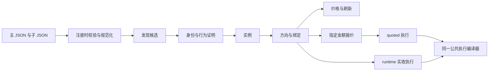

# Adapter Family Plugin：JSON 定义与 Family 公共管线

**Family 定义协议；Family 公共管线执行统一流程。** 本文以 ERC4626 为例，说明发现、身份、实例、方向、价格、指定金额报价与模拟执行怎样从 JSON 接入生产插件。

这里的“公共管线”是 Family 层的编译器、验证器和执行编译器。本文止于 Family 输出请求、报价与执行程序，不展开 live 的枚举、Solver、最终 sim 或 EV。

本文描述本次 ERC4626 的 v2 声明入口，不表示所有 Family 都已迁移。既有 swap、protocol、credit 等 domain 模板与 v1 入口继续保留；其他 Family 的覆盖需要分别推进。

源码基线位于云端 `/opt/mev-cloud/family-runtime-20261007`。下文文件路径以 `listener/src/searcher/` 为起点。JSON 块是对应文件的字段节选，完整定义入口列在文末；TypeScript 块摘取公共核心调用，省略周边类型与无关分支。

| 维护对象 | 文件 | 作者负责什么 |
|---|---|---|
| 标准 ERC4626 | `venues/protocols/erc4626-family/erc4626.json` | 生产声明、发现、标准身份参数、实例、方向、价格、报价与执行定义 |
| Custodian 变体 | `venues/protocols/erc4626-family/custodian.json` | 代理身份、外部 share、权限和容量、存入／赎回定义 |
| InfiniFi 变体 | `venues/protocols/erc4626-family/infinifi.json` | Registry、Gateway 和关联依赖、报价前处理、执行与效果定义 |
| 公共装配 | `venues/declarative-protocol.ts` | 把上述定义编译为原有 Family 接口 |
| 公共格式展开 | `venues/declarative-variant.ts` | 展开字段模型、读取集合与约束 |
| 公共准入流程 | `venues/declarative-conversion-admission.ts` | 固定推进匹配、资料读取、依赖验证、行为证明和身份结论 |
| 公共执行 | `venues/declarative-execution.ts` | ABI 编码、寄存器分配、输入补丁、授权、扣款和到账检查 |

StakedUSDat 仍是独立 Family，拥有自己的身份、刷新规则和生产入口。ERC4626 主定义中用于识别特殊实现的资料负责避免重复准入，不会因此生成 StakedUSDat 的方向或执行动作。

其 `standard-base.ts` 兼容桥复用 ERC4626 的共用转换定义，再绑定自己的 Family、lineage 和 deposit 方向；这不等于 StakedUSDat 已纳入本次三个 JSON，也不等于其专用身份与刷新逻辑已整体薄化。



## 1. 读取定义，生成一个共用生产接入调用

**输入：** 主 JSON、静态声明的子 JSON。

**共用处理：** 检查格式、路径、Family ID、lineage 和 action 所有权；生成静态入口；规范化声明并组装插件。

**产物：** 仍符合 `defineProtocolFamily` 合同的 `plugin`。

`erc4626.json` 声明生产域和子文件。标准实现直接放在主 JSON 的 `standard` 中。

```json
{
  "version": 2,
  "scope": {
    "family": "protocol:erc4626"
  },
  "production": {
    "domain": "protocol",
    "activation": {
      "enabled": true,
      "envKey": "SEARCHER_FAMILY_ERC4626_ENABLED"
    }
  },
  "variantFiles": [
    "./custodian.json",
    "./infinifi.json"
  ]
}
```

同一主文件还声明 action 所有权、允许的 lineage 和协议行为证明要求：

```json
{
  "manifest": {
    "familyId": "protocol:erc4626",
    "domain": "protocol",
    "ownedActionAdapterIds": [
      "erc4626-deposit",
      "erc4626-redeem"
    ],
    "supportedLineages": [
      "erc4626:standalone-standard-behavior",
      "erc4626:frax-custodian-sync-conversion",
      "erc4626:infinifi-gateway-staking"
    ]
  },
  "protocol": {
    "candidateKinds": [
      "observed-call",
      "address-surface",
      "standalone-contract"
    ],
    "activeBehaviorProof": "required"
  }
}
```

`build-declarative-production.ts` 生成的入口采用下面的结构。`erc4626.production.ts` 是构建产物，不需要再手写 Family 的生产装配代码。

```ts
import { defineFamilyActivation } from "./activation.js";
import { defineProtocolFamily } from "../adapter-family-plugin.js";
import { compileDeclarativeProtocol } from "../declarative-protocol.js";
import definition from "../protocols/erc4626-family/erc4626.json";
import child0 from "../protocols/erc4626-family/custodian.json";
import child1 from "../protocols/erc4626-family/infinifi.json";

export const activation = defineFamilyActivation({
  enabled: true,
  envKey: "SEARCHER_FAMILY_ERC4626_ENABLED",
});

export const plugin = defineProtocolFamily(
  compileDeclarativeProtocol(definition, [child0, child1]),
);
```

公共层在注册时规范化数据，随后才建立能力对象：

```ts
// venues/declarative-protocol.ts
normalized.standard = normalizeDeclarativeVariant(normalized.standard);
normalized.pricing.static.decode = normalizeDeclarativeFieldModel(
  normalized.pricing.static.decode,
);

const document = frozen(normalized);
const documents = [
  document.standard,
  ...children.map(child => frozen(normalizeDeclarativeVariant(child))),
];
```

Family 作者维护的是 `admission`、`reads`、`models.fields`、`checks` 和 `result`。规范化后出现的 `identity.stages`、`let/assert/return` 等内部表示由公共编译器生成，**不要求每个 Family 再写一份流程脚本**。

JSON 不能导入 TypeScript handler，也不能通过 `module/export/handler` 绕回专用实现。`binding` 可以是普通证据字段，但不能借此加载代码。现有 `instance.ts`、`pricing.ts`、`exact.ts` 等兼容出口只转接公共生成的能力；生产入口不依赖它们完成装配。

能力指纹包含主／子 JSON 和公共编译器的代码依赖。声明或公共实现发生语义变化时，不能继续把旧指纹冒充当前定义。

## 2. 从调用、日志和地址资料发现候选实例

**输入：** 已有观测提供的 call、log、地址资料。

**共用处理：** 从签名计算 selector／topic，按声明提取候选地址并去重。

**产物：** 例如 `{ candidateKind: "erc4626-vault", vault }`；此时只是候选。

`erc4626.json → discovery.definition`：

```json
{
  "definition": {
    "sources": [
      "observed-call",
      "landed-log",
      "address-surface"
    ],
    "candidateSources": [
      "dex-token-domain",
      "observed-interaction"
    ],
    "candidate": {
      "kind": "erc4626-vault",
      "addressField": "vault"
    },
    "calls": [
      {
        "id": "erc4626-deposit-call",
        "signature": "deposit(uint256,address)"
      },
      {
        "id": "erc4626-redeem-call",
        "signature": "redeem(uint256,address,address)"
      }
    ],
    "events": [
      {
        "id": "erc4626-deposit-log",
        "signature": "Deposit(address,address,uint256,uint256)"
      },
      {
        "id": "erc4626-withdraw-log",
        "signature": "Withdraw(address,address,address,uint256,uint256)"
      }
    ],
    "surface": {
      "id": "erc4626-standard-surface",
      "fingerprint": "erc4626-standard-behavior-v1"
    },
    "labels": [
      "erc4626",
      "protocol:erc4626"
    ]
  }
}
```

公共装配只调用一次发现编译器：

```ts
const discovery = compileDeclarativeDiscovery<Candidate>(
  document.discovery.definition,
);

const capture = createRouteCaptureMaterialization({
  familyId: document.manifest.familyId,
  discovery,
});
```

`venues/declarative-discovery.ts` 把签名转换成现有发现接口：

```ts
callPatterns: d.calls.map(call => ({
  ...call,
  selector: id(call.signature).slice(0, 10),
  candidateAddress: { from: "call-target" },
})),

logPatterns: d.events.map(event => ({
  ...event,
  topic: id(event.signature),
})),

candidate: address => ({
  candidateKind: d.candidate.kind,
  [d.candidate.addressField]: address,
}),
```

`compileAddressDiscovery()` 和 `createAddressSurfaceNomination()` 继续负责公共提名。`capture` 从相同发现定义派生，不要求 Family 再提供另一份捕获逻辑。命中 `deposit` 或 `redeem` 不能直接证明 ERC4626 身份，也不会跳过下一步行为验证。

## 3. 按共用准入流程读取资料并证明支持方向

**输入：** 候选、固定状态来源、前一步证据。

**共用处理：** 选择下一轮读取，执行请求，解码资料，检查关联身份、权限和主动行为。

**产物：** 已验证身份及 `verifiedDirections`，或带明确原因的拒绝／待处理结果。

标准 ERC4626 使用主 JSON 选择现有共用采样转换流程。函数名、事件字段和错误标识由参数给出：

```json
{
  "identity": {
    "definition": {
      "version": 1,
      "workflow": "sampled-conversion-v1",
      "parameters": {
        "calls": {
          "inputAsset": "asset",
          "assetSupply": "totalAssets",
          "shareSupply": "totalSupply",
          "toShares": "convertToShares",
          "toAssets": "convertToAssets",
          "previewForward": "previewDeposit",
          "previewReverse": "previewRedeem",
          "forward": "deposit",
          "reverse": "redeem",
          "balance": "balanceOf",
          "approval": "approve"
        },
        "events": {
          "forward": "Deposit",
          "reverse": "Withdraw",
          "assetField": "assets",
          "shareField": "shares"
        }
      }
    },
    "memoReuse": "recheck-identity"
  }
}
```

标准流程由 `venues/declarative-definition.ts` 的 `expandConversionDefinition()` 展开；共用流程本身位于 `venues/sampled-conversion-flow.json`。公共层再编译为统一身份接口：

```ts
const definition = expandConversionDefinition(document.identity.definition);

return compileDeclarativeIdentity(definition, {
  id: variant.document.id,
  familyId: document.manifest.familyId,
  lineageId: variant.document.lineageId,
  parameters: variant.document.identityParameters,
});
```

Custodian／InfiniFi 子 JSON 改用 `admission` 描述同一套固定流程需要的资料。以下为 `infinifi.json → admission.match`：

```json
{
  "admission": {
    "match": {
      "phase": "registry",
      "kind": "registry-pointer",
      "requirements": {
        "transports": [
          "get-code",
          "eth-call"
        ]
      },
      "sourceFailure": "propagate",
      "codeRequestId": "infinifi-registry-code",
      "candidateValue": "$candidate.vault",
      "mismatchReason": "infinifi_registry_not_matched",
      "valueRequestId": "infinifi-registry",
      "abi": "vault",
      "function": "getAddress",
      "noCodeReason": "infinifi_registry_not_deployed",
      "malformedReason": "InfiniFi malformed registry response",
      "reads": [
        {
          "id": "infinifi-registry-code",
          "code": "$constants.gateway"
        },
        {
          "id": "infinifi-registry",
          "call": {
            "abi": "vault",
            "function": "getAddress",
            "args": [
              "stakedToken"
            ]
          },
          "target": "$constants.gateway",
          "required": false,
          "completion": "return-or-revert-data"
        }
      ]
    }
  }
}
```

这里声明“读哪个 Registry、哪个字段应反向对应候选”，没有声明一段自定义阶段执行函数。Custodian 的同一位置选择 `runtime-template`，随后仍必须检查实例资料和行为。

```ts
// venues/declarative-variant.ts
for (const stage of ["match", "surface", "dependencies", "active"]) {
  const config = definition.admission[stage];
  config.requests = expandReadSet(config.reads);
  delete config.reads;
}

const admission = expandConversionAdmission(definition.admission);
```

`expandConversionAdmission()` 固定阶段推进规则。子 JSON 提供读取集合、字段模型、方向样本、期望余额变化和事件约束。`compileDeclarativeIdentity()` 把内部表示接到原接口：

```ts
buildRequests: step => {
  const selected = stage(step);
  const requests = evaluate(selected.requests, environment(step));
  return freeze(requests);
},

decode: ({ step, results }) => {
  const selected = stage(step);
  for (const result of results) {
    if (!result.ok && !selected.optionalFailures?.includes(result.id)) {
      throw new RequiredAdapterRequestError(result);
    }
  }
  return freeze(run(selected.decode, environment(step, results)));
},

decide: step => freeze(run(doc.identity.decide, environment(step))),
```

真实请求仍交给既有请求执行与证据发行机制。JSON 不能自己访问 RPC、伪造 source 或发行已验证身份。主动行为证明要求实际返回、独立扣款／到账、相关 supply 和事件符合该方向声明；class hash、ABI 存在或注册表返回值都不能单独替代它。

错误原因可以放在 JSON，例如 `mismatchReason`、`unavailableReason`、模型中的 `error`。公共层负责按真实结果分类，必要请求失败不能被子 JSON 吞掉后解释成成功。

## 4. 从已验证身份编译实例描述

**输入：** 已验证身份及其资产、变体、方向证据。

**共用处理：** 按字段映射生成实例，并计算后续绑定需要的稳定投影。

**产物：** `CompiledInstanceDescriptor`，包括 vault、asset、share、lineage 和支持方向。

`erc4626.json → instance.draft` 的字段映射：

```json
{
  "instance": {
    "draft": {
      "familyId": "$identity.familyId",
      "lineageId": "$identity.lineageId",
      "instanceKey": {
        "op": "lower",
        "args": [
          {
            "op": "address",
            "args": [
              "$identity.subject"
            ]
          }
        ]
      },
      "provenance": "$identity.provenance",
      "runtimeRequirements": [
        {
          "kind": "source-state",
          "freshness": "pinned-block"
        }
      ],
      "vault": {
        "op": "address",
        "args": [
          "$identity.subject"
        ]
      },
      "asset": {
        "op": "address",
        "args": [
          "$identity.asset"
        ]
      },
      "share": {
        "op": "address",
        "args": [
          {
            "op": "coalesce",
            "args": [
              "$identity.custodian.share",
              "$identity.subject"
            ]
          }
        ]
      },
      "custodian": "$identity.custodian",
      "infinifi": "$identity.infinifi",
      "verifiedDirections": "$identity.verifiedDirections"
    }
  }
}
```

标准 share 是 vault 本身；Custodian 的 share 取已验证外部 share，不能把 vault 地址错误地当成 share。InfiniFi 的关联 Gateway 等资料保存在 `infinifi` 绑定中。

```ts
// venues/declarative-protocol.ts
const instance = {
  instanceKey: identity => instanceKey(
    evalRoot(document.instance.key, { identity }),
  ),

  compileDraft: identity => frozen(
    evalRoot(document.instance.draft, { identity }),
  ),

  finalizeDescriptor: ({ draft }) => draft,
  staticBindingProjection: projection,
};
```

`compileDeclarativeValues().evaluate()` 只解释公共允许的字段引用和纯值操作。Family 无需再维护 `compileDraft()` 的专用 TypeScript 实现。

## 5. 按已验证方向生成路由并绑定身份

**输入：** 实例描述与 `verifiedDirections`。

**共用处理：** 生成方向、输入输出 token、目标与 action；固定实例绑定指纹。

**产物：** Family 路由，以及供既有图层使用的投影。

`erc4626.json → routes.directions`：

```json
{
  "routes": {
    "directions": [
      {
        "id": "deposit",
        "enabled": "$descriptor.verifiedDirections.deposit",
        "tokenIn": "$descriptor.asset",
        "tokenOut": "$descriptor.share",
        "adapterId": "erc4626-deposit",
        "taxonomy": {
          "slotKind": "protocol",
          "protocolAction": "wrap"
        }
      },
      {
        "id": "redeem",
        "enabled": "$descriptor.verifiedDirections.redeem",
        "tokenIn": "$descriptor.share",
        "tokenOut": "$descriptor.asset",
        "adapterId": "erc4626-redeem",
        "taxonomy": {
          "slotKind": "protocol",
          "protocolAction": "redeem"
        }
      }
    ]
  }
}
```

共用代码先用声明判断哪些方向可用，再填充绑定：

```ts
const fingerprint = hashCanonical(projection(descriptor));

return Object.freeze(
  document.routes.directions
    .filter(direction => evalRoot(direction.enabled, env))
    .map(direction => frozen({
      routeKey: routeKey([
        descriptor.familyId,
        evalRoot(document.routes.bindingKey, env),
        direction.id,
      ].join("\u001f")),
      familyId: descriptor.familyId,
      lineageId: descriptor.lineageId,
      instanceKey: descriptor.instanceKey,
      tokenIn: evalRoot(direction.tokenIn, env),
      tokenOut: evalRoot(direction.tokenOut, env),
      bindingRef: {
        bindingKey: evalRoot(document.routes.bindingKey, env),
        fingerprint,
      },
      target: env.target,
      direction: direction.id,
      adapterId: evalRoot(direction.adapterId, env),
    })),
);
```

上段省略了原函数同时填写的 `taxonomy` 和 `runtimeRequirements`。调用价格、报价或执行能力前，`assertInvocation()` 统一复核实例、lineage、target、token、direction、action 和绑定指纹。Family 子 JSON 只补充其变体约束。

## 6. 读取价格，并声明何时需要刷新

**输入：** 实例、方向、当前状态，以及所需静态资料。

**共用处理：** 获取精度、构造采样报价、检查变体状态、解码价格；编译触碰索引。

**产物：** 带来源的价格快照、方向价格和刷新依赖。

标准 ERC4626 的刷新声明在 `standard.pricing`：

```json
{
  "standard": {
    "pricing": {
      "mutationAddresses": [
        "$descriptor.vault"
      ],
      "refreshPolicy": "on-touch",
      "requirements": {
        "transports": [
          "eth-call"
        ]
      },
      "dependencies": [
        "$descriptor.vault",
        "$descriptor.asset",
        "$descriptor.share"
      ]
    }
  }
}
```

`dependencies` 用于依赖证明；`mutationAddresses` 才是事件触碰刷新入口。这两者分开，避免一次普通 USDC 转账就触发全部 USDC vault 重刷。标准实例保持 `on-touch`；Custodian／InfiniFi 仍声明 `each-block`，保留其权限、容量及外部状态检查。

静态精度不是一个 Family decoder 函数，而是 `pricing.static.decode` 的字段模型。以下摘取一个字段及最终输出：

```json
{
  "pricing": {
    "static": {
      "decode": {
        "fields": [
          {
            "name": "assetDecimals",
            "value": {
              "op": "word",
              "args": [
                {
                  "op": "get",
                  "args": [
                    {
                      "op": "returned",
                      "args": [
                        "static-asset-decimals"
                      ]
                    },
                    "data"
                  ]
                }
              ]
            },
            "checks": [
              {
                "condition": {
                  "op": "lte",
                  "args": [
                    "$assetDecimals",
                    {
                      "op": "uint",
                      "args": [
                        "77"
                      ]
                    }
                  ]
                },
                "error": "protocol token decimals exceed uint256 scale"
              }
            ]
          }
        ],
        "output": {
          "oneAsset": {
            "op": "pow",
            "args": [
              "10",
              "$assetDecimals"
            ]
          },
          "oneShare": {
            "op": "pow",
            "args": [
              "10",
              "$shareDecimals"
            ]
          }
        }
      }
    }
  }
}
```

完整文件还声明对 `shareDecimals` 的同类读取与上界检查。公共层用 `normalizeDeclarativeFieldModel()` 展开字段和约束，`staticEvidence.decode()` 执行统一解码。

当前价格与指定金额报价共用下一步的 `readPrograms.quote`。当前价格只负责选择每个方向的采样输入：

```ts
const amountIn = evalRoot(document.pricing.sampleAmount, {
  descriptor: input.descriptor,
  route,
});

return quoteRequests(
  variant,
  { ...input, route, amountIn },
  `current:${route.direction}`,
);
```

收到结果后，共用代码先验证 guard 和来源，再解码输出；`protocolMid()` 将正的输入／输出点转换成既有价格接口。`compileAddressMutations()` 消费声明的触碰地址生成索引，Family 不再自行维护刷新循环。

## 7. 用同一报价声明处理指定金额

**输入：** 已绑定方向、用户或生产调用提供的完整 `amountIn`、source 和 executor。

**共用处理：** 校验路由和权限，编码报价调用，校验来源，解码输出并生成证据。

**产物：** `amountOut` 与绑定该输入、方向、来源的 Exact evidence。

标准声明在 `standard.readPrograms.quote`。下列为完整报价定义：

```json
{
  "standard": {
    "readPrograms": {
      "quote": {
        "requests": [
          {
            "id": "$requestId",
            "kind": "eth-call",
            "to": "$descriptor.vault",
            "data": {
              "op": "encode",
              "args": [
                "vault",
                {
                  "op": "if",
                  "args": [
                    {
                      "op": "eq",
                      "args": [
                        "$direction",
                        "deposit"
                      ]
                    },
                    "previewDeposit",
                    "previewRedeem"
                  ]
                },
                [
                  "$amountIn"
                ]
              ]
            },
            "completion": "return-data"
          }
        ],
        "result": {
          "op": "uint",
          "args": [
            {
              "op": "decode",
              "args": [
                "vault",
                {
                  "op": "if",
                  "args": [
                    {
                      "op": "eq",
                      "args": [
                        "$direction",
                        "deposit"
                      ]
                    },
                    "previewDeposit",
                    "previewRedeem"
                  ]
                },
                {
                  "op": "get",
                  "args": [
                    {
                      "op": "returned",
                      "args": [
                        "$requestId"
                      ]
                    },
                    "data"
                  ]
                },
                0
              ]
            }
          ]
        }
      }
    }
  }
}
```

`requests` 定义调用，`result` 定义从结果取哪个值；没有 `decode.ts` handler。Custodian 的同一声明补上容量与权限 guard，InfiniFi 则声明其报价所需的前置调用和聚合返回格式。

公共 Exact 接口按统一顺序消费这些定义：

```ts
assertInvocation(input.descriptor, input.route);

const variant = select(input.descriptor);
const env = environment(variant, input);
variant.values.run(variant.document.exact.checks ?? [], env);

return frozen([
  ...guard(variant, input, true),
  ...quoteRequests(variant, input, "exact-preview"),
]);
```

上段省略了零输入／负输入分支及受保护执行器地址检查。正输入按原数量编码，公共层不会为了舍入人为减掉请求输入。解码时，`assertSource()` 先绑定请求状态，再执行结果与容量检查，最后按 `exact.evidence` 映射输出证据。

## 8. 从执行定义生成 quoted／runtime 模拟执行程序

**输入：** 已绑定方向、执行器、收款要求；quoted 路径另有指定输入及 Exact evidence。

**共用处理：** 从同一执行定义选择 ABI、编码参数、安排授权和读数，并检查真实扣款与到账。

**产物：** 既有执行接口可消费的 RuntimeAmountProgram；此处不展开整个交易计划的构造。

`standard.execution.call` 声明实际调用的函数及参数来源：

```json
{
  "standard": {
    "execution": {
      "settlement": {
        "directOutput": true
      },
      "protectedAddresses": [
        "$descriptor.vault",
        "$descriptor.share",
        "$descriptor.asset"
      ],
      "approval": {
        "token": "$route.tokenIn",
        "spender": "$descriptor.vault",
        "mode": "ensure",
        "when": {
          "op": "eq",
          "args": [
            "$direction",
            "deposit"
          ]
        }
      },
      "call": {
        "target": "$descriptor.vault",
        "signature": {
          "op": "if",
          "args": [
            {
              "op": "eq",
              "args": [
                "$direction",
                "deposit"
              ]
            },
            "function deposit(uint256,address) returns(uint256)",
            "function redeem(uint256,address,address) returns(uint256)"
          ]
        },
        "args": {
          "op": "if",
          "args": [
            {
              "op": "eq",
              "args": [
                "$direction",
                "deposit"
              ]
            },
            [
              {
                "runtime": "amountIn"
              },
              "$recipient"
            ],
            [
              {
                "runtime": "amountIn"
              },
              "$recipient",
              "$executor"
            ]
          ]
        },
        "save": {
          "output": 0
        }
      }
    }
  }
}
```

`{"runtime":"amountIn"}` 不是链外报价数。公共编译器把它绑定到交易内输入寄存器，随后为相应 ABI 参数建立输入补丁。

扣款与到账要求也由定义提供，公共执行层负责统一实现：

```json
{
  "standard": {
    "execution": {
      "effects": [
        {
          "kind": "debit",
          "token": "$route.tokenIn",
          "account": "$executor",
          "equals": {
            "runtime": "amountIn"
          }
        },
        {
          "kind": "credit",
          "token": "$route.tokenOut",
          "account": "$recipient",
          "equals": {
            "runtime": "output"
          },
          "minimum": "$minAmountOut"
        },
        {
          "kind": "unchanged-token",
          "token": "$route.tokenOut",
          "account": "$executor",
          "when": "$externalRecipient"
        },
        {
          "kind": "unchanged-token",
          "token": "$route.tokenIn",
          "account": "$recipient",
          "when": "$externalRecipient"
        },
        {
          "kind": "unchanged-native",
          "when": "$directSettlement"
        }
      ]
    }
  }
}
```

`venues/declarative-protocol.ts` 的两个入口最终调用同一个 `executionProgram()`：

```ts
function executionProgram(input: Data) {
  const variant = select(input.descriptor);
  const env = environment(variant, input);

  return buildDeclarativeExecutionProgram(
    variant.document.execution,
    env,
    variant.values,
  );
}
```

runtime 入口只传实际执行上下文，不读取 Exact、quoted 或链外 `amountIn`：

```ts
const program = executionProgram({
  descriptor: input.descriptor,
  route: input.route,
  executor: input.executor,
  source: input.source,
  runtimeEvidence: input.runtimeEvidence,
  settlement: input.settlement,
  recipient,
  minAmountOut: 1n,
  settlementRequested: input.settlement !== undefined,
});
```

quoted 入口先检查 Exact evidence，再使用同一声明生成程序，并把指定输入放入节点的 `amount`。公共 action 编码器随后读取 `runtimeAmountProgram`；不再根据 ERC4626 变体名字切换专用执行 handler。

action 的身份和 trace 匹配同样来自主 JSON。以下为 deposit action 的字段节选；完整定义还包含 Gateway 的对应调用，以及 redeem action。

```json
{
  "actionAdapters": [
    {
      "descriptor": {
        "adapterId": "erc4626-deposit",
        "lineage": "erc4626",
        "edgeKind": "protocol",
        "action": "deposit",
        "canSendValue": false,
        "leavesStandingPositionDefault": false
      },
      "traces": [
        {
          "signature": "function deposit(uint256,address)"
        }
      ]
    }
  ]
}
```


```ts
const actionAdapters = document.actionAdapters.map(action =>
  createDeclarativeProgramAction(action.descriptor, action.traces),
);
```

执行约束使用 `contextChecks: [{ condition, error }]`，而非 Family 自写执行阶段。公共执行层还拒绝定义引用链外 `$amountIn`、`$quotedAmountOut` 或 `$exactEvidence`；交易内金额只能使用 `runtime` 引用。

`venues/declarative-execution.ts` 负责从签名和参数生成实际调用：

```ts
const abi = callInterface(input.signature);
const fn = abi.getFunction(fragment.format("sighash"));

const args = input.args.map((value, index) => {
  if (!dynamic(value)) return value;

  const item = word(value);
  patches.push({ offset: 4 + index * 32, reg: item.reg });

  const type = fn.inputs[index].type;
  return type === "address" ? ZeroAddress : type === "bool" ? false : 0n;
});

program.call(
  getAddress(input.target),
  abi.encodeFunctionData(fn, args),
  { static: isStatic, patches },
);
```

上段将源码中的零地址字面量缩写为 `ZeroAddress`，省略了 ABI 形状校验和临时寄存器释放。运行时参数仅允许已支持的静态 ABI 词；不认识的形状直接拒绝，不猜测动态偏移。

公共层固定执行前后余额读取、精确输入扣款、正的实际到账、返回值一致性及声明的库存保护。Custodian／InfiniFi 还声明权限、容量、supply、残留和精确授权清理。Custodian 的保护地址包含 proxy admin。

`settlement.directOutput` 从 JSON 决定是否可以指定收款方。当前三种 ERC4626 语义声明 direct output；没有声明回调结算能力，共用入口遇到不支持的回调请求会拒绝，不能因为共用了执行器就自动宣称支持。

## 真实函数调用顺序

下面按 Family 生命周期列出实际函数；不同阶段由既有调用方分别触发，不表示一次同步函数会把所有阶段跑完。

```text
注册与装配
  build-declarative-production.syncDeclarativeProductionEntries()
    → renderDeclarativeProductionEntry()
    → 生成 erc4626.production.ts
  erc4626.production.plugin
    → declarative-protocol.compileDeclarativeProtocol()
    → createDeclarativeProtocolRuntime()
    → declarative-variant.normalizeDeclarativeVariant()
    → declarative-conversion-admission.expandConversionAdmission() 〔子变体〕
    → adapter-family-plugin.defineProtocolFamily()

发现
  declarative-protocol.createDeclarativeProtocolRuntime()
    → declarative-discovery.compileDeclarativeDiscovery()
    → address-discovery.compileAddressDiscovery()
    → address-surface-nomination.createAddressSurfaceNomination()
    → capture-materialization.createRouteCaptureMaterialization()
  已有发现调用方 → plugin.discovery → candidate

身份
  declarative-definition.expandConversionDefinition() 〔标准采样流程〕
  declarative-identity.compileDeclarativeIdentity()
  已有身份调用方 → variant.requirements()
    → variant.buildRequests() → 既有请求执行器
    → variant.decode() → variant.decide() → VerifiedIdentity

实例与方向
  plugin.instance.instanceKey()
    → plugin.instance.compileDraft()
    → plugin.instance.finalizeDescriptor()
    → plugin.routes.project()
    → plugin.routes.projectGraph()
    → declarative-protocol.assertInvocation()

价格
  plugin.pricing.compileDraft()
    → staticEvidence.buildRequests() → 既有请求执行器
    → staticEvidence.decode() → finalizePricingDescriptor()
  plugin.pricing.current.buildRequests()
    → guard() + quoteRequests() → 既有请求执行器
    → current.decodeSnapshot() → current.deriveMids()
  plugin.pricing.mutation.compile()
    → mutation-index.compileAddressMutations()

指定金额报价
  plugin.exact.methods() → request-program.program.buildRequests()
    → assertInvocation() → guard() + quoteRequests()
    → 既有请求执行器 → request-program.program.decode()
    → evidence()

模拟执行：runtime
  plugin.execution.buildRuntimeLeg()
    → assertInvocation() → executionProgram()
    → declarative-execution.buildDeclarativeExecutionProgram()
    → emit() → RuntimeAmountProgram.call()/math()/equal()
    → runtime-execution.runtimeLeg()

模拟执行：quoted
  plugin.execution.buildFragment()
    → assertInvocation() → Exact evidence 检查 → executionProgram()
    → declarative-execution.buildDeclarativeExecutionProgram()
    → node.params.runtimeAmountProgram
  createDeclarativeProgramAction().action.encode()
    → runtime-amount-program.encodeRuntimeAmountNode()
```

## 完整定义与字段对应

完整主定义是 `venues/protocols/erc4626-family/erc4626.json`；它包含本文各步的全部字段，不需要把片段手工拼成新的文件。子定义分别为同目录的 `custodian.json` 与 `infinifi.json`。

原文件职责与新定义的位置可这样对应；表中的“原文件”用于定位迁移关系，不表示仍通过该文件接入生产。

| 原文件职责 | JSON 位置 | 共用实现所在步骤 |
|---|---|---|
| `manifest.ts`、`protocol.ts`、生产入口 | 主 JSON 的 `manifest / protocol / production` | 1：注册与装配 |
| `discovery.ts`、`capture.ts` | 主 JSON 的 `discovery.definition` | 2：发现与公共捕获物化 |
| `identity.ts`、变体 identity | 主 JSON 的 `identity`；子 JSON 的 `admission / models / requestSets` | 3：身份与行为证明 |
| `instance.ts` | 主 JSON 的 `instance` | 4：实例字段映射 |
| `binding.ts`、`routes.ts` | `instance.bindingProjection / routes`，以及变体约束 | 5：方向与绑定 |
| `pricing.ts`、变体 guard／解码 | 主／子 JSON 的 `pricing / readPrograms / models` | 6：静态资料与价格刷新 |
| `exact.ts` | 主／子 JSON 的 `exact / readPrograms.quote` | 7：指定金额报价 |
| `execution.ts`、变体 execution、`action.ts` | 主／子 JSON 的 `execution`；主 JSON 的 `actionAdapters` | 8：统一执行编译 |
| ABI 声明 | `abi`、调用签名及事件签名 | 相应步骤由公共编码／解码器读取 |

| 子 JSON 字段 | 对应公共处理 |
|---|---|
| `version / id / lineageId` | 定义版本与变体身份；与主 manifest 声明交叉检查 |
| `abi / constants` | 公共 ABI 编码、解码及常量读取 |
| `expressions / inputs` | 命名表达式与输入字段声明；仅由公共求值器解释 |
| `admission` | 固定的匹配、资料、依赖、行为证明和结论流程 |
| `requestSets` | 公共读取集合展开；支持命名集合、条件与集合中的实例化读取 |
| `models` | 解码字段、字段约束与输出对象 |
| `match / context / boundState` | 从已验证实例选择唯一变体并建立变量上下文 |
| `assertions` | 方向、资产、目标和绑定关系的声明约束 |
| `pricing / readPrograms` | 刷新策略、依赖、guard、报价请求及结果 |
| `exact` | 指定金额限制、保护地址、输出条件与证据映射 |
| `execution` | 实际函数、参数、授权、收款与余额效果约束 |

原来的一个 TypeScript 文件不必机械对应一个新 JSON 文件。它对应的是上述明确的能力块：共享逻辑在公共 TypeScript 中，Family 差异集中在主 JSON 或所属子 JSON。新增共用 runtime、quoted 或结算检查时，优先修改 Family 公共层；只有确有协议差异时才新增声明字段。
