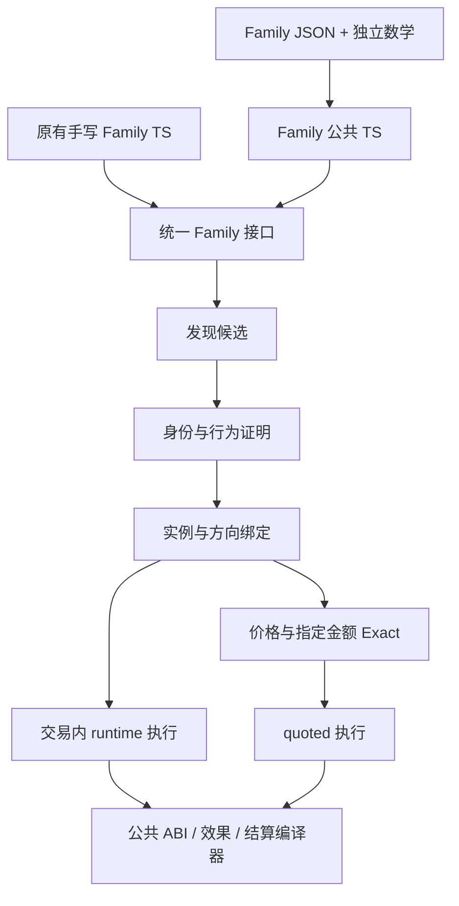

# Adapter Family Plugin：JSON、公共 TS 与统一接口

本文说明 **Family 公共管线怎样读取定义、生成能力，再接入中央接口**。按生产注册 → 发现 → 身份 → 实例与方向 → 价格 → Exact → 执行 → 结算的顺序展开。重点是各阶段的核心实现、JSON 数据和接口产物，不展开整轮 live 的枚举、选额、final sim 或 EV。

**源码核对：2026-11-03，云端 `/opt/mev-cloud/family-runtime-20261007`，HEAD `f4a16ced70acf3b1b4d634ab26480ec42ec2a96d`。** 已检查实际 dirty 状态；下文引用的核心文件与该提交内容一致。其他窗口尚未合入这里的迁移成果不算本文基线。

代码块是实际源码的连续节选，做了排版，省略处由正文说明；不是另写一套伪实现。每块附固定源码入口。JSON 标为“实际节选”的来自当前定义；标为“格式示意”的只说明通用格式，不代表 ERC4626 已启用该能力。节选不等于完整、可独立注册的配置。



JSON 化的 Family 经过公共解释器；未迁移的 Family 继续使用原 TS。两者最终都由 `defineProtocolFamily / defineSwapFamily / defineCreditFamily` 建立合同，进入同一个 catalog 和 strict runtime。它们是两种**实现来源**，没有两套准入、Graph 或调度权威。

| 层 | 负责什么 | 不应该承担什么 |
| --- | --- | --- |
| Family JSON | ABI、函数/事件、条件、读取顺序、身份关系、方向、效果与错误语义 | 动态加载 TS、任意代码回调、直接操作 RPC |
| 独立数学 TS | 不变量、费率、状态转换；以 model ID/version 注册 | 调度、身份准入或偷偷发请求 |
| Family 公共 TS | 校验和解释定义，组装接口、请求、ABI 与执行程序 | 按协议名分支、内置某个池的策略 |
| 中央 Family runtime | 签发来源/句柄、执行请求、管理生命周期与共用资产边界 | 读取协议 ABI、复制协议数学 |

## 1. 生产注册：同一个接口合同，三种领域装配

### 1.1 主 JSON 选择领域，生成薄入口

**输入：** 主定义、`variantFiles`、启用声明。**输出：** 生成的生产入口及可选编译期类型。

`build-declarative-production.ts` 的 `renderDataFamilyEntry()` 已支持 Protocol、Swap、Credit，旧文档的“仅 Protocol”判断已不适用：

```typescript
dataOnly(doc);
const domain = doc.production.domain as "protocol" | "swap" | "credit";
if (!["protocol", "swap", "credit"].includes(domain))
  throw new Error("unsupported declarative v2 domain");
const suffix =
  domain === "swap"
    ? "Swap"
    : domain === "credit"
      ? "Credit"
      : "Protocol";
const constructor = `define${suffix}Family`,
  compile = `compileDeclarative${suffix}`;
const required = [
  "version",
  "scope",
  "production",
  "manifest",
  "discovery",
  "identity",
  "instance",
  "routes",
  "pricing",
  domain,
  "standard",
  "actionAdapters",
  "variantFiles",
];
```

源码：[build-declarative-production.ts · 113–119 行](https://github.com/EuniceLeeee/c0ffeebabe.eth/blob/f4a16ced70acf3b1b4d634ab26480ec42ec2a96d/listener/src/searcher/build-declarative-production.ts#L113-L119)。

**实际节选：ERC4626 主 JSON。** 标准变体直接放在 `standard`；Custodian、InfiniFi 是独立子文件，不需要另造一个标准子 JSON。

```json
{
  "version": 2,
  "scope": { "family": "protocol:erc4626" },
  "production": {
    "domain": "protocol",
    "activation": {
      "enabled": true,
      "envKey": "SEARCHER_FAMILY_ERC4626_ENABLED"
    }
  },
  "variantFiles": ["./custodian.json", "./infinifi.json"]
}
```

源码：[erc4626.json](https://github.com/EuniceLeeee/c0ffeebabe.eth/blob/f4a16ced70acf3b1b4d634ab26480ec42ec2a96d/listener/src/searcher/venues/protocols/erc4626-family/erc4626.json)。

生成的 ERC4626 入口实际调用：

```typescript
export const plugin = defineProtocolFamily(
  compileDeclarativeProtocol<FamilyTypes>(definition, [child0, child1]),
);
```

源码：[erc4626.production.ts · 14–14 行](https://github.com/EuniceLeeee/c0ffeebabe.eth/blob/f4a16ced70acf3b1b4d634ab26480ec42ec2a96d/listener/src/searcher/venues/production-families/erc4626.production.ts#L14-L14)。

这个 `.production.ts` 是公共生成器产物，仍需保留。它不包含协议实现；Family 作者维护 JSON，生成器负责 import、类型、activation 和注册调用。

### 1.2 三个薄包装最终进入同一个核心

`declarative-protocol.ts`、`declarative-swap.ts`、`declarative-credit.ts` 只校验入口领域并提供对应类型。共同调用 `declarative-family.ts → createDeclarativeFamilyRuntime()`：

```typescript
const definition = {
  manifest: document.manifest as FamilyManifest<"protocol">,
  capture: (domain === "credit"
    ? createCreditCaptureMaterialization
    : createRouteCaptureMaterialization)({
    familyId: document.manifest.familyId,
    discovery,
  }),
  discovery,
  identity,
  instance,
  routes,
  pricing,
  exact,
  execution,
  ...(domain === "protocol"
    ? {
        protocol: compileDeclarativeProtocolDomain(
          document.protocol,
          primary.values,
          primary.modules.get("oracleVictim"),
        ),
      }
    : domain === "swap"
      ? {
          swap: compileDeclarativeSwap(
            document.swap,
            primary.values,
            document.manifest,
          ),
        }
      : { credit: credit!.definition }),
  actionAdapters,
};
```

源码：[declarative-family.ts · 773–783 行](https://github.com/EuniceLeeee/c0ffeebabe.eth/blob/f4a16ced70acf3b1b4d634ab26480ec42ec2a96d/listener/src/searcher/venues/declarative-family.ts#L773-L783)。

| 领域模块 | 实际入口 | 领域差异 |
| --- | --- | --- |
| `declarative-protocol-domain.ts` | `compileDeclarativeProtocolDomain()` | candidate kinds、行为证明要求、可选 oracle victim |
| `declarative-swap-domain.ts` | `compileDeclarativeSwap()` | landed/receipt 观察、swap impact、mutation、victim 能力 |
| `declarative-credit-domain.ts` | `compileDeclarativeCreditDomain()` | collateral/debt、position、风险证明与执行证据 |

这是按 **domain 合同** 装配，不是按协议名字特判。Funding 仍有既有领域接口，但当前 v2 JSON 编译器只接上述三类，不能由此推导 Funding 已 JSON 化。

统一合同位于 `adapter-family-plugin.ts` 的 `MasterTemplate` 和 `FAMILY_CAPABILITY_APPLICABILITY`。`capture/discovery/identity/instance/routes/pricing/exact/execution/actionAdapters` 按领域标记 required、optional、never；不把 Credit 强塞成普通兑换。

### 1.3 可选模块：格式能统一，能力不会凭空出现

`declarative-modules.ts → createDeclarativeModuleCatalog().read()` 把缺失模块显示为 `{}`，保留旧 JSON 的兼容性：

```typescript
const block = Object.hasOwn(raw, key) ? raw[key] : {};
record(block);
blocks[key] = freeze(JSON.parse(JSON.stringify(block)));
if (!Object.keys(block).length) continue;
const version = block.version;
const contract =
  typeof version === "number" &&
  Number.isSafeInteger(version) &&
  Object.hasOwn(entry.versions, version)
    ? entry.versions[version]
    : undefined;
if (!contract)
  throw new Error(`unknown declarative module version: ${key}`);
```

源码：[declarative-modules.ts · 60–67 行](https://github.com/EuniceLeeee/c0ffeebabe.eth/blob/f4a16ced70acf3b1b4d634ab26480ec42ec2a96d/listener/src/searcher/venues/declarative-modules.ts#L60-L67)。

依赖决定能否编译：

```typescript
if (visiting.has(key))
  throw new Error(`cyclic module dependency: ${key}`);
const prior = rows.get(key);
if (prior) return prior;
const contract = contracts.get(key);
visiting.add(key);
const missing = (dependencies.get(key) ?? []).filter(
  (dep) => visit(dep).state !== "compiled",
);
const state = !contract
  ? "undefined"
  : missing.length
    ? "blocked"
    : "compiled";
if (state === "compiled") {
  const value = contract!.compile(blocks[key]!);
  if (value === undefined)
    throw new Error(`module compiler returned no value: ${key}`);
  if (value && typeof (value as { then?: unknown }).then === "function")
    throw new Error(`module compilation must be synchronous: ${key}`);
  compiled.set(key, value);
}
const row = freeze({
  key,
  state,
  ...(contract ? { version: blocks[key]!.version as number } : {}),
  missingDependencies: missing,
}) as ModuleCoverage;
```

源码：[declarative-modules.ts · 78–90 行](https://github.com/EuniceLeeee/c0ffeebabe.eth/blob/f4a16ced70acf3b1b4d634ab26480ec42ec2a96d/listener/src/searcher/venues/declarative-modules.ts#L78-L90)。

这是**内存中的统一视图**，不会自动回写源 JSON，更不会替作者补业务定义。

```json
{
  "modules": {
    "liveStateProjection": {},
    "instanceEvidence": {},
    "executionProjection": {},
    "pricingProjection": {},
    "quoteOutput": {},
    "oracleVictim": {},
    "math": {},
    "executionMath": {},
    "quoteFlow": {},
    "pricingFlow": {},
    "trialState": {}
  }
}
```

上面是当前模块目录的空视图示意。`undefined` 表示没有定义，`blocked` 表示依赖未满足，`compiled` 只表示该模块完成编译；三者都不是历史执行验收结论。未知字段、版本和模块名直接拒绝。

`declarative-family-modules.ts → readFamilyModules()` 先分别校验主、子定义，再叠加；子定义显式 `{}` 可取消继承。`oracleVictim / instanceEvidence / executionProjection` 属于根模块，子变体不能覆写。

### 1.4 变体、类型与指纹

同一个 lineage 现在可以有多个模型，但每个 variant `id` 必须唯一，主/子定义必须覆盖声明的 lineage。运行时不猜模型：

```typescript
function select(descriptor: Data): Variant {
  const matches = variants.filter(
    (v) => v.values.evaluate(v.document.match, { descriptor }) === true,
  );
  if (matches.length !== 1)
    throw new Error("descriptor must match exactly one declared variant");
  return matches[0]!;
}
```

源码：[declarative-family.ts · 209–213 行](https://github.com/EuniceLeeee/c0ffeebabe.eth/blob/f4a16ced70acf3b1b4d634ab26480ec42ec2a96d/listener/src/searcher/venues/declarative-family.ts#L209-L213)。

这要求各变体 `match` 恰好命中一个。不能靠换一个 ID 绕过真实身份。

`types.definitions / types.contracts` 是可选的编译期类型定义，由 `declarative-types.ts → renderDeclarativeFamilyTypes()` 生成；它们不替代运行时检查。`build-family-capability-manifest.ts` 将定义、公共实现及依赖纳入指纹。源代码改变后重新生成指纹，不能把旧 hash 填回来。

## 2. Discovery：JSON 说观察什么，公共层产生候选

### 2.1 地址型发现：selector、topic、surface

**主文件：** `declarative-discovery.ts`。**产物：** `DiscoverySemantics`，不是已准入实例。

`compileDeclarativeDiscovery()` 把签名变成已有发现引擎使用的 pattern：

```typescript
callPatterns: d.calls.map((c) => ({
  ...c,
  selector: id(c.signature).slice(0, 10) as `0x${string}`,
  candidateAddress: { from: "call-target" as const },
})),
logPatterns: d.events.map((e) => ({
  ...e,
  topic: id(e.signature) as `0x${string}`,
})),
addressSurfaces: [{ ...d.surface, kind: "interface" }],
candidate: (address) =>
  ({
    candidateKind: d.candidate.kind,
    [d.candidate.addressField]: address,
  }) as unknown as C,
candidateKey: (candidate) =>
  getAddress(
    (candidate as unknown as Record<string, string>)[
      d.candidate.addressField
    ],
  ).toLowerCase(),
nominate: createAddressSurfaceNomination({
  opaqueLabels: d.labels,
  interfaceFingerprints: [d.surface.fingerprint],
}),
reverseBinding: explicitReverseBindingUnsupported(
  "no reverse-binding registry declared (explicit unsupported)",
),
```

源码：[declarative-discovery.ts · 96–103 行](https://github.com/EuniceLeeee/c0ffeebabe.eth/blob/f4a16ced70acf3b1b4d634ab26480ec42ec2a96d/listener/src/searcher/venues/declarative-discovery.ts#L96-L103)。

**实际节选：ERC4626。**

```json
{
  "discovery": {
    "definition": {
      "candidate": { "kind": "erc4626-vault", "addressField": "vault" },
      "calls": [
        {
          "id": "erc4626-deposit-call",
          "signature": "deposit(uint256,address)"
        },
        {
          "id": "erc4626-redeem-call",
          "signature": "redeem(uint256,address,address)"
        }
      ],
      "events": [
        {
          "id": "erc4626-deposit-log",
          "signature": "Deposit(address,address,uint256,uint256)"
        },
        {
          "id": "erc4626-withdraw-log",
          "signature": "Withdraw(address,address,address,uint256,uint256)"
        }
      ],
      "candidateSources": ["dex-token-domain", "observed-interaction"]
    }
  }
}
```

源码：[erc4626.json](https://github.com/EuniceLeeee/c0ffeebabe.eth/blob/f4a16ced70acf3b1b4d634ab26480ec42ec2a96d/listener/src/searcher/venues/protocols/erc4626-family/erc4626.json)。

公共层用真实 call target / log emitter 构造候选，再交给 identity。`asset()` 或常见 selector 只是发现线索，不等于身份成立。`candidateSources: []` 表示不投影候选来源能力，不能被旧合同误判为“空的必需能力”。

`capture-materialization.ts → createRouteCaptureMaterialization()` 复用这些发现声明，为既有 capture 管线提供事件/调用资料需求；不会手工插入 Ready 实例或图边。

### 2.2 多 token / tuple / 数组候选

Discovery v2 支持嵌套 ABI 路径、派生标量、有限候选展开，仍调用同一 catalog。

**格式示意：** 调用第一个参数是一个 tuple，提取它的地址叶子：

```json
{
  "fields": {
    "subject": { "from": "target" },
    "token0": { "from": "argument", "index": 0, "path": [0] },
    "token1": { "from": "argument", "index": 0, "path": [1, 0] }
  }
}
```

数组要显式声明 `fanOut`；次数来自 JSON，公共 TS 不写“某协议调用两次”：

```json
{
  "fanOut": { "argument": 0, "maxItems": 3 },
  "fields": {
    "subject": { "from": "target" },
    "token0": { "from": "item", "path": [0, 0] }
  }
}
```

公共展开核心：

```typescript
function expand<
  T extends { declaration: MappedPattern; pattern: { id: string } },
>(entry: T): (T & { itemIndex?: number })[] {
  if (entry.declaration.fanOut === undefined) return [entry];
  return Array.from(
    { length: entry.declaration.fanOut.maxItems },
    (_, itemIndex) => ({
      ...entry,
      itemIndex,
      pattern: {
        ...entry.pattern,
        id:
          itemIndex === 0
            ? entry.pattern.id
            : `${entry.pattern.id}-${itemIndex}`,
      },
    }),
  );
}
```

源码：[declarative-discovery.ts · 258–262 行](https://github.com/EuniceLeeee/c0ffeebabe.eth/blob/f4a16ced70acf3b1b4d634ab26480ec42ec2a96d/listener/src/searcher/venues/declarative-discovery.ts#L258-L262)。

一个声明上限 N 产生 N 个匹配位置，实际数组较短时多余位置不产生候选；超过上限整条拒绝，不截断。当前单处上限 128、总 pattern 上限 1024，fan-out 数据上限 64 KiB。派生 poolId 可以用 `abiEncode/codeHash`，但 subject 不能由任意表达式伪造。

只有 topic、没有 ABI 的观察可以用于提名；当前公共发现器仍明确声明 reverse binding unsupported。tuple 支持不等于已经实现 Core-init 反查、历史日志索引或任何协议的完整身份。

## 3. Identity：定义验证事实，公共层推进阶段

### 3.1 两种声明入口，落到同一个身份解释器

| 定义入口 | 公共展开器 | 当前例子 |
| --- | --- | --- |
| `identity.definition.workflow`＋参数 | `declarative-definition.ts` 读取 `sampled-conversion-flow.json` | 标准 ERC4626 |
| 子 JSON 的 `admission/models/requestSets` | `declarative-variant.ts`＋`declarative-conversion-admission.ts` | Custodian、InfiniFi |

通用底层格式也能直接描述 `identity.select/stages/decide`。高层 conversion admission 是已有便利模板，不能把所有协议强制改成相同四阶段。

**实际节选：标准 ERC4626 的函数映射。**

```json
{
  "identity": {
    "definition": {
      "workflow": "sampled-conversion-v1",
      "parameters": {
        "calls": {
          "inputAsset": "asset",
          "assetSupply": "totalAssets",
          "shareSupply": "totalSupply",
          "toShares": "convertToShares",
          "toAssets": "convertToAssets",
          "previewForward": "previewDeposit",
          "previewReverse": "previewRedeem",
          "forward": "deposit",
          "reverse": "redeem",
          "balance": "balanceOf",
          "approval": "approve"
        }
      }
    }
  }
}
```

源码：[erc4626.json](https://github.com/EuniceLeeee/c0ffeebabe.eth/blob/f4a16ced70acf3b1b4d634ab26480ec42ec2a96d/listener/src/searcher/venues/protocols/erc4626-family/erc4626.json)。

公共模板替换的是数据槽，不是动态函数：

```typescript
if (Object.prototype.hasOwnProperty.call(value, "parameter")) {
  if (Object.keys(value).length !== 1)
    throw new Error("invalid declaration slot");
  return lookup(value.parameter);
}
```

源码：[declarative-definition.ts · 36–39 行](https://github.com/EuniceLeeee/c0ffeebabe.eth/blob/f4a16ced70acf3b1b4d634ab26480ec42ec2a96d/listener/src/searcher/venues/declarative-definition.ts#L36-L39)。

### 3.2 Custodian 与 InfiniFi：不同身份关系，同一个展开器

**实际节选：Custodian 的入口类匹配。**

```json
{
  "admission": {
    "match": {
      "phase": "proxy",
      "kind": "runtime-template",
      "requirements": { "transports": ["get-code"] },
      "sourceFailure": "retry",
      "codeRequestId": "custodian-proxy",
      "candidateValue": "$candidate.vault",
      "mismatchReason": "custodian_proxy_not_matched",
      "templateProgram": "proxy",
      "reads": [{ "id": "custodian-proxy", "code": "$candidate.vault" }]
    }
  }
}
```

源码：[custodian.json](https://github.com/EuniceLeeee/c0ffeebabe.eth/blob/f4a16ced70acf3b1b4d634ab26480ec42ec2a96d/listener/src/searcher/venues/protocols/erc4626-family/custodian.json)。

**实际节选：InfiniFi 从 Registry/Gateway 反查关联实例。**

```json
{
  "admission": {
    "match": {
      "phase": "registry",
      "kind": "registry-pointer",
      "requirements": { "transports": ["get-code", "eth-call"] },
      "sourceFailure": "propagate",
      "codeRequestId": "infinifi-registry-code",
      "candidateValue": "$candidate.vault",
      "mismatchReason": "infinifi_registry_not_matched",
      "valueRequestId": "infinifi-registry",
      "abi": "vault",
      "function": "getAddress",
      "noCodeReason": "infinifi_registry_not_deployed",
      "malformedReason": "InfiniFi malformed registry response",
      "reads": [
        { "id": "infinifi-registry-code", "code": "$constants.gateway" },
        {
          "id": "infinifi-registry",
          "call": {
            "abi": "vault",
            "function": "getAddress",
            "args": ["stakedToken"]
          },
          "target": "$constants.gateway",
          "required": false,
          "completion": "return-or-revert-data"
        }
      ]
    }
  }
}
```

源码：[infinifi.json](https://github.com/EuniceLeeee/c0ffeebabe.eth/blob/f4a16ced70acf3b1b4d634ab26480ec42ec2a96d/listener/src/searcher/venues/protocols/erc4626-family/infinifi.json)。

`normalizeDeclarativeVariant()` 将可读的 reads、models 规范化；`expandConversionAdmission()` 生成公共解释器消费的阶段和结果：

```typescript
for (const stage of ["match", "surface", "dependencies", "active"]) {
  const config = definition.admission[stage];
  if (config.requests !== undefined || !Array.isArray(config.reads))
    throw new Error("admission uses declared reads");
  config.requests = expandReadSet(config.reads);
  delete config.reads;
}
const programs = Object.fromEntries(
  Object.entries(definition.models).map(([name, model]) => [
    name,
    expandModel(model),
  ]),
);
const admission = expandConversionAdmission(definition.admission);
for (const name of Object.keys(admission.programs))
  if (Object.hasOwn(programs, name))
    throw new Error(
      "variant cannot replace a shared conversion proof model",
    );
const {
  admission: _admission,
  models: _models,
  requestSets: _requestSets,
  ...rest
} = definition;
const expanded = {
  ...rest,
  expressions,
  readPrograms,
  identity: admission.identity,
  programs: { ...programs, ...admission.programs },
};
validateDeclarativeValue(expanded);
```

源码：[declarative-variant.ts · 157–169 行](https://github.com/EuniceLeeee/c0ffeebabe.eth/blob/f4a16ced70acf3b1b4d634ab26480ec42ec2a96d/listener/src/searcher/venues/declarative-variant.ts#L157-L169)。

这里的 runtime class/hash 是身份资料的一部分；是否支持方向仍要看关联关系、权限、容量和 active proof。常量中的基础设施地址不是实例 allowlist。标准定义内出现 StakedUSDat 的特殊实现识别资料，也不代表 StakedUSDat 被并入 ERC4626；它仍有独立 Family 身份和入口。

### 3.3 TS 怎样执行这些阶段

`declarative-identity.ts` 用 `select` 决定当前阶段，再解释该阶段的 requests：

```typescript
const stage = (step: Value) => {
  const id = run(doc.identity.select, environment(step));
  if (!Object.prototype.hasOwnProperty.call(doc.identity.stages, id))
    throw new Error("unknown declared identity stage");
  return doc.identity.stages[id];
};
function buildRequests(step: Value): readonly AdapterRequest[] {
  const selected = stage(step),
    env = environment(step);
  const declared = evaluate(selected.requests, env);
  const requests = materializeRequests
    ? materializeRequests(declared, env)
    : declared;
  if (
    !Array.isArray(requests) ||
    new Set(requests.map((r: AdapterRequest) => r.id)).size !==
      requests.length
  )
    throw new Error("duplicate declared request id");
  return freeze(requests);
}
```

源码：[declarative-identity.ts · 99–111 行](https://github.com/EuniceLeeee/c0ffeebabe.eth/blob/f4a16ced70acf3b1b4d634ab26480ec42ec2a96d/listener/src/searcher/venues/declarative-identity.ts#L99-L111)。

请求交给现有 issuer 执行，回来后解码、判断是否继续或完成：

```typescript
decode: ({ step, results, assets }) => {
  const selected = stage(step);
  for (const result of results)
    if (!result.ok && !selected.optionalFailures?.includes(result.id))
      throw new RequiredAdapterRequestError(result);
  return freeze(
    run(selected.decode, {
      ...environment(step, results),
      ...(hasAssets ? { assets } : {}),
      requests: buildRequests(step),
    }),
  );
},
decide: (step) => {
  return freeze(run(doc.identity.decide, environment(step)));
},
```

源码：[declarative-identity.ts · 119–124 行](https://github.com/EuniceLeeee/c0ffeebabe.eth/blob/f4a16ced70acf3b1b4d634ab26480ec42ec2a96d/listener/src/searcher/venues/declarative-identity.ts#L119-L124)。

`decide` 产生 continue、verified、retryable 或拒绝等合同结果。协议的返回错误码、条件和 reason 可以写在 JSON；RPC 失败和业务拒绝仍须按请求结果区分，不能把所有错误都变成通过或永久拒绝。

### 3.4 可选资产 metadata 与行为模拟

需要共用 token code/decimals 资料时，可声明资产 metadata hook。下面展示的是**身份解释器内部定义的节选**：主 JSON 使用底层身份格式时，它位于 `identity.definition.identity.assets`；规范化后的变体使用 `identity.assets`。不能把这段直接放到主 JSON 顶层 `identity` 下。

```json
{
  "identity": {
    "assets": [
      { "key": "input", "kind": "erc20", "address": "$candidate.asset" },
      { "key": "output", "kind": "native" }
    ]
  }
}
```

公共 identity 仅在声明时挂接 hook；`adapter-family-runtime.ts` 的现有 metadata authority 负责读取并传回 `assets`。没有声明时不新增读取，旧 JSON 仍可使用自己的局部变量名 `assets`。

行为模拟也复用同一份执行声明。`declarative-simulation.ts → buildDeclarativeExecutionSimulation()` 先编译 runtime leg，再产出标准模拟请求：

```typescript
const tokens = [
  ...new Set([tokenIn, tokenOut, ...protectedTokens.map(getAddress)]),
];
const leg = buildDeclarativeRuntimeLeg(execution, input, values, options);
if (!leg) throw new Error("execution simulation has no runtime program");
const caller = Object.freeze({ kind: "executor" as const });
const native = executionNativeSides(input.route);
return Object.freeze({
  id: declaration.id,
  kind: "effect-delta-simulation",
  ...(declaration.required === undefined
    ? {}
    : { required: declaration.required }),
  call: Object.freeze({
    caller,
    executionMode: "executor-program",
    to: actor,
    data: buildSubscriptCalldata(
      runtimeProgramScript(getBytes(leg.program), amountIn),
    ),
  }),
  overrideIntent: Object.freeze({
    caller,
    tokenBalances: Object.freeze([
      Object.freeze({ token: tokenIn, amount: amountIn }),
    ]),
  }),
  observeTokenBalances: Object.freeze(
    tokens.map((token) => Object.freeze({ token, account: caller })),
  ),
  observe: requirements.effects!,
  ...(native
    ? {
        executionAssetBoundary: Object.freeze({
          tokenIn,
          tokenOut,
          amountIn,
          minimum: 1n,
          executionAssets: Object.freeze({
            ...input.route.executionAssets,
          }),
        }),
      }
    : {}),
});
```

源码：[declarative-simulation.ts · 66–80 行](https://github.com/EuniceLeeee/c0ffeebabe.eth/blob/f4a16ced70acf3b1b4d634ab26480ec42ec2a96d/listener/src/searcher/venues/declarative-simulation.ts#L66-L80)。

内部的 `declarative-execution-simulation` 在 Family 编译层被转成上述普通请求；中央不认识这个伪请求类型，也不需要协议分支。模拟器返回的数据经请求/来源绑定后才能形成证明。只有 code hash、函数存在、接口返回正常，都不等于实际扣款/到账已验证。

## 4. 实例与方向：把已验证身份投影成稳定绑定

### 4.1 Identity → Descriptor

**主文件：** `declarative-family.ts`。公共层直接消费 `instance` 定义：

```typescript
const instance: InstanceSemantics<Identity, Descriptor> = {
  instanceKey: (identity) =>
    instanceKey(evalRoot(document.instance.key, { identity })),
  compileDraft: (identity) =>
    frozen(evalRoot(document.instance.draft, { identity })),
  ...(instanceEvidence
    ? {
        staticEvidence: compileInstanceEvidence(
          instanceEvidence,
          primary.values,
        ),
      }
    : {}),
  finalizeDescriptor(input) {
    if (!instanceEvidence) return input.draft;
    if (input.staticEvidence === undefined)
      throw new Error("declared instance evidence is missing");
    primary.values.run(instanceEvidence.checks, input);
    return frozen(
      primary.values.evaluate(instanceEvidence.finalize, input),
    );
  },
  staticBindingProjection: projection,
};
```

源码：[declarative-family.ts · 341–352 行](https://github.com/EuniceLeeee/c0ffeebabe.eth/blob/f4a16ced70acf3b1b4d634ab26480ec42ec2a96d/listener/src/searcher/venues/declarative-family.ts#L341-L352)。

**实际节选：ERC4626 实例键和身份绑定投影。**

```json
{
  "instance": {
    "key": {
      "op": "lower",
      "args": [{ "op": "address", "args": ["$identity.subject"] }]
    },
    "bindingProjection": {
      "vault": {
        "op": "lower",
        "args": [{ "op": "address", "args": ["$descriptor.vault"] }]
      },
      "asset": {
        "op": "lower",
        "args": [{ "op": "address", "args": ["$descriptor.asset"] }]
      },
      "share": {
        "op": "lower",
        "args": [{ "op": "address", "args": ["$descriptor.share"] }]
      },
      "verifiedDirections": "$descriptor.verifiedDirections",
      "standardPayout": "asset()",
      "custodian": "$descriptor.custodian",
      "infinifi": "$descriptor.infinifi"
    }
  }
}
```

源码：[erc4626.json](https://github.com/EuniceLeeee/c0ffeebabe.eth/blob/f4a16ced70acf3b1b4d634ab26480ec42ec2a96d/listener/src/searcher/venues/protocols/erc4626-family/erc4626.json)。

Descriptor 保存从 identity 得到的 vault/asset/share、lineage、已证明方向等事实。它不是用户任意传入的地址对象。

若实例还需要一次额外的静态证据，`modules.instanceEvidence` 通过 `declarative-instance-evidence.ts → compileInstanceEvidence()` 接入同一实例生命周期；没有声明时直接返回 draft。`reuse/requirements/requests/decode/checks/finalize` 的字段合同由模块目录校验。

### 4.2 Descriptor → 支持方向 → Graph 投影

**实际节选：ERC4626 只为已证明方向出边。**

```json
{
  "routes": {
    "target": "$descriptor.vault",
    "bindingKey": {
      "op": "lower",
      "args": [{ "op": "address", "args": ["$descriptor.vault"] }]
    },
    "directions": [
      {
        "id": "deposit",
        "enabled": "$descriptor.verifiedDirections.deposit",
        "tokenIn": "$descriptor.asset",
        "tokenOut": "$descriptor.share",
        "adapterId": "erc4626-deposit",
        "taxonomy": { "slotKind": "protocol", "protocolAction": "wrap" }
      },
      {
        "id": "redeem",
        "enabled": "$descriptor.verifiedDirections.redeem",
        "tokenIn": "$descriptor.share",
        "tokenOut": "$descriptor.asset",
        "adapterId": "erc4626-redeem",
        "taxonomy": { "slotKind": "protocol", "protocolAction": "redeem" }
      }
    ]
  }
}
```

源码：[erc4626.json](https://github.com/EuniceLeeee/c0ffeebabe.eth/blob/f4a16ced70acf3b1b4d634ab26480ec42ec2a96d/listener/src/searcher/venues/protocols/erc4626-family/erc4626.json)。

公共投影核心：

```typescript
rootRun(document.routes.descriptorChecks, env);
const fingerprint = hashCanonical(projection(descriptor));
const projected = directions(descriptor)
  .filter((d) => evalRoot(d.enabled, env))
  .map((d) => {
    const route = {
      familyId: descriptor.familyId,
      lineageId: descriptor.lineageId,
      instanceKey: descriptor.instanceKey,
      tokenIn: getAddress(evalRoot(d.tokenIn, env)),
      tokenOut: getAddress(evalRoot(d.tokenOut, env)),
      taxonomy: d.taxonomy,
      bindingRef: {
        bindingKey: evalRoot(document.routes.bindingKey, env),
        fingerprint,
      },
      runtimeRequirements: descriptor.runtimeRequirements,
      target: env.target,
      direction: d.id,
      adapterId: evalRoot(d.adapterId, env),
      ...(d.executionAssets === undefined
        ? {}
        : { executionAssets: executionAssets(d, env) }),
      ...(d.fields === undefined ? {} : evalRoot(d.fields, env)),
    };
    if (sameAddress(route.tokenIn, route.tokenOut))
      throw new Error("declared route requires distinct tokens");
    return frozen({
      ...route,
      routeKey: routeKey(
        document.routes.key === undefined
          ? [descriptor.familyId, route.bindingRef.bindingKey, d.id].join(
              "\u001f",
            )
          : evalRoot(document.routes.key, { ...env, route }),
      ),
    }) as Route;
  });
if (
  new Set(projected.map((route) => route.routeKey)).size !==
  projected.length
)
  throw new Error("duplicate declared route key");
```

源码：[declarative-family.ts · 246–263 行](https://github.com/EuniceLeeee/c0ffeebabe.eth/blob/f4a16ced70acf3b1b4d634ab26480ec42ec2a96d/listener/src/searcher/venues/declarative-family.ts#L246-L263)。

方向可以是固定数组，也可以用公共表达式从 descriptor 生成；结果仍须满足唯一 route key、不同 token、合法领域和绑定合同。`executionAssets` 显式说明底层腿使用 ERC20 还是 native，不靠 token 名字猜。

每次报价或执行前都重新核对调用的路线：

```typescript
function assertInvocation(descriptor: Descriptor, route: Route): void {
  const v = select(descriptor),
    env = environment(v, { descriptor, route });
  const projected = projectRoutes(descriptor);
  const expected =
    routeCache.get(descriptor)?.byKey.get(route.routeKey) ??
    projected.find((candidate) => candidate.routeKey === route.routeKey);
  if (!expected || hashCanonical(expected) !== hashCanonical(route))
    throw new Error("declarative route binding mismatch");
  rootRun(document.routes.assertions, env);
  v.values.run(v.document.assertions ?? [], env);
}
```

源码：[declarative-family.ts · 275–282 行](https://github.com/EuniceLeeee/c0ffeebabe.eth/blob/f4a16ced70acf3b1b4d634ab26480ec42ec2a96d/listener/src/searcher/venues/declarative-family.ts#L275-L282)。

随后 `routes.projectGraph()` 只返回 `routeActionAdapterId / executionTarget / venueIdentity / centralScoreKey`。Ready/Graph 的发布权仍在中央，JSON 不能直接宣称自己已经 admitted。

## 5. 价格更新：读取、数学、变化依赖各有明确位置

### 5.1 公共值解释器怎样读 JSON

`declarative-values.ts → compileDeclarativeValues()` 提供 `evaluate()` 和 `run()`：前者求值字段、条件、集合与 ABI 参数，后者执行已校验的声明语句。JSON 里的 `$descriptor.asset` 是绑定字段引用；`op` 只能来自公共层已支持的集合。

```typescript
if (++budget > 100000)
  throw new Error("declarative expression budget exceeded");
if (typeof x === "string" && x.startsWith("$")) {
  const parts = x.slice(1).split(".");
  if (!Object.prototype.hasOwnProperty.call(env, parts[0]))
    throw new Error(`unbound declarative reference ${x}`);
  let value: Value = env;
  for (const part of parts) {
    if (forbidden.has(part)) throw new Error("forbidden reference");
    if (
      parts[0] === "constants" &&
      (value == null ||
        !Object.prototype.hasOwnProperty.call(value, part))
    )
      throw new Error(`unknown declarative constant ${x}`);
    if (value == null) return undefined;
    value = Object.prototype.hasOwnProperty.call(value, part)
      ? value[part]
      : undefined;
  }
  return value;
}
if (Array.isArray(x)) return x.map((v) => evaluateInternal(v, env));
if (!x || typeof x !== "object") return x;
```

源码：[declarative-values.ts · 111–126 行](https://github.com/EuniceLeeee/c0ffeebabe.eth/blob/f4a16ced70acf3b1b4d634ab26480ec42ec2a96d/listener/src/searcher/venues/declarative-values.ts#L111-L126)。

操作包括 `encode/decodeCanonical`、有界集合/条件、`abiEncode/create2Address/decodeErrorCanonical` 等。无 `eval`、任意模块加载或 handler 回调；每次求值有预算。错误引用、循环表达式和非无损 JSON 会被拒绝。

### 5.2 静态资料与当前快照分开

**实际节选：ERC4626 静态精度读取、采样输入与刷新声明。**

```json
{
  "pricing": {
    "static": {
      "requests": [
        {
          "id": "static-asset-decimals",
          "kind": "eth-call",
          "to": "$draft.asset",
          "data": { "op": "encode", "args": ["token", "decimals", []] },
          "completion": "return-data"
        },
        {
          "id": "static-share-decimals",
          "kind": "eth-call",
          "to": "$draft.share",
          "data": { "op": "encode", "args": ["token", "decimals", []] },
          "completion": "return-data"
        }
      ]
    },
    "sampleAmount": {
      "op": "if",
      "args": [
        { "op": "eq", "args": ["$route.direction", "deposit"] },
        "$descriptor.oneAsset",
        "$descriptor.oneShare"
      ]
    }
  },
  "standard": {
    "pricing": {
      "mutationAddresses": ["$descriptor.vault"],
      "refreshPolicy": "on-touch",
      "requirements": { "transports": ["eth-call"] },
      "dependencies": [
        "$descriptor.vault",
        "$descriptor.asset",
        "$descriptor.share"
      ]
    }
  }
}
```

源码：[erc4626.json](https://github.com/EuniceLeeee/c0ffeebabe.eth/blob/f4a16ced70acf3b1b4d634ab26480ec42ec2a96d/listener/src/searcher/venues/protocols/erc4626-family/erc4626.json)。

根 `pricing.static` 生成静态资料请求、计算 `oneAsset/oneShare`，`finalize` 生成定价 descriptor。当前阶段再读取新的状态/价格。标准 ERC4626 的 `oneAsset/oneShare` 用于点价格采样；显式 Exact 使用调用者指定的 `amountIn`，不拿采样金额替换它。

公共当前读取有两种已存在的声明形式：简单 `readPrograms.quote`，或可选 `modules.pricingFlow`：

```typescript
buildRequests(input) {
  const v = select(input.descriptor);
  requireAvailableExtension(v, "pricingFlow");
  requireAvailableExtension(v, "pricingProjection");
  if (v.pricingFlow)
    return checkedRequests([
      ...guard(v, input, false),
      ...v.pricingFlow.program.buildRequests(flowEnvironment(v, input)),
    ]);
  return frozen([
    ...guard(v, { ...input, direction: undefined }, false),
    ...input.descriptor.routes.flatMap((route: Route) => {
      const amountIn = evalRoot(document.pricing.sampleAmount, {
        descriptor: input.descriptor,
        route,
      });
      return quoteRequests(
        v,
        { ...input, route, amountIn },
        `current:${route.direction}`,
      );
    }),
  ]);
},
```

源码：[declarative-family.ts · 489–499 行](https://github.com/EuniceLeeee/c0ffeebabe.eth/blob/f4a16ced70acf3b1b4d634ab26480ec42ec2a96d/listener/src/searcher/venues/declarative-family.ts#L489-L499)。

公共层核对结果来源，组装 snapshot，再调用 `deriveMids()`。若有 `pricingProjection`，由 `declarative-pricing-projection.ts` 验证其 rows 与路线的对应关系；没有时使用已绑定的采样报价生成 mid。raw mid 与指定金额 effective 不是同一个值，effective 继续消费 Exact 能力。

### 5.3 多步调用：步骤由 JSON 列出，TS 只推进依赖

**实际节选：Balancer V1 的两个 quoteFlow 步骤。** 第二步引用第一步读到的 balances；这里只展示步骤名与最终结果引用，完整 requests/decode 在源码链接中。

```json
{
  "modules": {
    "quoteFlow": {
      "version": 1,
      "steps": [
        { "id": "balances", "requirements": { "transports": ["eth-call"] } },
        { "id": "quote", "requirements": { "transports": ["eth-call"] } }
      ],
      "result": "$steps.quote",
      "sourceKind": "view"
    }
  }
}
```

源码：[balancer-v1.json](https://github.com/EuniceLeeee/c0ffeebabe.eth/blob/f4a16ced70acf3b1b4d634ab26480ec42ec2a96d/listener/src/searcher/venues/swaps/balancer-v1-family/balancer-v1.json)。

公共 `declarative-read-flow.ts` 推进下一步的核心：

```typescript
requirements: (input: ReadFlowInput) =>
  bound(0, input, {}, new Set()).requirements,
buildRequests: (input: ReadFlowInput) =>
  bound(0, input, {}, new Set()).requests,
buildDependentProgram({
  programInput,
  completedRound,
  initialResults,
  priorEvidence,
}) {
  if (
    !Number.isSafeInteger(completedRound) ||
    completedRound < 0 ||
    completedRound !== priorEvidence.length
  )
    throw new Error("read-flow completed round mismatch");
  const { steps, seen } = reconstruct(
    programInput,
    initialResults,
    priorEvidence,
  );
  const next = completedRound + 1;
  return next === definition.steps.length
    ? null
    : bound(next, programInput, steps, seen);
},
```

源码：[declarative-read-flow.ts · 156–164 行](https://github.com/EuniceLeeee/c0ffeebabe.eth/blob/f4a16ced70acf3b1b4d634ab26480ec42ec2a96d/listener/src/searcher/venues/declarative-read-flow.ts#L156-L164)。

结果按 request ID、轮次和 canonical source 严格重建，不接受缺轮、重复结果或跨块拼接。TS 没有写“该协议固定调用两次”；不过公共读取预算和各领域 issuer 的轮次上限仍然有效，不能把“可配置步数”写成无限调用。

### 5.4 本地数学是独立模块，JSON 只绑定入口

**实际节选：Balancer V1 的数学绑定。**

```json
{
  "modules": {
    "math": {
      "version": 1,
      "entries": {
        "spotPrice": { "model": "balancer-v1:spot-price", "version": 1 },
        "maxInput": { "model": "balancer-v1:max-input", "version": 1 },
        "sumWeights": { "model": "balancer-v1:sum-weights", "version": 1 },
        "outputGuard": { "model": "balancer-v1:output-guard", "version": 1 }
      }
    }
  }
}
```

源码：[balancer-v1.json](https://github.com/EuniceLeeee/c0ffeebabe.eth/blob/f4a16ced70acf3b1b4d634ab26480ec42ec2a96d/listener/src/searcher/venues/swaps/balancer-v1-family/balancer-v1.json)。

`declarative-math.ts → createDeclarativeMathRegistry().bind()` 从静态注册表取 model，并检查输入输出：

```typescript
const model = entries.get(`${binding.model}@${binding.version}`);
if (!model)
  throw new Error(
    `unregistered math model: ${binding.model}@${binding.version}`,
  );
return [
  alias,
  (value: MathValue) => {
    const input = immutable(value);
    if (model.validateInput(input) !== undefined)
      throw new Error(
        "math input validation must be synchronous and return void",
      );
    const output = immutable(model.evaluate(input));
    if (model.validateOutput(output) !== undefined)
      throw new Error(
        "math output validation must be synchronous and return void",
      );
    return output;
  },
];
```

源码：[declarative-math.ts · 39–47 行](https://github.com/EuniceLeeee/c0ffeebabe.eth/blob/f4a16ced70acf3b1b4d634ab26480ec42ec2a96d/listener/src/searcher/venues/declarative-math.ts#L39-L47)。

JSON 使用 `{"op":"model","args":["spotPrice", "输入表达式"]}` 形式引用别名；这里的“输入表达式”是格式说明，不是可直接运行的数据。数学 TS 不接收 RPC 或调度器。

交易内数学另走 `modules.executionMath`、`declarative-runtime-math.ts` 与静态 model 注册表：数学模型展开为受支持的 VM 运算，公共编译器分配寄存器。不能把链外 TypeScript 函数塞进链上程序。

### 5.5 触碰刷新与可用性

`refreshPolicy` 可以是 `on-touch` 或 `each-block`。`dependencies` 表示状态依赖，`mutationAddresses / mutationKinds / mutationPredicate` 把观察映射到受影响 state key：

```typescript
affectedStateKeys(input) {
  const observation = input.observation;
  if (!document.pricing.mutationKinds.includes(observation.kind)) return [];
  const target =
    observation.kind === "log"
      ? observation.address
      : observation.kind === "call"
        ? observation.target
        : undefined;
  if (!target || !acceptsMutation(input)) return [];
  const v = select(input.descriptor),
    env = environment(v, input);
  const dependencies = uniqueAddresses(
    v.values.evaluate(v.document.pricing.dependencies, env),
  );
  return dependencies.some((a) => sameAddress(a, target)) &&
    uniqueAddresses(
      v.values.evaluate(v.document.pricing.mutationAddresses, env),
    ).some((a) => sameAddress(a, target))
    ? [...new Set(input.routes.map(pricingStateKey))]
    : [];
},
```

源码：[declarative-family.ts · 582–592 行](https://github.com/EuniceLeeee/c0ffeebabe.eth/blob/f4a16ced70acf3b1b4d634ab26480ec42ec2a96d/listener/src/searcher/venues/declarative-family.ts#L582-L592)。

这些声明由已有价格生命周期消费。缺失/失败的读取、`classifyUnavailable` 的状态性拒绝与无变化复用分别处理；不能仅凭定义写了 dependencies 就声称整个生产刷新链已验证。

## 6. Exact：指定金额、同状态证据与领域差异

### 6.1 标准 ERC4626 直接声明 preview 调用

**实际节选：同一份 quote 定义按方向选择 previewDeposit 或 previewRedeem。**

```json
{
  "standard": {
    "readPrograms": {
      "quote": {
        "requests": [
          {
            "id": "$requestId",
            "kind": "eth-call",
            "to": "$descriptor.vault",
            "data": {
              "op": "encode",
              "args": [
                "vault",
                {
                  "op": "if",
                  "args": [
                    { "op": "eq", "args": ["$direction", "deposit"] },
                    "previewDeposit",
                    "previewRedeem"
                  ]
                },
                ["$amountIn"]
              ]
            },
            "completion": "return-data"
          }
        ]
      }
    },
    "exact": {
      "methodId": "erc4626-preview",
      "requirements": { "transports": ["eth-call"] },
      "evidence": {
        "kind": "erc4626-preview",
        "source": "$source",
        "vault": "$descriptor.vault",
        "direction": "$route.direction",
        "amountIn": "$amountIn",
        "amountOut": "$amountOut",
        "bindingFingerprint": "$route.bindingRef.fingerprint"
      }
    }
  }
}
```

源码：[erc4626.json](https://github.com/EuniceLeeee/c0ffeebabe.eth/blob/f4a16ced70acf3b1b4d634ab26480ec42ec2a96d/listener/src/searcher/venues/protocols/erc4626-family/erc4626.json)。

`declarative-family.ts` 根据所选 variant 生成 `ExactQuoteSemantics.methods()`；request-program 的请求来自定义：

```typescript
buildRequests(input) {
  assertInvocation(input.descriptor, input.route);
  if (input.amountIn < 0n)
    throw new Error("exact input cannot be negative");
  if (input.amountIn === 0n) return [];
  const v = select(input.descriptor),
    env = environment(v, input);
  requireAvailableExtension(v, "quoteFlow");
  requireAvailableExtension(v, "trialState");
  v.values.run(v.document.exact.checks ?? [], env);
  if (v.document.exact.protectedAddresses)
    runtimeExecutor(
      input.executor,
      ...v.values.evaluate(v.document.exact.protectedAddresses, env),
    );
  return checkedRequests([
    ...guard(v, input, true),
    ...(v.quoteFlow
      ? v.quoteFlow.program.buildRequests(flowEnvironment(v, input))
      : quoteRequests(v, input, "exact-preview")),
  ]);
},
```

源码：[declarative-family.ts · 646–657 行](https://github.com/EuniceLeeee/c0ffeebabe.eth/blob/f4a16ced70acf3b1b4d634ab26480ec42ec2a96d/listener/src/searcher/venues/declarative-family.ts#L646-L657)。

报价结果携带 source、amountIn/out、route/binding、适用 caller 等证据。`decodeExact()` 检查原始整数值，并运行协议声明的 outputChecks。正输入返回零输出时必须有明确 unavailableReason；不能把零报价当成一次可执行兑换。

### 6.2 链式报价证明与特殊返回

`modules.quoteFlow` 可选 `view / effect-simulation / local-math`。前两种需要实际请求证据，不能仅在 JSON 中写一个输出数字。

`declarative-quote-proof.ts` 对 view proof 绑定调用目标、caller、输入和输出：

```typescript
if (proof.requestBinding) {
  const target = evaluate(proof.requestBinding.target, input, amountIn);
  if (
    typeof target !== "string" ||
    getAddress(target) !== getAddress(request.to) ||
    callerKey(evaluate(proof.requestBinding.caller, input, amountIn)) !==
      callerKey(request.caller ?? { kind: "none" })
  )
    throw new Error("chain quote proof target or caller mismatch");
}
const decoded = decodeView(proof, request, result);
let expectedInput = amountIn;
if (proof.inputBinding) {
  for (const check of proof.inputBinding.checks)
    if (evaluate(check, input, amountIn) !== true)
      throw new Error("derived quote input check failed");
  const transformed = evaluate(proof.inputBinding.value, input, amountIn);
  if (typeof transformed !== "bigint")
    throw new Error("derived quote input is not an integer");
  expectedInput = transformed;
}
if (decoded.callAmount !== expectedInput || decoded.output !== amountOut)
  throw new Error("chain quote proof input or output amount mismatch");
```

源码：[declarative-quote-proof.ts · 183–199 行](https://github.com/EuniceLeeee/c0ffeebabe.eth/blob/f4a16ced70acf3b1b4d634ab26480ec42ec2a96d/listener/src/searcher/venues/declarative-quote-proof.ts#L183-L199)。

**格式示意：v2 链式证明。**

```json
{
  "version": 2,
  "choices": [
    {
      "when": { "op": "eq", "args": ["$direction", "deposit"] },
      "proof": {
        "version": 2,
        "step": "quote",
        "requestId": "quote",
        "signature": "function quote(uint256) view returns(uint256)",
        "amountPath": [0],
        "outputPath": [0],
        "requestBinding": {
          "target": "$target",
          "caller": { "kind": "none" }
        }
      }
    }
  ]
}
```

条件必须恰好选中一份完整证明。可选 `inputBinding.value/checks` 证明协议要求的派生调用输入，同时保留原始请求金额；不能用于人为少传一单位。`outputWord` 只提取 bytes32 中声明的有界字段。`errorSignature` 配合 `completion: "reverted-as-declared"` 验证自定义 error 报价，普通 revert 不能因此算成功。

旧证明格式仍可用。这些新增链外证明能力不等于 runtime 已支持所有 revert-quoter。

### 6.3 本地试算状态与 Map

`modules.trialState` 经 `declarative-trial-state.ts` 编译为既有 local state 模型。JSON 指定 `reads / model / input / amountOut / stateChanges / stateEffects`，数学模块产生转换结果，公共层验证状态 key 和前缀来源。

支持普通对象与受控 Map 状态。没有定义 trialState 时，local-math 必须明确给出不支持连续试算的原因；不能直接拿上一跳未经验证的状态冒充新状态。模型条件不适用也必须显式拒绝。

### 6.4 Protocol、Swap、Credit 的独有能力

Protocol 的可选 `modules.oracleVictim` 由领域模块统一消费：

```typescript
if (Object.hasOwn(raw, "oracleVictim"))
  throw new Error(
    "oracleVictim must be declared in the root modules block",
  );
return {
  ...raw,
  // The strict constructor installs its synchronous guard before freezing.
  ...(oracleVictim
    ? {
        oracleVictim: {
          ...compileDeclarativeOracleVictim(oracleVictim, values),
        },
      }
    : {}),
} as ProtocolDomainSemantics;
```

源码：[declarative-protocol-domain.ts · 12–18 行](https://github.com/EuniceLeeee/c0ffeebabe.eth/blob/f4a16ced70acf3b1b4d634ab26480ec42ec2a96d/listener/src/searcher/venues/declarative-protocol-domain.ts#L12-L18)。

Swap 在 `swap.events/calls/receiptReads` 中定义观察。没有 ABI 的 topic 必须保持 unresolved：

```typescript
if (spec.topic !== undefined) {
  record(spec, ["id", "topic", "classification", "receiptMode"]);
  if (spec.receiptMode !== "unresolved")
    throw new Error("opaque topic must remain unresolved");
} else {
  record(
    spec,
    ["id", "pool", "payload", "match", "impact", "classification"],
    [
      "valid",
      "signature",
      "packed",
      "relatedEvents",
      "receiptMode",
      "mutationReason",
    ],
  );
  if (
    spec.receiptMode !== undefined &&
    spec.receiptMode !== "mutation-only"
  )
    throw new Error("invalid receipt mode");
  if (
    spec.receiptMode === "mutation-only" &&
    (typeof spec.mutationReason !== "string" ||
      !spec.mutationReason.trim())
  )
    throw new Error("mutation-only observation requires a reason");
  if (spec.receiptMode === undefined && spec.mutationReason !== undefined)
    throw new Error("orphan mutation reason");
}
```

源码：[declarative-swap-domain.ts · 27–37 行](https://github.com/EuniceLeeee/c0ffeebabe.eth/blob/f4a16ced70acf3b1b4d634ab26480ec42ec2a96d/listener/src/searcher/venues/declarative-swap-domain.ts#L27-L37)。

`victimSupport` 的 none/detect-only/local-apply/overlay/replay 有各自必需声明；看见日志不等于具备 victim replay。mutation-only 需要说明原因，不伪造金额影响。

Credit 使用 `credit.risk.evidence/proof` 与 position 合同。它的公共实现先重建同源证据，再验证实际 position simulation：

```typescript
const { request, result } = reconstructed.proof,
  spec = d.risk.proof;
const target = values.evaluate(spec.target, reconstructed.complete);
if (
  (request.kind !== "effect-delta-simulation" &&
    request.kind !== "state-override-simulation") ||
  request.call.caller.kind !== "executor" ||
  request.overrideIntent.caller.kind !== "executor" ||
  !same(request.call.to, target) ||
  !request.observe.includes("return-data") ||
  !request.observe.includes("token-delta") ||
  !result.ok ||
  result.completion !== "returned" ||
  !result.provenance?.kind ||
  !result.provenance.fingerprint
)
  throw new Error(
    "Credit requires a successful issuer-bound position simulation",
  );
assertDeclarativeExecutionSource(result.source);
assertSource(result.source, input.source);
const funding = request.overrideIntent.tokenBalances;
if (
  request.overrideIntent.nativeBalanceWei !== undefined ||
  funding?.length !== 1 ||
  !same(funding[0]!.token, input.route.tokenIn) ||
  funding[0]!.amount !== input.collateralAmount
)
  throw new Error(
    "Credit proof funding must match the issued collateral input",
  );
```

源码：[declarative-credit-domain.ts · 166–177 行](https://github.com/EuniceLeeee/c0ffeebabe.eth/blob/f4a16ced70acf3b1b4d634ab26480ec42ec2a96d/listener/src/searcher/venues/declarative-credit-domain.ts#L166-L177)。

当前声明式 Credit 不自动提供普通兑换 runtime leg；`buildFragment()` 需要 risk proof。它也不等于新增借款策略授权。三领域共享验证/读取原语，领域的必要语义仍分别检查。

## 7. quoted / runtime：同一动作定义，两个接口

### 7.1 中央只调用标准接口

无论插件由 JSON 编译还是手写 TS，中央的 `buildFamilyRuntimeAmountLeg()` 都取同一个槽：

```typescript
const builder = input.family.plugin.execution.buildRuntimeLeg;
if (!builder) return null;
executionNativeSides(record.route);
const requested = mapRuntimeAssetSettlementRequest({
  route: record.route,
  executor: input.executor,
  request: input.settlement,
});
if (requested === null) return null;
const leg = builder(
  Object.freeze({
    descriptor: record.instance.descriptor,
    route: record.route,
    source: Object.freeze({ ...input.source }),
    executor: input.executor,
    runtimeEvidence: Object.freeze([...input.runtimeEvidence]),
    ...(requested === undefined
      ? {}
      : { settlement: Object.freeze({ ...requested }) }),
    ...(caller.transactionOrigin === undefined
      ? {}
      : { transactionOrigin: caller.transactionOrigin }),
  }),
);
```

源码：[adapter-family-runtime.ts · 2787–2796 行](https://github.com/EuniceLeeee/c0ffeebabe.eth/blob/f4a16ced70acf3b1b4d634ab26480ec42ec2a96d/listener/src/searcher/venues/adapter-family-runtime.ts#L2787-L2796)。

quoted 路径从同 session 签发的 Exact handle 取金额和证据，再调用 `plugin.execution.buildFragment()`；不允许拿另一条路线、另一调用者的报价替换。`StrictProductionRuntimeSession` 是这两个入口的上层包装，Family 不自建执行调度器。

### 7.2 JSON 插件如何接这两个接口

`declarative-family.ts` 的 runtime 实现选择模型、构造环境，然后调用公共执行编译器：

```typescript
const v = select(input.descriptor);
const env = environment(v, {
  descriptor: input.descriptor,
  route: input.route,
  executor: input.executor,
  source: input.source,
  transactionOrigin: input.transactionOrigin,
  runtimeEvidence: input.runtimeEvidence,
  settlement: input.settlement,
});
return buildDeclarativeRuntimeLeg(v.execution, env, v.values, {
  math: v.modules.get<BoundRuntimeMath>("executionMath"),
});
```

源码：[declarative-family.ts · 735–740 行](https://github.com/EuniceLeeee/c0ffeebabe.eth/blob/f4a16ced70acf3b1b4d634ab26480ec42ec2a96d/listener/src/searcher/venues/declarative-family.ts#L735-L740)。

quoted 实现先验证 Exact/risk 证据，再调用同一个 `executionProgram()`，返回含 `runtimeAmountProgram` 的 fragment node。两条路径共享执行声明，但证据入口不同；runtime 构造不先调用链外 Exact 填下一跳金额。

### 7.3 ABI 函数、批准、参数从哪里来

**实际节选：标准 ERC4626 的执行定义。** 当前它仍使用 `execution.version=1` 的单转换形式，根 Family `version=2` 与执行子格式版本不是同一个概念。

```json
{
  "standard": {
    "execution": {
      "version": 1,
      "settlement": { "directOutput": true },
      "approval": {
        "token": "$route.tokenIn",
        "spender": "$descriptor.vault",
        "mode": "ensure",
        "when": { "op": "eq", "args": ["$direction", "deposit"] }
      },
      "call": {
        "target": "$descriptor.vault",
        "signature": {
          "op": "if",
          "args": [
            { "op": "eq", "args": ["$direction", "deposit"] },
            "function deposit(uint256,address) returns(uint256)",
            "function redeem(uint256,address,address) returns(uint256)"
          ]
        },
        "args": {
          "op": "if",
          "args": [
            { "op": "eq", "args": ["$direction", "deposit"] },
            [{ "runtime": "amountIn" }, "$recipient"],
            [{ "runtime": "amountIn" }, "$recipient", "$executor"]
          ]
        },
        "save": { "output": 0 }
      }
    }
  }
}
```

源码：[erc4626.json](https://github.com/EuniceLeeee/c0ffeebabe.eth/blob/f4a16ced70acf3b1b4d634ab26480ec42ec2a96d/listener/src/searcher/venues/protocols/erc4626-family/erc4626.json)。

`$recipient`、`$executor` 等静态绑定由公共环境解析；`{"runtime":"amountIn"}` 保留到交易内取实收。`call.save.output=0` 声明捕获返回值第一个 word，不代表该返回值自动等于真实到账。

v2 多步声明写 `steps` 数组。步骤可包含条件、普通 call、math 或 frame；公共层展开集合并挑选命中的步骤：

```typescript
const declarations = definition.steps.flatMap((step: Value) => {
  if (step.op === undefined) return [step];
  if (!values)
    throw new Error(
      "execution step projection requires the common value evaluator",
    );
  const projected = values.evaluate(step, env);
  if (!Array.isArray(projected))
    throw new Error("execution step projection must return a list");
  return projected;
});
if (declarations.length > 64)
  throw new Error("declared execution steps require a bounded list");
const steps = declarations
  .filter((step: Value) => {
    if (!step || typeof step !== "object" || Array.isArray(step))
      throw new Error("invalid execution step");
    if (step.when === undefined) return true;
    const selected =
      typeof step.when === "boolean"
        ? step.when
        : values?.evaluate(step.when, env);
    if (typeof selected !== "boolean")
      throw new Error("execution step condition must resolve to boolean");
    return selected;
  })
  .map(({ when: _when, ...step }: Value) => step);
if (
  input.settlement?.kind !== "quote-output" &&
  !steps.some(
    (step: Value) =>
      step.frame !== undefined ||
      (step.call !== undefined && step.static !== true),
  )
)
  throw new Error("selected execution requires a state-changing step");
```

源码：[declarative-execution.ts · 243–259 行](https://github.com/EuniceLeeee/c0ffeebabe.eth/blob/f4a16ced70acf3b1b4d634ab26480ec42ec2a96d/listener/src/searcher/venues/declarative-execution.ts#L243-L259)。

`steps/effects` 顶层仍为数组，其中元素可使用已有 `map/concat` 产生有限列表。最终各至多 64 项，且仍受 VM 寄存器和指令预算约束。调用几步由 JSON 定义，不为每个协议写固定步骤 TS。

### 7.4 runtime 参数如何进入 calldata

`declarative-call-codec.ts → encodeDeclarativeCall()` 先按 ABI 编码占位值，再递归查 tuple/array 的真实偏移，记录动态 patch：

```typescript
function walk(type: ParamType, value: any, at: number): void {
  if (reference(value)) {
    if (at < 4 || at + 32 > bytes.length)
      throw new Error("declared ABI patch bounds");
    const bits = /^(?:u?int)[0-9]+$/.test(type.type)
      ? Number(type.type.match(/[0-9]+$/)![0])
      : 256;
    patches.push({
      offset: at,
      reference: value.runtime,
      ...(type.type.startsWith("int") ? { signed: true as const } : {}),
      ...(bits < 256 ? { bits } : {}),
    });
    return;
  }
  if (type.baseType === "tuple")
    fields(type.components!, tupleValues(type, value), at);
  else if (type.baseType === "array") {
    const base = type.arrayLength === -1 ? at + 32 : at;
    if (type.arrayLength === -1 && offset(at) !== value.length)
      throw new Error("declared ABI array length mismatch");
    fields(
      value.map(() => type.arrayChildren!),
      value,
      base,
    );
  }
}
```

源码：[declarative-call-codec.ts · 87–100 行](https://github.com/EuniceLeeee/c0ffeebabe.eth/blob/f4a16ced70acf3b1b4d634ab26480ec42ec2a96d/listener/src/searcher/venues/declarative-call-codec.ts#L87-L100)。

`declarative-execution.ts → emit()` 将 patch 连接到本次执行的 runtime word。窄 `uintN/intN` 只有检查型消费者才能使用；CALL 前验证无符号范围和完整符号扩展，不做截断。普通未启用检查的 codec 消费者保持原有限制。

### 7.5 实际扣款与到账独立核对

**实际节选：ERC4626 的前两个 effects。**

```json
{
  "standard": {
    "execution": {
      "effects": [
        {
          "kind": "debit",
          "token": "$route.tokenIn",
          "account": "$executor",
          "equals": { "runtime": "amountIn" }
        },
        {
          "kind": "credit",
          "token": "$route.tokenOut",
          "account": "$recipient",
          "equals": { "runtime": "output" },
          "minimum": "$minAmountOut"
        }
      ]
    }
  }
}
```

源码：[erc4626.json](https://github.com/EuniceLeeee/c0ffeebabe.eth/blob/f4a16ced70acf3b1b4d634ab26480ec42ec2a96d/listener/src/searcher/venues/protocols/erc4626-family/erc4626.json)。

公共编译器在调用前后测量对应账户余额，计算 delta，再应用约束：

```typescript
const before = `${prefix}${index}Before`,
  after = `${prefix}${index}After`,
  delta = `${prefix}${index}Delta`;
operations.push({
  kind: "capture",
  name: after,
  token: effect.token,
  account: effect.account,
  supply: effect.kind === "supply",
  native: effect.kind === "unchanged-native" || effect.asset === "native",
});
if (effect.kind.startsWith("unchanged-")) {
  check(reference(after), "eq", reference(before));
  continue;
}
const increase =
  effect.kind === "credit" ||
  (effect.kind === "supply" && effect.direction === "increase");
if (
  effect.kind === "supply" &&
  !["increase", "decrease"].includes(effect.direction)
)
  throw new Error("declared supply direction");
operations.push({
  kind: "difference",
  name: delta,
  left: increase ? after : before,
  right: increase ? before : after,
});
if (effect.kind === "credit")
  check(
    reference(delta),
    "gte",
    routeEffects && effect === credit[0] && minAmountOut > 0n
      ? minAmountOut
      : 1n,
  );
if (effect.kind === "debit" && definition.version === 2)
  check(reference(delta), "gte", 1n);
if (effect.equals !== undefined)
  check(reference(delta), "eq", effect.equals);
if (effect.maximum !== undefined)
  check(effect.maximum, "gte", reference(delta));
if (
  effect.minimum !== undefined &&
  (!routeEffects ||
    effect !== credit[0] ||
    effect.minimum !== minAmountOut)
)
  check(reference(delta), "gte", effect.minimum);
```

源码：[declarative-execution.ts · 485–496 行](https://github.com/EuniceLeeee/c0ffeebabe.eth/blob/f4a16ced70acf3b1b4d634ab26480ec42ec2a96d/listener/src/searcher/venues/declarative-execution.ts#L485-L496)。

因此“返回 output”与“实际到账”是两个事实。JSON 可按真实语义声明等值、下限或方向，但不能用零扣款冒充兑换、消耗旧库存补足输出或放宽最终偿还。

普通 ERC20 多输出要求唯一 `role: "route-output"`，额外资产为 `side-output` 且各有 minimum/equals。它们分别验证新到账；side-output 不自动成为下一跳或利润。当前不支持把多输出与 native/callback/延迟付款混用，也不支持无限大篮子。

## 8. 收款、回调、原生币与共用测试

### 8.1 声明能力不等于所有请求都能使用

`declarativeSettlementCapabilities()` 根据实际动作与资产边界生成能力；`supportsDeclarativeSettlement()` 对本次请求判定；不支持时返回 null，不能默默把外部收款变成付给 executor。

公共 runtime 包装入口：

```typescript
export function buildDeclarativeRuntimeLeg(
  definition: DeclarativeConversionExecution,
  input: Environment,
  values: DeclarationValues,
  options: DeclarativeExecutionOptions = {},
) {
  definition = selectExecutionSteps(definition, input, values);
  if (!supportsDeclarativeSettlement(definition, input)) return null;
  const inputMode =
    input.settlement?.kind === "quote-output"
      ? undefined
      : declarativeInputMode(definition, input, values);
  return {
    ...runtimeLeg(
      input.route.adapterId,
      buildDeclarativeExecutionProgram(
        definition,
        { ...executionContext(input, true), minAmountOut: 1n },
        values,
        options,
      ),
    ),
    ...(inputMode ? { inputMode } : {}),
    settlement: declarativeSettlementCapabilities(definition, input),
    ...(input.settlement ? { settlementRequest: input.settlement } : {}),
  };
}
```

源码：[declarative-execution.ts · 928–937 行](https://github.com/EuniceLeeee/c0ffeebabe.eth/blob/f4a16ced70acf3b1b4d634ab26480ec42ec2a96d/listener/src/searcher/venues/declarative-execution.ts#L928-L937)。

| 定义 | 含义 | 当前限制 |
| --- | --- | --- |
| `settlement.directOutput` | 调用可将本腿输出交给指定接收者 | 必须验证实际接收者与新到账；原生币边界另有约束 |
| `modules.quoteOutput` | 在交易内准备输入相关报价，提供公共可引用结果 | 依赖完整且适用才声明；不是链外 Exact 回退 |
| `execution.deferred` | 收到可用输出后在受鉴权回调内支付输入 | 当前这条简单路径限 ERC20、executor 收币 |
| `steps[].frame`＋`framedSettlement` | 定义 callback frame、债务和 continuation | 有界结构、唯一结算 continuation，原生边界必须显式声明 |
| `executionAssets` | 说明该腿实际用 native 还是 ERC20 | ETH/WETH 包装、实收和库存保护走共用资产边界 |

标准 ERC4626 当前声明 directOutput，没有声明 deferred 或 callback frame；不能因为公共层支持就把 ERC4626 标成支持回调付款。

### 8.2 callback 的公共实现做什么

简单 deferred 由 `declarative-callback.ts` 编译；结构化 frame 由 `declarative-callback-frames.ts` 编译。JSON 定义 ABI、捕获字段、caller/selector、债务、付款目标和步骤，公共层负责校验、生成程序和接 continuation。

frame 内的 selector 校验由公共层自动加入，JSON 不能覆盖：

```typescript
// Selector capture is internal and cannot be supplied/overwritten by JSON.
ops.push({
  kind: "argument",
  name: "frameSelector",
  index: -1,
  type: "bytes4",
  encoding: "word",
});
ops.push({
  kind: "check",
  check: {
    left: ref("frameSelector"),
    operator: "eq",
    right: BigInt(incoming.fn.selector),
  },
});
for (const [name, value] of Object.entries(cb.captures))
  ops.push({ kind: "seed", name, value });
```

源码：[declarative-callback-frames.ts · 285–288 行](https://github.com/EuniceLeeee/c0ffeebabe.eth/blob/f4a16ced70acf3b1b4d634ab26480ec42ec2a96d/listener/src/searcher/venues/declarative-callback-frames.ts#L285-L288)。

caller/target、传入参数绑定、债务与付款顺序还在该文件其余校验/emit 路径验证；上面只是其中一段，不是完整 callback 安全模型。一般 hook/unlock 回调不自动等于“先出款后付款”，必须由实际行为与声明证明。

`quoteOutput` 的局部变量只能通过显式 exports 暴露给执行步骤；未导出的内部捕获不能被 JSON 步骤引用。`executionMath` 只能展开数学运算，不能借此夹带 call、approval 或 callback。

### 8.3 ETH/WETH 边界由统一运行时包住

`adapter-family-runtime.ts` 先 `mapRuntimeAssetSettlementRequest()`，调用插件后核对其 settlementRequest 与本次请求一致，最后 `applyRuntimeAssetBoundary()`；quoted 路径使用对应的共用边界。

Family JSON 声明底层调用的 native 语义及参数，公共层承担统一包装、实收和旧库存保护。不能按协议名字硬接 ETH 分支，也不能为了没有实例的变体强造一个成功样本。

### 8.4 action 编码同样公共化

根 `actionAdapters` 提供所属 action 的描述与 trace 匹配签名，公共层生成 ActionAdapter。最终 `encode()` 消费已生成的程序：

```typescript
matchTrace: (target, selector) =>
  traces.some(
    (item) =>
      item.selector === selector.toLowerCase() &&
      (item.target === undefined || item.target === target.toLowerCase()),
  ),
encode(node, _executor, inner) {
  if (
    node.adapterId !== descriptor.adapterId ||
    Object.keys(node.params).length !== 1
  )
    throw new Error("declared quoted node adapter mismatch");
  const script = encodeRuntimeAmountNode(node, inner);
  if (script === null)
    throw new Error("declared quoted node has no program");
  return script;
},
```

源码：[declarative-execution.ts · 959–966 行](https://github.com/EuniceLeeee/c0ffeebabe.eth/blob/f4a16ced70acf3b1b4d634ab26480ec42ec2a96d/listener/src/searcher/venues/declarative-execution.ts#L959-L966)。

所以删除旧 Family `execution.ts` 时，还要迁移原 action 的注册和所有权引用。生成入口与公共 action 编码器仍是生产依赖，不能一起删。

### 8.5 同一套测试，按能力覆盖

**代码引擎共用，真实样本按 Family/方向/变体保存。** 主入口是 `test:family-json`；Protocol/Swap 同状态单腿入口是 `accept:family-json`（兼容名称 `accept:protocol-json`），共同消费 `protocol-json-acceptance.ts`。`check:protocol-json-samples` 与 `check:swap-json-samples` 只检查样本完整性，不执行交易。

统一执行入口先构造 runtime，再单独报价与构造 quoted，避免 runtime 偷偷借报价结果：

```typescript
assert(
  context.graph.some(
    (edge) =>
      edge.instanceKey === instance.instanceKey &&
      same(edge.tokenIn, route.tokenIn) &&
      same(edge.tokenOut, route.tokenOut),
  ),
  "admitted direction missing from production graph",
);
const base = {
  family,
  route: handle,
  source,
  executor,
  runtimeEvidence: [],
  actionOwnership: catalog,
};
const build = (
  settlement?: Parameters<
    typeof buildFamilyRuntimeAmountLeg
  >[0]["settlement"],
) =>
  guard.build(() =>
    buildFamilyRuntimeAmountLeg({
      ...base,
      runtime: guard.runtime,
      ...(settlement ? { settlement } : {}),
    }),
  );
// This is deliberately before Exact, including on the first trial.
const leg = build();
assert(leg, "runtime is missing; no quoted fallback");
const amountIn = BigInt(trial.amountIn);
const quote = await guard.exact(() =>
  executeFamilyExactQuote({
    ...base,
    amountIn,
    generation: source.generation,
    runtime,
    control,
  }),
);
row.quote = quote;
checkpoint();
assert.equal(
  quote.status,
  "resolved",
  "state refusal/unavailable is retained, never promoted to execution support",
);
if (quote.status !== "resolved")
  throw new Error("amount quote unavailable");
```

源码：[protocol-json-acceptance.ts · 131–143 行](https://github.com/EuniceLeeee/c0ffeebabe.eth/blob/f4a16ced70acf3b1b4d634ab26480ec42ec2a96d/listener/src/searcher/test/protocol-json-acceptance.ts#L131-L143)。

这个 runner 读取源块/hash/actor、核对实际 Graph，并分别执行 quoted/runtime 及适用 direct-output。没有覆盖全部方向时保留 incomplete。当前它显式拒绝把 callback 单腿测试当成回调结算验收；回调使用现有公共 callback 套件。Credit 另有领域风险证明测试，不能拿普通兑换 runner 强塞过去。

数学、source、余额、回调和模块等回归属于同一公共测试体系的不同模块；不是每个 Family 都再写一套测试引擎。真实 TX、金额、方向和边界期望留在测试目录 JSON。迁移验收完成后，旧专属测试中有效的事实转到公共套件/样本，再删除重复旧测试及无引用的旧实现。当前文档更新没有执行删除，也不宣称历史样本已重新验收。

### 8.6 新增能力时的边界

新增基础能力应在公共模块目录声明字段、版本、依赖与检查，旧 JSON 不声明时保持原行为。不能为一个协议把完整专用实现藏进公共模块；不能因为统一格式里出现空块就把该能力当作已支持。

本批仍未提供大篮子嵌套程序、通用 runtime-evidence producer/EIP-712 授权机制、全部 reverse binding 或所有 runtime revert-quoter。需要它们的族应保留具体缺项；其余族可继续使用已具备的基础能力。

## 公共模块与原 Family 文件的对应位置

| 原职责 | JSON 定义 | 公共实现 |
| --- | --- | --- |
| `manifest.ts` / 生产入口 | `manifest / production / variantFiles` | `build-declarative-production.ts`、`declarative-family.ts` |
| 手写类型 | `types.definitions / contracts` | `declarative-types.ts` 生成类型 |
| `abi.ts` | `abi`、call/event signature | `declarative-values.ts`、`declarative-call-codec.ts`、`declarative-event-codec.ts` |
| `discovery.ts` / capture | `discovery.definition` | `declarative-discovery.ts`、`declarative-nomination.ts`、`capture-materialization.ts` |
| `identity.ts` | `identity.definition` 或 `admission/models/requestSets` | `declarative-definition.ts`、`declarative-variant.ts`、`declarative-conversion-admission.ts`、`declarative-identity.ts` |
| runtime class / 合约字节码资料 | code/storage 读取、`bytes/maskHash/codeHash` 定义 | `declarative-values.ts`、`declarative-variant.ts`；`declarative-bytecode.ts` 识别有限 getter 形状，不单凭 class 放行 |
| 数学与试算数据保护 | 数学输入/输出、trial state | `declarative-immutable.ts` 冻结并校验数据与受控 Map；它不是 Solidity immutable 解析器 |
| `instance.ts` | `instance`、可选 `instanceEvidence` | `declarative-family.ts`、`declarative-instance-evidence.ts` |
| `routes.ts` | `routes`、direction/taxonomy/asset boundaries | `declarative-family.ts`，中央绑定/发布 |
| `pricing.ts` | `pricing`、`pricingFlow / pricingProjection / liveStateProjection` | `declarative-family.ts`、`declarative-read-flow.ts`、`declarative-pricing-projection.ts` |
| `exact.ts` | `exact`、`quoteFlow / trialState` | `declarative-family.ts`、`declarative-quote-proof.ts`、`declarative-trial-state.ts` |
| `math.ts` | `modules.math.entries` | 独立数学 TS＋`declarative-math.ts`；注册在 `declarative-math-models.ts` |
| 交易内数学 | `modules.executionMath.entries` | `declarative-runtime-math.ts`、`declarative-runtime-math-models.ts` |
| `execution.ts` | `execution`、`effects`、`quoteOutput / executionProjection` | `declarative-execution.ts`、`declarative-call-codec.ts` |
| callback/结算 | `deferred / frame / framedSettlement` | `declarative-callback.ts`、`declarative-callback-frames.ts`、共用资产边界 |
| 主动行为模拟 | 模拟请求、观察与效果约束 | `declarative-simulation.ts`＋现有 issuer/backend |
| `protocol.ts` | `protocol`、可选 `oracleVictim` | `declarative-protocol-domain.ts`、`declarative-oracle-victim.ts` |
| `swap.ts` | `swap.events/calls/receiptReads/victimSupport` | `declarative-swap-domain.ts` |
| Credit 风险/仓位 | `credit.risk / position` | `declarative-credit-domain.ts` |
| action adapter | `actionAdapters` | `createDeclarativeProgramAction()` |
| 可选能力演进 | `modules`，缺省为空 | `declarative-modules.ts`、`declarative-family-modules.ts` |
| 测试 | 测试目录内真实样本、方向、金额、边界数据 | 公共 `test:family-json` 与领域对应事实验收模块 |

`declarative-protocol.ts / declarative-swap.ts / declarative-credit.ts` 是领域薄入口；`declarative-protocol-modules.ts` 是旧名称兼容导出。它们不是各自复制一份生命周期实现。JSON 的顶层 domain、子定义 version、execution version、可选模块 version 各有自己的合同，不能混成一个版本号。

## 实际函数调用顺序

箭头表示真实调用/装配关系，不表示一个同步函数会从发现一直跑到执行。

```text
1. 生产注册
   build-declarative-production.syncDeclarativeProductionEntries()
     → renderDeclarativeProductionEntry() → renderDataFamilyEntry()
     → 生成 production entry / 可选类型
   生成入口 → compileDeclarativeProtocol / Swap / Credit()
     → createDeclarativeFamilyRuntime()
     → normalizeDeclarativeVariant() / readFamilyModules()
     → defineProtocolFamily / SwapFamily / CreditFamily()
     → FamilyCapabilityCatalog

2. 发现
   compileDeclarativeDiscovery()
     → compileAddressDiscovery() 或 compileMappedDiscovery()
     → capture / nomination / decodeCandidate()
     → 候选交给既有 identity 生命周期

3. 身份
   expandConversionDefinition() 或 expandConversionAdmission()
     → compileDeclarativeIdentity()
     → requirements() → buildRequests() → 中央 issuer
     → decode() → decide() → VerifiedIdentity

4. 实例与方向
   instance.instanceKey() → compileDraft()
     → 可选 instanceEvidence → finalizeDescriptor()
   routes.project() → projectRoutes() → projectGraph()
     → 已绑定实例与方向交给中央 Ready/Graph 发布

5. 价格
   pricing.compileDraft() → staticEvidence → finalizePricingDescriptor()
   pricing.current.buildRequests() / buildDependentProgram()
     → readPrograms 或 compileDeclarativeReadFlow()
     → 中央 issuer → decodeSnapshot() → deriveMids()
   pricing.mutation.compile() → 受影响 state key

6. Exact
   executeFamilyExactQuote() → plugin.exact.methods()
     → 请求程序或 local trial-state
     → decodeExact() → 可选 verifyDeclarativeQuoteChain()
     → 同来源、同输入的 Exact 证据/句柄
   Credit → compileDeclarativeCreditDomain() → risk proof

7. 模拟执行时选择 Family 函数
   StrictProductionRuntimeSession.buildRuntimeAmountLeg()
     → buildFamilyRuntimeAmountLeg()
     → plugin.execution.buildRuntimeLeg()
     → buildDeclarativeRuntimeLeg()
   StrictProductionRuntimeSession.buildExecution()
     → buildFamilyExecutionFragment()
     → plugin.execution.buildFragment()
     → executionProgram()
   两者 → buildDeclarativeExecutionProgram()
     → encodeDeclarativeCall() → emit() → RuntimeAmountProgram

8. 结算与编码
   supportsDeclarativeSettlement() / declarativeSettlementCapabilities()
   deferred → emitDeclarativeDeferredExecution()
   frame → emitDeclarativeCallbackFrame()
   中央共用 applyRuntimeAssetBoundary / applyQuotedAssetBoundary
   quoted node → createDeclarativeProgramAction().action.encode()
     → encodeRuntimeAmountNode()
```

## 完整定义与源码入口

以下链接固定到本次核对的源码提交；正文是阅读用节选，不需要另拼第四份配置。

- [ERC4626 主 JSON](https://github.com/EuniceLeeee/c0ffeebabe.eth/blob/f4a16ced70acf3b1b4d634ab26480ec42ec2a96d/listener/src/searcher/venues/protocols/erc4626-family/erc4626.json)
- [Custodian 子 JSON](https://github.com/EuniceLeeee/c0ffeebabe.eth/blob/f4a16ced70acf3b1b4d634ab26480ec42ec2a96d/listener/src/searcher/venues/protocols/erc4626-family/custodian.json)
- [InfiniFi 子 JSON](https://github.com/EuniceLeeee/c0ffeebabe.eth/blob/f4a16ced70acf3b1b4d634ab26480ec42ec2a96d/listener/src/searcher/venues/protocols/erc4626-family/infinifi.json)
- [Balancer V1 主 JSON（多步读取与数学示例）](https://github.com/EuniceLeeee/c0ffeebabe.eth/blob/f4a16ced70acf3b1b4d634ab26480ec42ec2a96d/listener/src/searcher/venues/swaps/balancer-v1-family/balancer-v1.json)
- [公共 Family 核心](https://github.com/EuniceLeeee/c0ffeebabe.eth/blob/f4a16ced70acf3b1b4d634ab26480ec42ec2a96d/listener/src/searcher/venues/declarative-family.ts)
- [能力字段目录](https://github.com/EuniceLeeee/c0ffeebabe.eth/blob/f4a16ced70acf3b1b4d634ab26480ec42ec2a96d/listener/src/searcher/venues/declarative-family-modules.ts)
- [公共能力补丁及尚未支持的边界](https://github.com/EuniceLeeee/c0ffeebabe.eth/blob/f4a16ced70acf3b1b4d634ab26480ec42ec2a96d/docs/research/design/family-common-capabilities-20261102.md)
