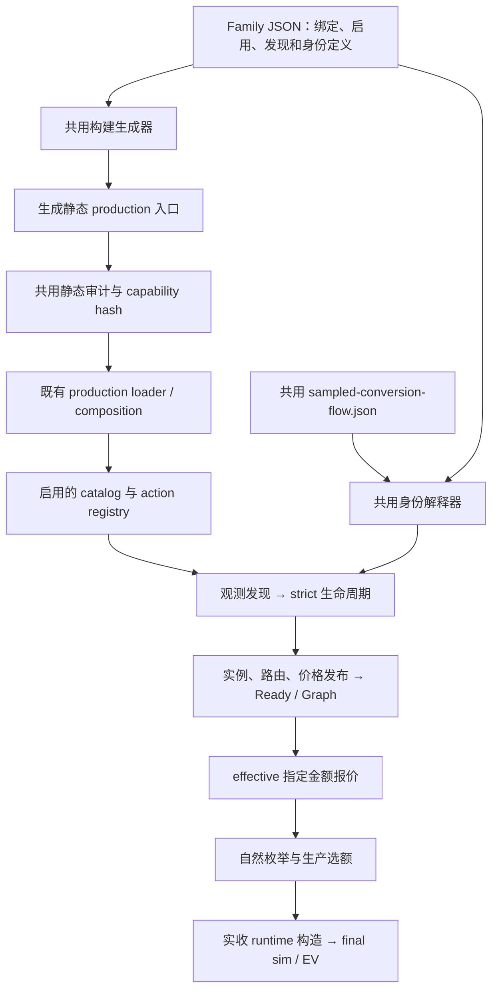

# Adapter Family Plugin：共用流程、Family JSON 与统一生产接入

本文描述 ERC4626 试点的实际实现。源码位于云端 `mev-impl-c4d-20261002` 的 `/opt/mev-cloud/family-runtime-20261007`，沿用当前工作区。相对路径均以该工作区的 `listener/src/searcher/` 为起点。

**维护入口是 Family JSON；生产入口由共用生成器产生，再由既有共用加载器加载。** ERC4626 不再手工维护独立的生产装配代码。生成后的 `.production.ts` 仍存在，是构建产物，供静态导入、直根审计和生产部署使用。

本次覆盖 ERC4626 的生产槽声明、标准 discovery 和标准 identity。Custodian、InfiniFi 的既有独立语义保留；pricing、Exact、execution、action 等仍引用各自实现。这里没有声称所有协议数学与执行程序已经被改成 JSON。以后适合共用流程的定义直接复用；不同数学或特殊结算仍由独立语义模块提供。

## 1. 中央管线怎样接起来



有两种不同的共用入口，职责不能混淆：

| 层 | 实际文件 | 职责 |
|---|---|---|
| 构建装配 | `build-declarative-production.ts` | 扫描有 `production` 声明的 `<name>-family/<name>.json`；检查 domain、槽、路径和模块；生成直接具名导入与 domain constructor |
| 指纹与产物 | `build-family-capability-manifest.ts` | 先生成或核对 JSON 对应入口，再沿既有 AST 直根规则生成静态目录和能力指纹 |
| 生产加载 | `venues/production-families/loader.ts`、`venues/production-family-composition.ts` | 加载已生成静态目录，执行原合同、启用、action 所有权和 catalog 校验 |
| 定义展开 | `venues/declarative-definition.ts` | 把 Family 的 ABI、参数填入共用流程；无动态代码求值、网络或准入权 |
| 发现 | `venues/declarative-discovery.ts` | 从定义生成 call/log/surface 模式；匹配只是候选提名 |
| 身份 | `venues/declarative-identity.ts` | 执行受限声明表达式，形成 requirements、请求、decode、阶段推进与 decide；传输和最终准入仍由中央掌握 |
| strict 生命周期 | `strict-family-lifecycle-runner.ts`、`strict-central-adapter-runtime.ts` | 调度请求，固定 source/actor，核对证据，发行可发布的实例与路由能力 |
| 报价与执行 | `strict-production-runtime-session.ts`、`venues/adapter-family-runtime.ts` | 按已验证路由调用 Family Exact/quoted/runtime，保留 issuer、source、金额和结算安全门 |

swap、protocol、credit 等既有模板继续保留，当前生成器复用原 `define*Family` 构造器。中央不增加 ERC4626 名称分支，不判断某个协议 selector，不承接协议数学。

## 2. 文件一：共用身份流程 JSON

**真实文件：`venues/sampled-conversion-flow.json`**

这是可复用的流程定义：先读基础身份与采样视图，再按证据进入相应阶段，最后用行为证据判断方向是否成立。第一次与后续 call 的顺序、结果依赖、解码和决策在此文件；具体 ABI、函数名、事件字段和参数来自 Family 定义。

这是当前已实现的 `sampled-conversion-v1` 流程，不代表任意协议都适用。下面按一个文件一个代码块展示原文件完整内容。

<details>
<summary>展开共用流程 JSON（完整文件）</summary>

```json
{
  "version": 1,
  "abi": {"parameter": "abi"},
  "constants": {"parameter": "parameters.constants"},
  "expressions": {
    "sampleTolerance": {
      "op": "add",
      "args": [
        {"op": "div", "args": ["$amount", {"op": "uint", "args": ["$constants.sampleToleranceDivisor"]}]},
        {"op": "uint", "args": ["$constants.sampleToleranceAddend"]}
      ]
    },
    "invalidBase": {
      "phase": "base",
      "vault": {"op": "address", "args": ["$candidate.vault"]},
      "vaultCodeHash": {"op": "codeHash", "args": ["$code"]},
      "asset": "$constants.zero",
      "assetCodeHash": {"op": "hash", "args": [{"asset": "$constants.zero"}]},
      "totalAssets": {"op": "uint", "args": ["0"]},
      "totalSupply": {"op": "uint", "args": ["0"]},
      "sampleAssets": {"op": "uint", "args": ["0"]},
      "sampleShares": {"op": "uint", "args": ["0"]},
      "previewDeposit": {"op": "uint", "args": ["0"]},
      "previewRedeem": {"op": "uint", "args": ["0"]},
      "baseValid": false,
      "evidenceRequestIds": "$ids"
    },
    "depositProof": {
      "op": "and",
      "args": [
        "$deposit.ok",
        {"op": "eq", "args": ["$deposit.completion", "returned"]},
        {"op": "gte", "args": ["$eventAssets", {"op": "uint", "args": ["0"]}]},
        {"op": "lte", "args": ["$eventAssets", "$base.sampleAssets"]},
        {
          "op": "lte",
          "args": ["$roundTrip", {"op": "add", "args": ["$base.sampleAssets", {"op": "expression", "args": ["sampleTolerance", {"amount": "$base.sampleAssets"}]}]}]
        },
        {
          "op": "eq",
          "args": [{"op": "coalesce", "args": ["$depositValue", {"op": "decode", "args": ["vault", "{{calls.forward}}", "$deposit.data", 0]}]}, "$base.previewDeposit"]
        },
        {
          "op": "tokenDelta",
          "args": [
            {
              "result": "$deposit",
              "token": "$base.asset",
              "account": {"op": "address", "args": ["$constants.actor"]},
              "direction": "decrease",
              "amount": "$base.sampleAssets"
            }
          ]
        },
        {
          "op": "tokenDelta",
          "args": [
            {
              "result": "$deposit",
              "token": "$base.vault",
              "account": {"op": "address", "args": ["$constants.actor"]},
              "direction": "increase",
              "amount": "$base.previewDeposit"
            }
          ]
        },
        {"op": "supplyDelta", "args": [{"result": "$deposit", "token": "$base.vault", "direction": "increase", "amount": "$base.previewDeposit"}]},
        {
          "op": "event",
          "args": [
            {
              "abi": "vault",
              "result": "$deposit",
              "address": "$base.vault",
              "name": "{{events.forward}}",
              "fields": {"{{events.assetField}}": "$eventAssets", "{{events.shareField}}": "$base.previewDeposit"}
            }
          ]
        }
      ]
    },
    "redeemProof": {
      "op": "and",
      "args": [
        {"op": "gt", "args": ["$base.sampleShares", {"op": "uint", "args": ["0"]}]},
        "$redeem.ok",
        {"op": "eq", "args": ["$redeem.completion", "returned"]},
        {"op": "gt", "args": ["$previewRedeem", {"op": "uint", "args": ["0"]}]},
        {"op": "eq", "args": [{"op": "decode", "args": ["vault", "{{calls.reverse}}", "$redeem.data", 0]}, "$previewRedeem"]},
        {
          "op": "tokenDelta",
          "args": [
            {
              "result": "$redeem",
              "token": "$base.vault",
              "account": {"op": "address", "args": ["$constants.actor"]},
              "direction": "decrease",
              "amount": "$base.sampleShares"
            }
          ]
        },
        {
          "op": "tokenDelta",
          "args": [
            {
              "result": "$redeem",
              "token": "$base.asset",
              "account": {"op": "address", "args": ["$constants.actor"]},
              "direction": "increase",
              "amount": "$previewRedeem"
            }
          ]
        },
        {"op": "supplyDelta", "args": [{"result": "$redeem", "token": "$base.vault", "direction": "decrease", "amount": "$base.sampleShares"}]},
        {
          "op": "event",
          "args": [
            {
              "abi": "vault",
              "result": "$redeem",
              "address": "$base.vault",
              "name": "{{events.reverse}}",
              "fields": {"{{events.assetField}}": "$previewRedeem", "{{events.shareField}}": "$base.sampleShares"}
            }
          ]
        }
      ]
    },
    "eventAssets": {"op": "if", "args": ["$profile.hasEventMath", {"op": "math", "args": ["depositEventAssets", "$base.sampleAssets"]}, "$base.sampleAssets"]},
    "effectsEvidence": {
      "op": "map",
      "args": [
        {"op": "filter", "args": ["$results", "r", "$r.ok"]},
        "r",
        {"id": "$r.id", "completion": "$r.completion", "effects": {"op": "effects", "args": ["$r.effects"]}}
      ]
    },
    "activeRequests": {
      "op": "if",
      "args": [
        "$base.baseValid",
        {
          "op": "concat",
          "args": [
            [
              {"id": "active-asset-code", "kind": "get-code", "address": {"op": "address", "args": ["$base.asset"]}},
              {
                "id": "active-asset-balance",
                "kind": "eth-call",
                "to": {"op": "address", "args": ["$base.asset"]},
                "data": {"op": "encode", "args": ["token", "{{calls.balance}}", [{"op": "address", "args": ["$constants.actor"]}]]},
                "completion": "return-or-revert-data",
                "required": false
              },
              {
                "id": "active-share-balance",
                "kind": "eth-call",
                "to": {"op": "address", "args": ["$base.vault"]},
                "data": {"op": "encode", "args": ["token", "{{calls.balance}}", [{"op": "address", "args": ["$constants.actor"]}]]},
                "completion": "return-or-revert-data",
                "required": false
              },
              {
                "id": "active-roundtrip",
                "kind": "eth-call",
                "to": {"op": "address", "args": ["$base.vault"]},
                "data": {"op": "encode", "args": ["vault", "{{calls.previewReverse}}", ["$base.previewDeposit"]]},
                "completion": "return-data"
              },
              {
                "id": "active-deposit",
                "required": false,
                "kind": "effect-delta-simulation",
                "call": {
                  "caller": "$constants.caller",
                  "to": {"op": "address", "args": ["$base.vault"]},
                  "data": {"op": "encode", "args": ["vault", "{{calls.forward}}", {"parameter": "parameters.execution.forwardArgs"}]}
                },
                "overrideIntent": {"caller": "$constants.caller", "tokenBalances": [{"token": "$base.asset", "amount": "$base.sampleAssets"}]},
                "observeTokenBalances": [{"token": "$base.asset", "account": "$constants.caller"}, {"token": "$base.vault", "account": "$constants.caller"}],
                "observe": ["return-data", "revert-data", "token-delta", "total-supply-delta", "logs"],
                "preCalls": [
                  {
                    "caller": "$constants.caller",
                    "to": {"op": "address", "args": ["$base.asset"]},
                    "data": {"op": "encode", "args": ["token", "{{calls.approval}}", ["$base.vault", "$base.sampleAssets"]]}
                  }
                ]
              }
            ],
            {
              "op": "if",
              "args": [
                {"op": "gt", "args": ["$base.sampleShares", {"op": "uint", "args": ["0"]}]},
                [
                  {
                    "id": "active-preview-redeem",
                    "kind": "eth-call",
                    "to": {"op": "address", "args": ["$base.vault"]},
                    "data": {"op": "encode", "args": ["vault", "{{calls.previewReverse}}", ["$base.sampleShares"]]},
                    "completion": "return-data"
                  },
                  {
                    "id": "active-redeem",
                    "required": false,
                    "kind": "effect-delta-simulation",
                    "call": {
                      "caller": "$constants.caller",
                      "to": {"op": "address", "args": ["$base.vault"]},
                      "data": {"op": "encode", "args": ["vault", "{{calls.reverse}}", {"parameter": "parameters.execution.reverseArgs"}]}
                    },
                    "overrideIntent": {"caller": "$constants.caller", "tokenBalances": [{"token": "$base.vault", "amount": "$base.sampleShares"}]},
                    "observeTokenBalances": [{"token": "$base.asset", "account": "$constants.caller"}, {"token": "$base.vault", "account": "$constants.caller"}],
                    "observe": ["return-data", "revert-data", "token-delta", "total-supply-delta", "logs"]
                  }
                ],
                []
              ]
            }
          ]
        },
        []
      ]
    }
  },
  "identity": {
    "select": [
      {"return": "base", "when": {"op": "not", "args": [{"op": "defined", "args": ["$evidence"]}]}},
      {
        "assert": {"op": "or", "args": [{"op": "eq", "args": ["$evidence.phase", "base"]}, {"op": "eq", "args": ["$evidence.phase", "active"]}]},
        "error": "{{errors.erc4626_identity_phase}}"
      },
      {
        "assert": {
          "op": "lte",
          "args": [
            {
              "op": "length",
              "args": [
                {
                  "op": "filter",
                  "args": [
                    ["$evidence.{{fields.getterCheck}}", "$evidence.{{fields.maskedCheck}}", "$evidence.depositRetry"],
                    "item",
                    {"op": "defined", "args": ["$item"]}
                  ]
                }
              ]
            },
            1
          ]
        },
        "error": "{{errors.erc4626_conflicting_identity_stages}}"
      },
      {
        "assert": {
          "op": "or",
          "args": [{"op": "not", "args": [{"op": "defined", "args": ["$evidence.depositRetry"]}]}, {"op": "eq", "args": ["$evidence.phase", "active"]}]
        },
        "error": "{{errors.erc4626_retry_phase}}"
      },
      {"return": "deposit-retry", "when": {"op": "defined", "args": ["$evidence.depositRetry"]}},
      {
        "assert": {
          "op": "not",
          "args": [
            {
              "op": "and",
              "args": [
                {"op": "defined", "args": ["$evidence.{{fields.getterCheck}}"]},
                {"op": "not", "args": [{"op": "defined", "args": ["$evidence.{{fields.getterCheck}}.implementation"]}]},
                "$evidence.{{fields.getterCheck}}.implementationMatched"
              ]
            }
          ]
        },
        "error": "{{errors.erc4626_implementation_stage}}"
      },
      {
        "return": {
          "op": "if",
          "args": [
            {"op": "not", "args": [{"op": "defined", "args": ["$evidence.{{fields.getterCheck}}.implementation"]}]},
            "getter-slot",
            {"op": "if", "args": ["$evidence.{{fields.getterCheck}}.implementationMatched", "getter-binding", "getter-code"]}
          ]
        },
        "when": {"op": "defined", "args": ["$evidence.{{fields.getterCheck}}"]}
      },
      {
        "assert": {
          "op": "or",
          "args": [
            {"op": "not", "args": [{"op": "defined", "args": ["$evidence.{{fields.maskedCheck}}"]}]},
            {"op": "eq", "args": ["$evidence.{{fields.maskedCheck}}", "slot"]},
            {"op": "eq", "args": ["$evidence.{{fields.maskedCheck}}", "code"]}
          ]
        },
        "error": "{{errors.erc4626_custodian_stage}}"
      },
      {
        "return": {"op": "join", "args": [["masked", "$evidence.{{fields.maskedCheck}}"], "-"]},
        "when": {"op": "defined", "args": ["$evidence.{{fields.maskedCheck}}"]}
      },
      {"return": "active"}
    ],
    "stages": {
      "base": {
        "requirements": {"transports": ["get-code", "eth-call"]},
        "requests": {
          "op": "concat",
          "args": [
            [
              {"id": "base-vault-code", "kind": "get-code", "address": {"op": "address", "args": ["$candidate.vault"]}},
              {
                "id": "base-asset",
                "kind": "eth-call",
                "to": {"op": "address", "args": ["$candidate.vault"]},
                "data": {"op": "encode", "args": ["vault", "{{calls.inputAsset}}", []]},
                "completion": "return-data"
              },
              {
                "id": "base-total-assets",
                "kind": "eth-call",
                "to": {"op": "address", "args": ["$candidate.vault"]},
                "data": {"op": "encode", "args": ["vault", "{{calls.assetSupply}}", []]},
                "completion": "return-data"
              },
              {
                "id": "base-total-supply",
                "kind": "eth-call",
                "to": {"op": "address", "args": ["$candidate.vault"]},
                "data": {"op": "encode", "args": ["vault", "{{calls.shareSupply}}", []]},
                "completion": "return-data"
              }
            ],
            {
              "op": "flatMap",
              "args": [
                "$constants.samples",
                "sampleAmount",
                [
                  {
                    "id": {"op": "join", "args": [["base-convert-shares", {"op": "string", "args": ["$index"]}], ":"]},
                    "kind": "eth-call",
                    "to": {"op": "address", "args": ["$candidate.vault"]},
                    "data": {"op": "encode", "args": ["vault", "{{calls.toShares}}", [{"op": "uint", "args": ["$sampleAmount"]}]]},
                    "completion": "return-data"
                  },
                  {
                    "id": {"op": "join", "args": [["base-preview-deposit", {"op": "string", "args": ["$index"]}], ":"]},
                    "kind": "eth-call",
                    "to": {"op": "address", "args": ["$candidate.vault"]},
                    "data": {"op": "encode", "args": ["vault", "{{calls.previewForward}}", [{"op": "uint", "args": ["$sampleAmount"]}]]},
                    "completion": "return-data"
                  },
                  {
                    "id": {"op": "join", "args": [["base-convert-assets", {"op": "string", "args": ["$index"]}], ":"]},
                    "kind": "eth-call",
                    "to": {"op": "address", "args": ["$candidate.vault"]},
                    "data": {"op": "encode", "args": ["vault", "{{calls.toAssets}}", [{"op": "uint", "args": ["$sampleAmount"]}]]},
                    "completion": "return-data"
                  },
                  {
                    "id": {"op": "join", "args": [["base-preview-redeem", {"op": "string", "args": ["$index"]}], ":"]},
                    "kind": "eth-call",
                    "to": {"op": "address", "args": ["$candidate.vault"]},
                    "data": {"op": "encode", "args": ["vault", "{{calls.previewReverse}}", [{"op": "uint", "args": ["$sampleAmount"]}]]},
                    "completion": "return-data"
                  }
                ]
              ]
            }
          ]
        },
        "decode": [
          {"let": "source", "value": {"op": "source", "args": [{"op": "filter", "args": ["$results", "r", "$r.ok"]}]}},
          {"let": "code", "value": {"op": "code", "args": ["base-vault-code"]}},
          {
            "return": {"op": "expression", "args": ["invalidBase", {"ids": ["base-asset", "base-total-assets", "base-total-supply"]}]},
            "when": {"op": "ne", "args": [{"op": "shape", "args": ["base-asset"]}, "returned"]}
          },
          {
            "let": "asset",
            "value": {
              "op": "address",
              "args": [{"op": "decode", "args": ["vault", "{{calls.inputAsset}}", {"op": "get", "args": [{"op": "returned", "args": ["base-asset"]}, "data"]}, 0]}]
            }
          },
          {
            "return": {"op": "expression", "args": ["invalidBase", {"ids": ["base-asset"]}]},
            "when": {"op": "or", "args": [{"op": "sameAddress", "args": ["$asset", "$constants.zero"]}, {"op": "sameAddress", "args": ["$asset", "$candidate.vault"]}]}
          },
          {
            "return": {"op": "expression", "args": ["invalidBase", {"ids": ["base-total-assets", "base-total-supply"]}]},
            "when": {
              "op": "or",
              "args": [
                {"op": "ne", "args": [{"op": "shape", "args": ["base-total-assets"]}, "returned"]},
                {"op": "ne", "args": [{"op": "shape", "args": ["base-total-supply"]}, "returned"]}
              ]
            }
          },
          {
            "let": "totalAssets",
            "value": {"op": "decode", "args": ["vault", "{{calls.assetSupply}}", {"op": "get", "args": [{"op": "returned", "args": ["base-total-assets"]}, "data"]}, 0]}
          },
          {
            "let": "totalSupply",
            "value": {"op": "decode", "args": ["vault", "{{calls.shareSupply}}", {"op": "get", "args": [{"op": "returned", "args": ["base-total-supply"]}, "data"]}, 0]}
          },
          {
            "let": "samples",
            "value": {
              "op": "filter",
              "args": [
                {
                  "op": "map",
                  "args": [
                    "$constants.samples",
                    "sampleAmount",
                    {
                      "op": "if",
                      "args": [
                        {
                          "op": "and",
                          "args": [
                            {
                              "op": "eq",
                              "args": [
                                {"op": "shape", "args": [{"op": "join", "args": [["base-convert-shares", {"op": "string", "args": ["$index"]}], ":"]}]},
                                "returned"
                              ]
                            },
                            {
                              "op": "eq",
                              "args": [
                                {"op": "shape", "args": [{"op": "join", "args": [["base-preview-deposit", {"op": "string", "args": ["$index"]}], ":"]}]},
                                "returned"
                              ]
                            },
                            {
                              "op": "eq",
                              "args": [
                                {"op": "shape", "args": [{"op": "join", "args": [["base-convert-assets", {"op": "string", "args": ["$index"]}], ":"]}]},
                                "returned"
                              ]
                            },
                            {
                              "op": "eq",
                              "args": [
                                {"op": "shape", "args": [{"op": "join", "args": [["base-preview-redeem", {"op": "string", "args": ["$index"]}], ":"]}]},
                                "returned"
                              ]
                            }
                          ]
                        },
                        {
                          "amount": {"op": "uint", "args": ["$sampleAmount"]},
                          "shares": {
                            "op": "decode",
                            "args": [
                              "vault",
                              "{{calls.toShares}}",
                              {
                                "op": "get",
                                "args": [
                                  {"op": "returned", "args": [{"op": "join", "args": [["base-convert-shares", {"op": "string", "args": ["$index"]}], ":"]}]},
                                  "data"
                                ]
                              },
                              0
                            ]
                          },
                          "previewDeposit": {
                            "op": "decode",
                            "args": [
                              "vault",
                              "{{calls.previewForward}}",
                              {
                                "op": "get",
                                "args": [
                                  {"op": "returned", "args": [{"op": "join", "args": [["base-preview-deposit", {"op": "string", "args": ["$index"]}], ":"]}]},
                                  "data"
                                ]
                              },
                              0
                            ]
                          },
                          "assets": {
                            "op": "decode",
                            "args": [
                              "vault",
                              "{{calls.toAssets}}",
                              {
                                "op": "get",
                                "args": [
                                  {"op": "returned", "args": [{"op": "join", "args": [["base-convert-assets", {"op": "string", "args": ["$index"]}], ":"]}]},
                                  "data"
                                ]
                              },
                              0
                            ]
                          },
                          "previewRedeem": {
                            "op": "decode",
                            "args": [
                              "vault",
                              "{{calls.previewReverse}}",
                              {
                                "op": "get",
                                "args": [
                                  {"op": "returned", "args": [{"op": "join", "args": [["base-preview-redeem", {"op": "string", "args": ["$index"]}], ":"]}]},
                                  "data"
                                ]
                              },
                              0
                            ]
                          }
                        },
                        null
                      ]
                    }
                  ]
                },
                "s",
                {"op": "defined", "args": ["$s"]}
              ]
            }
          },
          {
            "let": "depositSamples",
            "value": {
              "op": "filter",
              "args": [
                "$samples",
                "s",
                {
                  "op": "and",
                  "args": [
                    {"op": "gt", "args": ["$s.shares", {"op": "uint", "args": ["0"]}]},
                    {"op": "gt", "args": ["$s.previewDeposit", {"op": "uint", "args": ["0"]}]},
                    {
                      "op": "lte",
                      "args": ["$s.previewDeposit", {"op": "add", "args": ["$s.shares", {"op": "expression", "args": ["sampleTolerance", {"amount": "$s.shares"}]}]}]
                    }
                  ]
                }
              ]
            }
          },
          {
            "let": "redeemSamples",
            "value": {
              "op": "filter",
              "args": [
                "$samples",
                "s",
                {
                  "op": "and",
                  "args": [
                    {"op": "gt", "args": ["$s.assets", {"op": "uint", "args": ["0"]}]},
                    {"op": "gt", "args": ["$s.previewRedeem", {"op": "uint", "args": ["0"]}]},
                    {
                      "op": "lte",
                      "args": ["$s.previewRedeem", {"op": "add", "args": ["$s.assets", {"op": "expression", "args": ["sampleTolerance", {"amount": "$s.assets"}]}]}]
                    }
                  ]
                }
              ]
            }
          },
          {"let": "d", "value": {"op": "at", "args": ["$depositSamples", 0]}},
          {"let": "r", "value": {"op": "at", "args": ["$redeemSamples", 0]}},
          {"let": "alternate", "value": {"op": "at", "args": ["$depositSamples", 1]}},
          {"let": "assetCode", "value": {"op": "result", "args": ["base-asset-code"]}},
          {
            "let": "base",
            "value": {
              "phase": "base",
              "vault": {"op": "address", "args": ["$candidate.vault"]},
              "vaultCodeHash": {"op": "codeHash", "args": ["$code"]},
              "asset": "$asset",
              "assetCodeHash": {
                "op": "if",
                "args": [
                  {"op": "and", "args": ["$assetCode.ok", {"op": "eq", "args": ["$assetCode.completion", "returned"]}]},
                  {"op": "codeHash", "args": ["$assetCode.data"]},
                  {"op": "hash", "args": [{"asset": "$asset"}]}
                ]
              },
              "totalAssets": "$totalAssets",
              "totalSupply": "$totalSupply",
              "sampleAssets": {"op": "coalesce", "args": ["$d.amount", {"op": "uint", "args": ["0"]}]},
              "sampleShares": {
                "op": "if",
                "args": [
                  {"op": "gt", "args": ["$totalSupply", {"op": "uint", "args": ["1"]}]},
                  {
                    "op": "min",
                    "args": [
                      {"op": "coalesce", "args": ["$r.amount", {"op": "div", "args": ["$totalSupply", {"op": "uint", "args": ["2"]}]}]},
                      {"op": "div", "args": ["$totalSupply", {"op": "uint", "args": ["2"]}]}
                    ]
                  },
                  {"op": "uint", "args": ["0"]}
                ]
              },
              "previewDeposit": {"op": "coalesce", "args": ["$d.previewDeposit", {"op": "uint", "args": ["0"]}]},
              "previewRedeem": {"op": "coalesce", "args": ["$r.previewRedeem", {"op": "uint", "args": ["0"]}]},
              "alternateDepositSample": {
                "op": "if",
                "args": [{"op": "defined", "args": ["$alternate"]}, {"amount": "$alternate.amount", "preview": "$alternate.previewDeposit"}, "$missing"]
              },
              "baseValid": {"op": "and", "args": [{"op": "defined", "args": ["$d"]}, {"op": "defined", "args": ["$r"]}]}
            }
          },
          {
            "return": "$base",
            "when": {"op": "or", "args": [{"op": "not", "args": ["$base.baseValid"]}, {"op": "eq", "args": ["$profile.excludeSpecialized", false]}]}
          },
          {
            "return": {"op": "merge", "args": ["$base", {"{{fields.getterCheck}}": {"source": "$source", "proxyCodeHash": "$base.vaultCodeHash"}}]},
            "when": {"op": "eq", "args": [{"op": "codeHash", "args": ["$code"]}, {"op": "codeHash", "args": ["$constants.getterProxyCode"]}]}
          },
          {
            "return": {"op": "merge", "args": ["$base", {"{{fields.maskedCheck}}": "slot", "{{fields.maskedSource}}": "$source"}]},
            "when": {
              "op": "and",
              "args": [
                {"op": "matches", "args": ["$code", "$constants.maskedCodePattern"]},
                {
                  "op": "matches",
                  "args": [{"op": "bytes", "args": ["$code", "$constants.maskedAdminOffset", "$constants.maskedAdminSize"]}, "^0x0{24}[a-fA-F0-9]{40}$"]
                },
                {
                  "op": "ne",
                  "args": [
                    {"op": "bytes", "args": ["$code", "$constants.maskedAdminOffset", "$constants.maskedAdminSize"]},
                    "0x0000000000000000000000000000000000000000000000000000000000000000"
                  ]
                },
                {
                  "op": "every",
                  "args": [
                    "$constants.maskedByteChecks",
                    "check",
                    {"op": "eq", "args": [{"op": "bytes", "args": ["$code", "$check.offset", "$check.size"]}, "$check.value"]}
                  ]
                },
                {
                  "op": "eq",
                  "args": [{"op": "maskHash", "args": ["$code", [["$constants.maskedAdminOffset", "$constants.maskedAdminSize"]]]}, "$constants.maskedTemplateHash"]
                }
              ]
            }
          },
          {"return": "$base"}
        ]
      },
      "active": {
        "requirements": {
          "transports": ["get-code", "eth-call", "effect-delta-simulation"],
          "caller": "verified-actor",
          "effects": ["return-data", "revert-data", "token-delta", "total-supply-delta", "logs"]
        },
        "optionalFailures": ["active-asset-balance", "active-share-balance", "active-deposit", "active-redeem", "fallback-deposit", "fallback-roundtrip"],
        "requests": {"op": "expression", "args": ["activeRequests", {"base": "$evidence"}]},
        "decode": [
          {"let": "depositValue", "value": "$missing"},
          {"let": "source", "value": {"op": "source", "args": [{"op": "filter", "args": ["$results", "r", "$r.ok"]}]}},
          {"let": "base", "value": "$evidence"},
          {"let": "assetCode", "value": {"op": "code", "args": ["active-asset-code"]}},
          {
            "let": "balanceSurfaces",
            "value": [{"op": "wordSurface", "args": ["active-asset-balance"]}, {"op": "wordSurface", "args": ["active-share-balance"]}]
          },
          {"let": "erc20SurfacesValid", "value": {"op": "every", "args": ["$balanceSurfaces", "s", {"op": "eq", "args": ["$s.status", "valid"]}]}},
          {
            "let": "unresolvedSurface",
            "value": {"op": "at", "args": [{"op": "filter", "args": ["$balanceSurfaces", "s", {"op": "eq", "args": ["$s.status", "unresolved"]}]}, 0]}
          },
          {
            "evaluate": {"op": "requestFailure", "args": ["$unresolvedSurface.result"]},
            "when": {
              "op": "and",
              "args": [
                {"op": "not", "args": [{"op": "some", "args": ["$balanceSurfaces", "s", {"op": "eq", "args": ["$s.status", "invalid"]}]}]},
                {"op": "defined", "args": ["$unresolvedSurface"]}
              ]
            }
          },
          {
            "let": "roundTrip",
            "value": {
              "op": "decode",
              "args": ["vault", "{{calls.previewReverse}}", {"op": "get", "args": [{"op": "returned", "args": ["active-roundtrip"]}, "data"]}, 0]
            }
          },
          {"let": "deposit", "value": {"op": "result", "args": ["active-deposit"]}},
          {"assert": {"op": "defined", "args": ["$deposit"]}, "error": "{{errors.ERC4626_active_deposit_result_is_missing}}"},
          {"let": "eventAssets", "value": {"op": "expression", "args": ["eventAssets", {}]}},
          {"let": "depositVerified", "value": {"op": "expression", "args": ["depositProof", {}]}},
          {"let": "redeem", "value": {"op": "result", "args": ["active-redeem"]}},
          {
            "let": "previewRedeem",
            "value": {
              "op": "if",
              "args": [
                {"op": "and", "args": [{"op": "gt", "args": ["$base.sampleShares", {"op": "uint", "args": ["0"]}]}, "$redeem.ok"]},
                {
                  "op": "decode",
                  "args": ["vault", "{{calls.previewReverse}}", {"op": "get", "args": [{"op": "returned", "args": ["active-preview-redeem"]}, "data"]}, 0]
                },
                {"op": "uint", "args": ["0"]}
              ]
            }
          },
          {"let": "redeemVerified", "value": {"op": "expression", "args": ["redeemProof", {}]}},
          {
            "let": "unresolvedDirections",
            "value": {
              "op": "sortId",
              "args": [
                {
                  "op": "filter",
                  "args": [["$deposit", "$redeem"], "r", {"op": "and", "args": [{"op": "defined", "args": ["$r"]}, {"op": "not", "args": ["$r.ok"]}]}]
                }
              ]
            }
          },
          {
            "let": "depositRetry",
            "value": {
              "op": "if",
              "args": [
                {
                  "op": "and",
                  "args": [
                    "$erc20SurfacesValid",
                    "$deposit.ok",
                    {"op": "eq", "args": ["$deposit.completion", "reverted-as-declared"]},
                    {"op": "defined", "args": ["$base.alternateDepositSample"]}
                  ]
                },
                {"op": "merge", "args": ["$base.alternateDepositSample", {"source": "$source"}]},
                "$missing"
              ]
            }
          },
          {
            "evaluate": {"op": "requestFailure", "args": [{"op": "at", "args": ["$unresolvedDirections", 0]}]},
            "when": {
              "op": "and",
              "args": [
                "$erc20SurfacesValid",
                {"op": "not", "args": ["$depositVerified"]},
                {"op": "not", "args": ["$redeemVerified"]},
                {"op": "gt", "args": [{"op": "length", "args": ["$unresolvedDirections"]}, 0]}
              ]
            }
          },
          {
            "return": {
              "op": "merge",
              "args": [
                "$base",
                {
                  "phase": "active",
                  "assetCodeHash": {"op": "codeHash", "args": ["$assetCode"]},
                  "erc20SurfacesValid": "$erc20SurfacesValid",
                  "depositVerified": "$depositVerified",
                  "redeemVerified": "$redeemVerified",
                  "depositRetry": "$depositRetry",
                  "behaviorProofHash": {
                    "op": "hash",
                    "args": [
                      {
                        "vault": "$base.vault",
                        "asset": "$base.asset",
                        "roundTrip": "$roundTrip",
                        "depositEventAssets": {"op": "if", "args": ["$profile.hasEventMath", "$eventAssets", "$missing"]},
                        "erc20SurfacesValid": "$erc20SurfacesValid",
                        "depositVerified": "$depositVerified",
                        "redeemVerified": "$redeemVerified",
                        "directionOutcomes": {
                          "op": "map",
                          "args": [
                            {
                              "op": "filter",
                              "args": [
                                "$results",
                                "r",
                                {"op": "or", "args": [{"op": "eq", "args": ["$r.id", "active-deposit"]}, {"op": "eq", "args": ["$r.id", "active-redeem"]}]}
                              ]
                            },
                            "r",
                            {
                              "id": "$r.id",
                              "status": {"op": "if", "args": ["$r.ok", "ok", "failure"]},
                              "outcome": {"op": "if", "args": ["$r.ok", "$r.completion", "$r.failure"]}
                            }
                          ]
                        },
                        "resultEffects": {"op": "expression", "args": ["effectsEvidence", {}]}
                      }
                    ]
                  }
                }
              ]
            }
          }
        ]
      },
      "deposit-retry": {
        "requirements": {
          "transports": ["eth-call", "effect-delta-simulation"],
          "caller": "verified-actor",
          "effects": ["return-data", "revert-data", "token-delta", "total-supply-delta", "logs"]
        },
        "optionalFailures": ["active-asset-balance", "active-share-balance", "active-deposit", "active-redeem", "fallback-deposit", "fallback-roundtrip"],
        "requests": {
          "op": "map",
          "args": [
            {
              "op": "filter",
              "args": [
                {
                  "op": "expression",
                  "args": [
                    "activeRequests",
                    {
                      "base": {
                        "op": "merge",
                        "args": ["$evidence", {"phase": "base", "sampleAssets": "$evidence.depositRetry.amount", "previewDeposit": "$evidence.depositRetry.preview"}]
                      }
                    }
                  ]
                },
                "r",
                {"op": "or", "args": [{"op": "eq", "args": ["$r.id", "active-deposit"]}, {"op": "eq", "args": ["$r.id", "active-roundtrip"]}]}
              ]
            },
            "r",
            {
              "op": "merge",
              "args": [
                "$r",
                {"id": {"op": "if", "args": [{"op": "eq", "args": ["$r.id", "active-deposit"]}, "fallback-deposit", "fallback-roundtrip"]}, "required": false},
                {"op": "if", "args": [{"op": "eq", "args": ["$r.kind", "eth-call"]}, {"completion": "return-or-revert-data"}, {}]}
              ]
            }
          ]
        },
        "decode": [
          {"let": "retry", "value": "$evidence.depositRetry"},
          {"assert": {"op": "defined", "args": ["$retry"]}, "error": "{{errors.ERC4626_deposit_retry_evidence_missing}}"},
          {"evaluate": {"op": "map", "args": ["$results", "r", {"op": "assertSource", "args": ["$r.source", "$retry.source"]}]}},
          {"let": "deposit", "value": {"op": "result", "args": ["fallback-deposit"]}},
          {"let": "roundTripResult", "value": {"op": "result", "args": ["fallback-roundtrip"]}},
          {
            "assert": {"op": "and", "args": [{"op": "defined", "args": ["$deposit"]}, {"op": "defined", "args": ["$roundTripResult"]}]},
            "error": "{{errors.ERC4626_deposit_retry_result_missing}}"
          },
          {
            "let": "base",
            "value": {
              "op": "merge",
              "args": [
                {"op": "omit", "args": ["$evidence", ["depositRetry", "alternateDepositSample"]]},
                {"sampleAssets": "$retry.amount", "previewDeposit": "$retry.preview"}
              ]
            }
          },
          {"let": "eventAssets", "value": {"op": "expression", "args": ["eventAssets", {}]}},
          {
            "try": [
              {
                "let": "roundTrip",
                "value": {
                  "op": "decode",
                  "args": ["vault", "{{calls.previewReverse}}", {"op": "get", "args": [{"op": "returned", "args": ["fallback-roundtrip"]}, "data"]}, 0]
                },
                "when": {"op": "and", "args": ["$roundTripResult.ok", {"op": "eq", "args": ["$roundTripResult.completion", "returned"]}]}
              },
              {
                "let": "depositValue",
                "value": {"op": "decode", "args": ["vault", "{{calls.forward}}", "$deposit.data", 0]},
                "when": {"op": "and", "args": ["$deposit.ok", {"op": "eq", "args": ["$deposit.completion", "returned"]}]}
              }
            ],
            "recoverWhen": "$evidence.redeemVerified"
          },
          {
            "let": "depositVerified",
            "value": {
              "op": "and",
              "args": [{"op": "defined", "args": ["$roundTrip"]}, {"op": "defined", "args": ["$depositValue"]}, {"op": "expression", "args": ["depositProof", {}]}]
            }
          },
          {"let": "unresolved", "value": {"op": "at", "args": [{"op": "filter", "args": ["$results", "r", {"op": "not", "args": ["$r.ok"]}]}, 0]}},
          {
            "evaluate": {"op": "requestFailure", "args": ["$unresolved"]},
            "when": {
              "op": "and",
              "args": [{"op": "not", "args": ["$depositVerified"]}, {"op": "not", "args": ["$evidence.redeemVerified"]}, {"op": "defined", "args": ["$unresolved"]}]
            }
          },
          {
            "return": {
              "op": "merge",
              "args": [
                "$base",
                {
                  "depositVerified": "$depositVerified",
                  "depositRetryCompleted": true,
                  "behaviorProofHash": {
                    "op": "hash",
                    "args": [
                      {
                        "previous": "$evidence.behaviorProofHash",
                        "sample": {"amount": "$retry.amount", "preview": "$retry.preview", "source": "$retry.source"},
                        "depositEventAssets": {"op": "if", "args": ["$profile.hasEventMath", "$eventAssets", "$missing"]},
                        "results": {
                          "op": "map",
                          "args": [
                            "$results",
                            "r",
                            {
                              "id": "$r.id",
                              "completion": {"op": "if", "args": ["$r.ok", "$r.completion", null]},
                              "data": {"op": "if", "args": ["$r.ok", "$r.data", null]},
                              "effects": {"op": "if", "args": ["$r.ok", {"op": "effects", "args": ["$r.effects"]}, null]},
                              "failure": {"op": "if", "args": ["$r.ok", null, "$r.failure"]}
                            }
                          ]
                        }
                      }
                    ]
                  }
                }
              ]
            }
          }
        ]
      },
      "getter-slot": {
        "requirements": {"transports": ["get-storage"]},
        "requests": [{"id": "{{requestPrefixes.getter}}-implementation", "kind": "get-storage", "address": "$candidate.vault", "slot": "$constants.implementationSlot"}],
        "decode": [
          {
            "evaluate": {
              "op": "assertSource",
              "args": [{"op": "source", "args": [{"op": "filter", "args": ["$results", "r", "$r.ok"]}]}, "$evidence.{{fields.getterCheck}}.source"]
            }
          },
          {
            "return": {
              "op": "merge",
              "args": [
                "$evidence",
                {
                  "{{fields.getterCheck}}": {
                    "op": "merge",
                    "args": [
                      "$evidence.{{fields.getterCheck}}",
                      {
                        "implementation": {
                          "op": "addressWord",
                          "args": [
                            {"op": "get", "args": [{"op": "returned", "args": ["{{requestPrefixes.getter}}-implementation"]}, "data"]},
                            {"malformed": "{{errors.StakedUSDat_malformed_address_word}}", "zero": "{{errors.StakedUSDat_zero_binding}}"}
                          ]
                        }
                      }
                    ]
                  }
                }
              ]
            }
          }
        ]
      },
      "masked-slot": {
        "requirements": {"transports": ["get-storage"]},
        "requests": [{"id": "standard-implementation", "kind": "get-storage", "address": "$candidate.vault", "slot": "$constants.implementationSlot"}],
        "decode": [
          {
            "evaluate": {
              "op": "assertSource",
              "args": [{"op": "source", "args": [{"op": "filter", "args": ["$results", "r", "$r.ok"]}]}, "$evidence.{{fields.maskedSource}}"]
            }
          },
          {
            "return": {
              "op": "merge",
              "args": [
                "$evidence",
                {
                  "{{fields.maskedCheck}}": "code",
                  "{{fields.maskedImplementation}}": {
                    "op": "addressWord",
                    "args": [
                      {"op": "get", "args": [{"op": "returned", "args": ["standard-implementation"]}, "data"]},
                      {"malformed": "{{errors.Custodian_malformed_implementation_slot}}", "zero": "{{errors.Custodian_zero_binding}}"}
                    ]
                  }
                }
              ]
            }
          }
        ]
      },
      "getter-code": {
        "requirements": {"transports": ["get-code"]},
        "requests": [
          {
            "id": "{{requestPrefixes.getter}}-code",
            "kind": "get-code",
            "address": {"op": "address", "args": ["$evidence.{{fields.getterCheck}}.implementation"]}
          }
        ],
        "decode": [
          {
            "evaluate": {
              "op": "assertSource",
              "args": [{"op": "source", "args": [{"op": "filter", "args": ["$results", "r", "$r.ok"]}]}, "$evidence.{{fields.getterCheck}}.source"]
            }
          },
          {
            "return": {
              "op": "if",
              "args": [
                {
                  "op": "eq",
                  "args": [{"op": "codeHash", "args": [{"op": "code", "args": ["{{requestPrefixes.getter}}-code"]}]}, "$constants.getterImplementationHash"]
                },
                {
                  "op": "merge",
                  "args": ["$evidence", {"{{fields.getterCheck}}": {"op": "merge", "args": ["$evidence.{{fields.getterCheck}}", {"implementationMatched": true}]}}]
                },
                {"op": "omit", "args": ["$evidence", ["{{fields.getterCheck}}"]]}
              ]
            }
          }
        ]
      },
      "masked-code": {
        "requirements": {"transports": ["get-code"]},
        "requests": [{"id": "standard-implementation-code", "kind": "get-code", "address": {"op": "address", "args": ["$evidence.{{fields.maskedImplementation}}"]}}],
        "decode": [
          {
            "evaluate": {
              "op": "assertSource",
              "args": [{"op": "source", "args": [{"op": "filter", "args": ["$results", "r", "$r.ok"]}]}, "$evidence.{{fields.maskedSource}}"]
            }
          },
          {
            "let": "standard",
            "value": {"op": "omit", "args": ["$evidence", ["{{fields.maskedCheck}}", "{{fields.maskedSource}}", "{{fields.maskedImplementation}}"]]}
          },
          {
            "return": {
              "op": "if",
              "args": [
                {
                  "op": "eq",
                  "args": [{"op": "codeHash", "args": [{"op": "code", "args": ["standard-implementation-code"]}]}, "$constants.maskedImplementationHash"]
                },
                {"op": "merge", "args": ["$standard", {"baseValid": false, "evidenceRequestIds": ["standard-implementation-code"]}]},
                "$standard"
              ]
            }
          }
        ]
      },
      "getter-binding": {
        "requirements": {"transports": ["get-code", "eth-call"]},
        "requests": {
          "op": "concat",
          "args": [
            [
              {
                "id": "{{requestPrefixes.getter}}-code",
                "kind": "get-code",
                "address": {"op": "address", "args": ["$evidence.{{fields.getterCheck}}.implementation"]}
              },
              {
                "id": "{{requestPrefixes.getter}}-asset",
                "kind": "eth-call",
                "to": {"op": "address", "args": ["$candidate.vault"]},
                "data": {"op": "encode", "args": ["specialized", "{{calls.inputAsset}}", []]},
                "completion": "return-data"
              }
            ],
            {
              "op": "map",
              "args": [
                {"op": "filter", "args": ["$constants.getterBindings", "binding", {"op": "defined", "args": ["$binding.getter"]}]},
                "binding",
                {
                  "id": "$binding.requestId",
                  "kind": "eth-call",
                  "to": {"op": "address", "args": ["$candidate.vault"]},
                  "data": {"op": "encode", "args": ["specialized", "$binding.getter", []]},
                  "completion": "return-data"
                }
              ]
            }
          ]
        },
        "decode": [
          {
            "evaluate": {
              "op": "assertSource",
              "args": [{"op": "source", "args": [{"op": "filter", "args": ["$results", "r", "$r.ok"]}]}, "$evidence.{{fields.getterCheck}}.source"]
            }
          },
          {"let": "standard", "value": {"op": "omit", "args": ["$evidence", ["{{fields.getterCheck}}"]]}},
          {"let": "code", "value": {"op": "code", "args": ["{{requestPrefixes.getter}}-code"]}},
          {"return": "$standard", "when": {"op": "ne", "args": [{"op": "codeHash", "args": ["$code"]}, "$constants.getterImplementationHash"]}},
          {
            "assert": {
              "op": "and",
              "args": [
                {"op": "defined", "args": ["$evidence.{{fields.getterCheck}}.implementation"]},
                {"op": "eq", "args": ["$evidence.{{fields.getterCheck}}.proxyCodeHash", {"op": "codeHash", "args": ["$constants.getterProxyCode"]}]}
              ]
            },
            "error": "{{errors.StakedUSDat_missing_reverse_proxy_proof}}"
          },
          {
            "let": "bindings",
            "value": {
              "op": "map",
              "args": [
                "$constants.getterBindings",
                "binding",
                {
                  "op": "merge",
                  "args": [
                    "$binding",
                    {
                      "words": {
                        "op": "map",
                        "args": [
                          "$binding.offsets",
                          "offset",
                          {
                            "op": "addressWord",
                            "args": [
                              {"op": "bytes", "args": ["$code", "$offset", 32]},
                              {"malformed": "{{errors.StakedUSDat_malformed_address_word}}", "zero": "{{errors.StakedUSDat_zero_binding}}"}
                            ]
                          }
                        ]
                      }
                    }
                  ]
                }
              ]
            }
          },
          {
            "assert": {
              "op": "every",
              "args": [
                "$bindings",
                "binding",
                {"op": "every", "args": ["$binding.words", "word", {"op": "sameAddress", "args": ["$word", {"op": "at", "args": ["$binding.words", 0]}]}]}
              ]
            },
            "error": "{{errors.StakedUSDat_immutable_disagreement}}"
          },
          {
            "assert": {
              "op": "every",
              "args": [
                {"op": "filter", "args": ["$bindings", "binding", {"op": "not", "args": [{"op": "defined", "args": ["$binding.getter"]}]}]},
                "binding",
                {"op": "sameAddress", "args": [{"op": "at", "args": ["$binding.words", 0]}, "$evidence.{{fields.getterCheck}}.implementation"]}
              ]
            },
            "error": "{{errors.StakedUSDat_UUPS_implementation_self_mismatch}}"
          },
          {
            "let": "asset",
            "value": {
              "op": "addressWord",
              "args": [
                {"op": "get", "args": [{"op": "returned", "args": ["{{requestPrefixes.getter}}-asset"]}, "data"]},
                {"malformed": "{{errors.StakedUSDat_malformed_address_word}}", "zero": "{{errors.StakedUSDat_zero_binding}}"}
              ]
            }
          },
          {
            "assert": {
              "op": "and",
              "args": [
                {"op": "not", "args": [{"op": "sameAddress", "args": ["$asset", "$candidate.vault"]}]},
                {
                  "op": "every",
                  "args": [
                    {"op": "filter", "args": ["$bindings", "binding", {"op": "defined", "args": ["$binding.getter"]}]},
                    "binding",
                    {
                      "op": "sameAddress",
                      "args": [
                        {
                          "op": "addressWord",
                          "args": [
                            {"op": "get", "args": [{"op": "returned", "args": ["$binding.requestId"]}, "data"]},
                            {"malformed": "{{errors.StakedUSDat_malformed_address_word}}", "zero": "{{errors.StakedUSDat_zero_binding}}"}
                          ]
                        },
                        {"op": "at", "args": ["$binding.words", 0]}
                      ]
                    }
                  ]
                }
              ]
            },
            "error": "{{errors.StakedUSDat_getter_binding_mismatch}}"
          },
          {
            "return": {
              "op": "merge",
              "args": [
                "$standard",
                {
                  "baseValid": false,
                  "evidenceRequestIds": {
                    "op": "concat",
                    "args": [
                      ["{{requestPrefixes.getter}}-code", "{{requestPrefixes.getter}}-asset"],
                      {
                        "op": "map",
                        "args": [
                          {"op": "filter", "args": ["$constants.getterBindings", "binding", {"op": "defined", "args": ["$binding.getter"]}]},
                          "binding",
                          "$binding.requestId"
                        ]
                      }
                    ]
                  }
                }
              ]
            }
          }
        ]
      }
    },
    "decide": [
      {"return": {"status": "continue"}, "when": {"op": "not", "args": [{"op": "defined", "args": ["$evidence"]}]}},
      {
        "return": {
          "op": "if",
          "args": [
            "$evidence.baseValid",
            {"status": "continue"},
            {
              "status": "chain-proven-rejected",
              "reasonCode": "{{errors.erc4626_standard_views_failed}}",
              "evidenceRequestIds": {"op": "coalesce", "args": ["$evidence.evidenceRequestIds", ["base-asset", "base-total-assets", "base-total-supply"]]}
            }
          ]
        },
        "when": {"op": "eq", "args": ["$evidence.phase", "base"]}
      },
      {
        "return": {"status": "chain-proven-rejected", "reasonCode": "{{errors.erc4626_erc20_surfaces_failed}}", "evidenceRequestIds": ["base-asset"]},
        "when": {"op": "not", "args": ["$evidence.erc20SurfacesValid"]}
      },
      {"return": {"status": "continue"}, "when": {"op": "defined", "args": ["$evidence.depositRetry"]}},
      {
        "return": {
          "status": "chain-proven-rejected",
          "reasonCode": "{{errors.erc4626_execution_surfaces_failed}}",
          "evidenceRequestIds": {
            "op": "concat",
            "args": [["active-deposit", "active-redeem"], {"op": "if", "args": ["$evidence.depositRetryCompleted", ["fallback-deposit", "fallback-roundtrip"], []]}]
          }
        },
        "when": {"op": "and", "args": [{"op": "not", "args": ["$evidence.depositVerified"]}, {"op": "not", "args": ["$evidence.redeemVerified"]}]}
      },
      {
        "return": {
          "status": "verified",
          "identity": {
            "familyId": "$profile.familyId",
            "lineageId": "$profile.lineageId",
            "subject": {"op": "address", "args": ["$candidate.vault"]},
            "provenance": [
              {
                "kind": "{{errors.erc4626_standard_active_proof}}",
                "subject": {"op": "address", "args": ["$candidate.vault"]},
                "evidenceHash": "$evidence.behaviorProofHash"
              }
            ],
            "asset": "$evidence.asset",
            "verifiedDirections": {"deposit": "$evidence.depositVerified", "redeem": "$evidence.redeemVerified"}
          }
        }
      }
    ]
  }
}

```

</details>

## 3. 文件二：ERC4626 Family JSON

**真实文件：`venues/protocols/erc4626-family/erc4626.json`**

同一文件按旧文件职责分块：`manifest`、`capture`、`discovery`、`identity`、`instance`、`routes`、`pricing`、`exact`、`execution`、`protocol`、`actionAdapters`。每个 `binding` 指向现有模块的具名导出；只有当前实际声明化的 `discovery`、`identity` 额外带 `definition`。

`production` 声明 domain 和默认启用开关；运行时仍使用既有环境覆盖规则。`scope` 是范围说明，不授予准入权。标准身份定义中的特殊类排除、已有变体与验证演员边界均保留。

**为什么出现 StakedUSDat：它仍是独立 Family。** 此处的 `stakedUsdatCheck`、实现代码指纹、oracle/withdrawal-queue getter 绑定只用于识别并排除重叠候选；匹配后本标准流程返回 `baseValid: false`。不是在 ERC4626 中执行 StakedUSDat 的报价或兑换，也不是自动将候选转交给另一个 Family；独立 Family 仍需自行发现并准入。该排除在旧 identity.ts 中已经存在，本次为保持行为等价原值迁移；它是保留的跨 Family 归属约束，不表示已经完成统一归属注册表。直接删除会改变普通 ERC4626 的准入范围。

```json
{
  "version": 1,
  "scope": {
    "family": "protocol:erc4626",
    "variant": "standalone-standard-behavior",
    "consumed": [
      "production",
      "discovery",
      "identity"
    ],
    "unchanged": [
      "custodian variant",
      "infinifi variant",
      "pricing",
      "exact",
      "execution",
      "settlement"
    ]
  },
  "production": {
    "domain": "protocol",
    "activation": {
      "enabled": true,
      "envKey": "SEARCHER_FAMILY_ERC4626_ENABLED"
    }
  },
  "manifest": {
    "binding": {
      "module": "./manifest.js",
      "export": "erc4626FamilyManifest"
    }
  },
  "capture": {
    "binding": {
      "module": "./capture.js",
      "export": "erc4626Capture"
    }
  },
  "discovery": {
    "binding": {
      "module": "./discovery.js",
      "export": "erc4626Discovery"
    },
    "definition": {
      "sources": [
        "observed-call",
        "landed-log",
        "address-surface"
      ],
      "candidateSources": [
        "dex-token-domain",
        "observed-interaction"
      ],
      "candidate": {
        "kind": "erc4626-vault",
        "addressField": "vault"
      },
      "calls": [
        {
          "id": "erc4626-deposit-call",
          "signature": "deposit(uint256,address)"
        },
        {
          "id": "erc4626-redeem-call",
          "signature": "redeem(uint256,address,address)"
        }
      ],
      "events": [
        {
          "id": "erc4626-deposit-log",
          "signature": "Deposit(address,address,uint256,uint256)"
        },
        {
          "id": "erc4626-withdraw-log",
          "signature": "Withdraw(address,address,address,uint256,uint256)"
        }
      ],
      "surface": {
        "id": "erc4626-standard-surface",
        "fingerprint": "erc4626-standard-behavior-v1"
      },
      "labels": [
        "erc4626",
        "protocol:erc4626"
      ]
    }
  },
  "identity": {
    "binding": {
      "module": "./identity.js",
      "export": "erc4626Identity"
    },
    "definition": {
      "version": 1,
      "workflow": "sampled-conversion-v1",
      "abi": {
        "vault": [
          "function asset() view returns (address)",
          "function totalAssets() view returns (uint256)",
          "function totalSupply() view returns (uint256)",
          "function convertToShares(uint256 assets) view returns (uint256)",
          "function convertToAssets(uint256 shares) view returns (uint256)",
          "function previewDeposit(uint256 assets) view returns (uint256)",
          "function previewRedeem(uint256 shares) view returns (uint256)",
          "function deposit(uint256 assets,address receiver) returns (uint256 shares)",
          "function redeem(uint256 shares,address receiver,address owner) returns (uint256 assets)",
          "event Deposit(address indexed sender,address indexed owner,uint256 assets,uint256 shares)",
          "event Withdraw(address indexed sender,address indexed receiver,address indexed owner,uint256 assets,uint256 shares)"
        ],
        "token": [
          "function balanceOf(address account) view returns (uint256)",
          "function decimals() view returns (uint8)",
          "function approve(address spender,uint256 amount) returns (bool)"
        ],
        "specialized": [
          "function asset() view returns(address)",
          "function getStrcOracle() view returns(address)",
          "function getWithdrawalQueue() view returns(address)"
        ]
      },
      "parameters": {
        "constants": {
          "actor": "0x000000000000000000000000000000000000face",
          "caller": {
            "kind": "verified-actor",
            "evidenceId": "erc4626-probe-actor"
          },
          "zero": "0x0000000000000000000000000000000000000000",
          "samples": [
            "1000000",
            "1000000000000000000"
          ],
          "implementationSlot": "0x360894a13ba1a3210667c828492db98dca3e2076cc3735a920a3ca505d382bbc",
          "maskedCodePattern": "^0x[0-9a-fA-F]{2976}$",
          "maskedAdminOffset": 16,
          "maskedAdminSize": 32,
          "sampleToleranceDivisor": "1000",
          "sampleToleranceAddend": "2",
          "getterProxyCode": "0x6080604052600a600c565b005b60186014601a565b6050565b565b5f604b7f360894a13ba1a3210667c828492db98dca3e2076cc3735a920a3ca505d382bbc546001600160a01b031690565b905090565b365f5f375f5f365f845af43d5f5f3e8080156069573d5ff35b3d5ffdfea264697066735822122062ba703e4a09017c3a3f8e56bd964d252d36fcc1692ec264f7c15b6c0b89424064736f6c634300081e0033",
          "getterImplementationHash": "0x555fcdfcc7e072b39cb27f6a0f4619c376a0d6b1f6d2b8d60216d5beaca8d2a2",
          "maskedTemplateHash": "0x834029e91a0eb94f478b72d8f8d0924a57de0dc6046e828a543fc421bd6270d7",
          "maskedImplementationHash": "0x51c008b264124ad667f58a8595b86745a657419baac327c1d1f335bc95b953a7",
          "getterBindings": [
            {
              "offsets": [
                11189,
                11230,
                11551
              ]
            },
            {
              "offsets": [
                3508,
                8461,
                9878,
                11665
              ],
              "getter": "getStrcOracle",
              "requestId": "standard-staked-getStrcOracle"
            },
            {
              "offsets": [
                1439,
                6190,
                6667,
                7579,
                7646,
                7723,
                7813,
                12524,
                12584
              ],
              "getter": "getWithdrawalQueue",
              "requestId": "standard-staked-getWithdrawalQueue"
            }
          ],
          "maskedByteChecks": [
            {
              "offset": 15,
              "size": 1,
              "value": "0x7f"
            }
          ]
        },
        "calls": {
          "inputAsset": "asset",
          "assetSupply": "totalAssets",
          "shareSupply": "totalSupply",
          "toShares": "convertToShares",
          "toAssets": "convertToAssets",
          "previewForward": "previewDeposit",
          "previewReverse": "previewRedeem",
          "forward": "deposit",
          "reverse": "redeem",
          "balance": "balanceOf",
          "approval": "approve"
        },
        "events": {
          "forward": "Deposit",
          "reverse": "Withdraw",
          "assetField": "assets",
          "shareField": "shares"
        },
        "errors": {
          "erc4626_identity_phase": "erc4626 identity phase",
          "erc4626_conflicting_identity_stages": "erc4626 conflicting identity stages",
          "erc4626_retry_phase": "erc4626 retry phase",
          "erc4626_implementation_stage": "erc4626 implementation stage",
          "erc4626_custodian_stage": "erc4626 custodian stage",
          "ERC4626_active_deposit_result_is_missing": "ERC4626 active-deposit result is missing",
          "ERC4626_deposit_retry_evidence_missing": "ERC4626 deposit retry evidence missing",
          "ERC4626_deposit_retry_result_missing": "ERC4626 deposit retry result missing",
          "StakedUSDat_malformed_address_word": "StakedUSDat malformed address word",
          "StakedUSDat_zero_binding": "StakedUSDat zero binding",
          "Custodian_malformed_implementation_slot": "Custodian malformed implementation slot",
          "Custodian_zero_binding": "Custodian zero binding",
          "StakedUSDat_missing_reverse_proxy_proof": "StakedUSDat missing reverse proxy proof",
          "StakedUSDat_immutable_disagreement": "StakedUSDat immutable disagreement",
          "StakedUSDat_UUPS_implementation_self_mismatch": "StakedUSDat UUPS implementation self mismatch",
          "StakedUSDat_getter_binding_mismatch": "StakedUSDat getter binding mismatch",
          "erc4626_standard_views_failed": "erc4626_standard_views_failed",
          "erc4626_erc20_surfaces_failed": "erc4626_erc20_surfaces_failed",
          "erc4626_execution_surfaces_failed": "erc4626_execution_surfaces_failed",
          "erc4626_standard_active_proof": "erc4626-standard-active-proof"
        },
        "fields": {
          "getterCheck": "stakedUsdatCheck",
          "maskedCheck": "custodianCheck",
          "maskedSource": "custodianCheckSource",
          "maskedImplementation": "custodianImplementation"
        },
        "requestPrefixes": {
          "getter": "standard-staked"
        },
        "execution": {
          "forwardArgs": [
            "$base.sampleAssets",
            {
              "op": "address",
              "args": [
                "$constants.actor"
              ]
            }
          ],
          "reverseArgs": [
            "$base.sampleShares",
            {
              "op": "address",
              "args": [
                "$constants.actor"
              ]
            },
            {
              "op": "address",
              "args": [
                "$constants.actor"
              ]
            }
          ]
        }
      }
    }
  },
  "instance": {
    "binding": {
      "module": "./instance.js",
      "export": "erc4626Instance"
    }
  },
  "routes": {
    "binding": {
      "module": "./routes.js",
      "export": "erc4626Routes"
    }
  },
  "pricing": {
    "binding": {
      "module": "./pricing.js",
      "export": "erc4626Pricing"
    }
  },
  "exact": {
    "binding": {
      "module": "./exact.js",
      "export": "erc4626Exact"
    }
  },
  "execution": {
    "binding": {
      "module": "./execution.js",
      "export": "erc4626Execution"
    }
  },
  "protocol": {
    "binding": {
      "module": "./protocol.js",
      "export": "erc4626Protocol"
    }
  },
  "actionAdapters": [
    {
      "module": "./action.js",
      "export": "erc4626DepositFamilyOwnedAction"
    },
    {
      "module": "./action.js",
      "export": "erc4626RedeemFamilyOwnedAction"
    }
  ]
}

```

## 4. 两份 JSON 如何被消费

| JSON 字段 | 消费方 | 产物 / 效果 |
|---|---|---|
| `production.domain`、`production.activation` | 共用构建生成器 | 选择已有 domain constructor、生成原 activation 调用 |
| 各槽 `binding.module / export` | 共用构建生成器 + 原 AST 审计 | 生成静态具名导入；不允许远程模块、路径逃逸或表达式注入 |
| `actionAdapters` | 原构造器与 action registry | 保持两种动作的所有权与注册边界 |
| `discovery.definition` | 薄 `discovery.ts` → 共用 discovery 编译器 | call/log/surface 候选模式 |
| `identity.definition` | 薄 `identity.ts` → 定义展开 → 共用 identity 解释器 | 标准方向的分阶段请求、解码、行为判断 |
| `sampled-conversion-flow.json` | 定义展开与解释器 | 共用步骤和受限操作，不直接发 RPC 或发行已验证身份 |

`identity.ts` 还负责把标准声明化 variant 与原 Custodian、InfiniFi variant 组合；它不再复制标准流程本身。其他语义模块的文件边界保留，数学可以独立维护。

构建时沿原命令 `npm run family-capability-manifest:generate` 串行生成；检查使用 `npm run family-capability-manifest:check`。检查模式不写文件，JSON 或生成入口不一致直接失败。程序化调用能力构建 API 也先检查一致性。

**生成入口不再是第二个维护入口。** 修改 ERC4626 的启用、模块绑定、动作列表应改 JSON，再执行共用生成。首次迁移旧手工入口需要显式保留原件后替换；生成器本身拒绝覆盖任意手写入口，也拒绝遗留孤儿产物。生成阶段校验模块存在；具名导出、Family ID/domain 一致性和语义根继续由能力审计校验。

能力指纹方面，实际存在的能力闭包包含 Family JSON 与共用装配编译器；身份闭包继续追踪共用身份流程和解释器。仅修改 Exact 模块不会把所有其他语义模块揉成同一个闭包。明确不存在的能力继续使用原 absence 契约。指纹变化按原选择性重验机制处理，不手改 Ready 或旧 hash。

## 5. Ready、报价与双执行保持原主流程

1. 真实观测经 JSON discovery 提名候选。selector 命中不代表准入。
2. strict 调用标准 identity 共用流程。读取身份、资产域和采样视图后，还要核对实际行为；完成返回的 revert、零扣款、少到账等不能冒充成功。
3. 原 instance/routes/pricing 模块生成发布内容，中央 issuer 与 Graph 接口接收已验证的能力。不能手写 admitted 或 Graph 边。
4. `buildEffectiveMids()` 仍走生产指定金额报价，`issueExact()` 将本次 `amountIn` 与 source 传入原 ERC4626 Exact。存入使用 `previewDeposit(amountIn)`，赎回使用 `previewRedeem(amountIn)`；不能用身份采样额替换生产输入。
5. quoted 路径保留原 `buildFragment`；runtime 路径保留原 `buildRuntimeLeg`。下一跳依据交易内实收，生产 sim 构造不调用链外逐跳 Exact，也不回退 quoted。
6. 原付款方扣款、输出收款方到账、旧库存、原生币、回调与最终偿还/利润/守恒安全门继续生效。本次没有增加 ERC4626 延迟付款回调能力。

指定收款方由既有标准执行模块支持；Custodian、InfiniFi 继续走各自已经存在的实现。JSON 重新装配不是新的真实链上执行证明。

## 6. 本次验证与明确边界

2026-10-27，在实际云端 dirty 基线上完成：

| 检查 | 结果与覆盖 |
|---|---|
| `build:live` | PASS，当前生产 TypeScript 构建 |
| `searcher:erc4626-family-plugin` | 26/26；原方向隔离、11 项声明解释测试、8 项生产合同串接、6 项生成合同 |
| `searcher:identity-flow` | 3/3；依赖轮次、调用者要求、阶段拒绝与候选提名 |
| `searcher:family-capability-manifest` | PASS；静态直根、能力精度、拒绝负例及当前 59×11 清单 |
| production loader / strict declarations / execution projection | 三组 PASS |
| 生成产物 `--check` | PASS；未通过手改 hash 消除差异 |
| 提交包离线复核 | 仅本次改动与漏收的既有依赖：生产 build、26 项 ERC 测试、3 项流程测试、生成检查全部 PASS；其他未提交 Family 不打包 |
| 非作者独立复核 | 9/9 候选文件一致；生成合同 6/6；真实开关 1→0→1；冲突零覆写负例；前后 98 份文件指纹未变 |

原 identity/discovery 定义搬迁前后逐值相等，10 个语义绑定和 2 个 action 引用原模块。v1 新增测试因重复 Family 的 fixture 缺模块而失败；修正 fixture 后 v2 通过，失败记录保留。独立复核报告为 `independent-production-v2-review.json`，SHA-256 `dde2785a3a86e8250d2e1a899d6593b5a686bd6f5c080db4300497ec7f5cd168`。

已有历史证据应按对应源码、状态和适用方向复用；新生成指纹不等于旧证据自动升级。本次没有新建 Ready、启动 live、执行主网交易或进行机会复现，也没有重测代表性性能。构建与离线接线通过只能证明这次声明化迁移及集成合同，不能推导任意 TX 逐 wei 一致或所有变体的历史验收通过。

此次改动限定 ERC4626 试点与必要共用装配；未展开其他 Family 的 JSON 迁移。提交打包时另补收既有 `ready-transaction-input.ts` 原字节：HEAD 已在 checkpoint/runner 引用并调用该模块，但文件漏入 Git；此文件在本轮开始前已存在，SHA-256 为 `413ce646cb757444e369aaa3408611a85a17c591589b958ebd197c6f48488273`。不修改 Ready 接线，不收取其余未提交的 transaction-set 功能，不能将补文件称为 Ready 功能验收。后续交接再按 app-run2 实际启用清单限定范围，不能把这次完成当成全族迁移已经完成。

## 7. 源码与证据索引

- 工作区基线：`ce92029b341970c9750ccf30990cb61c14fe21e3` 加当前未提交工作；不是仅以 HEAD 代表实际源码。
- 本次生成与检查：`logs/erc4626-production-json-20261027/`，保留 v1 失败及 v2 后续结果。
- 原标准声明化等价复核：`logs/erc4626-json-pilot-20261026/`；原生产合同串接：`logs/erc4626-pipeline-20261026/`。
- 共用流程 JSON SHA-256：`f328fb1e6e8e486a39ffb6848fdead2ae53e09fa7867cf2f114e0a967703666f`。
- ERC4626 JSON SHA-256：`6919592000a32ef2aa81936938fed2f91fa7aa2e7b1b22c03adf8c9c4371b37a`。
- 文档 JSON 块与受测源码逐值一致；TS 文件按实际职责说明，没有虚构“中央管线 JSON”文件。

## 附录：此前价格链路笔记

以下原文原样保留供查阅，其中旧手工 production 入口及旧部署编号属于历史说明，以本文前述新装配和当前源码为准。原金额示例是教学假设，不能当作新链上验收证据。

<details>
<summary>展开此前笔记（保留原内容）</summary>


## 主线

```text
已验证 Graph 中的有向边
        ↓
buildEffectiveMids() 决定起始 WETH 金额
        ↓
按成功报价向外传播各 token 的输入金额
例如：0.002 WETH → 5 USDC
        ↓
main.ts 的 quote 回调 → session.issueExact()
        ↓
找到 ERC4626 Family 的 erc4626Exact
buildRequests() → previewDeposit(5 USDC)
        ↓ eth_call
decode() → amountOut = 4 share
        ↓
buildEffectiveMids() 的 accept() / writeRow()
生成包含 amountIn、amountOut、effectiveMid 的 row
        ↓

```

**金额选择、分层和建表由中央 Blockscan 负责；ERC4626 Family 负责按传入金额构造请求、解码输出。** 第 0 篇把两部分连起来说明，方便追踪数据来源。

## ① ERC4626 Family 提供什么接口

**注册文件：`venues/production-families/erc4626.production.ts`**

```typescript
export const plugin = defineProtocolFamily({
  // ...manifest、发现、身份、实例、路由等字段
  exact: erc4626Exact,
  // ...执行等字段
});
```

`exact: erc4626Exact` 把 ERC4626 的金额报价实现注册到 Family。

**接口文件：`venues/adapter-family-plugin.ts`**

金额报价的输入、输出包含以下字段：

```typescript
export interface ExactQuoteInput<
  Descriptor extends CompiledInstanceDescriptor,
  Route extends FamilyRouteDescriptor,
> {
  readonly descriptor: Descriptor;
  readonly route: Route;
  readonly amountIn: bigint;
  readonly source: CanonicalSource;
  readonly executor: string;
  // ...runtimeEvidence、prefix、trialState 等字段
}

export interface ExactQuoteResult<Evidence> {
  readonly amountOut: bigint;
  readonly evidence: Evidence;
  // ...可选的状态变化字段
}
```

| 字段 | 在 ERC4626 例子里是什么 |
| --- | --- |
| `descriptor` | 已验证的 vault 实例信息，包括 vault、asset、share |
| `route` | 本次走 `deposit` 还是 `redeem` |
| `amountIn` | 本次询价输入数量，以输入 token 的最小单位表示 |
| `source` | 本次绑定的区块号、区块哈希、generation |
| `executor` | 本次报价绑定的执行者地址 |
| `amountOut` | 合约返回的输出数量，以输出 token 的最小单位表示 |
| `evidence` | 本次询价的来源、方向、金额和绑定信息 |

例如 `deposit` 的输入是 USDC、输出是 vault share；`redeem` 的输入是 share、输出是 USDC。

## ② 中央先决定：这次用多少 WETH 开始报价

**文件：`blockscan-effective-mid.ts` → `buildEffectiveMids()`**

默认起始金额为 `2_000_000_000_000_000n` 个 WETH 最小单位，也就是 **0.002 WETH**。下面把默认常量和函数内的金额选择放在一起：

```typescript
export const DEFAULT_EFFECTIVE_WETH_INPUT = 2_000_000_000_000_000n;

// buildEffectiveMids() 内部：
const gasCostWei = input.fixedWethInput !== undefined ||
  input.enumerationSpreadBps === 0
  ? null
  : input.gasCostWei;

const defaultInput =
  input.fixedWethInput ?? DEFAULT_EFFECTIVE_WETH_INPUT;

const referenceWethInput = gasCostWei === null
  ? defaultInput
  : gasReferenceInput(
      gasCostWei,
      { num: 1n, den: 1n },
      input.enumerationSpreadBps,
    )!;
```

优先级如下：

| 条件 | 使用的起始金额 |
| --- | --- |
| 显式传入 `fixedWethInput` | 使用指定金额；这是诊断选项 |
| 价差门槛大于 0，且有有效 gas 估计 | 使用 `G = floor(gasCostWei × 10,000 ÷ enumerationSpreadBps) + 1` |
| 其余情况 | 默认 `0.002 WETH` |

`gasCostWei` 来自 `BlockScanAmountReference.estimateGasCost()`：取同一祖先链上最近一个有成功最终 sim 的较早区块，使用该块成功样本中最大的 `gasUsed`，乘当前块头推算的下一块 base fee。

**当前代码默认 `minSpreadBps = 0`，因此使用默认 `0.002 WETH`。** gas 估计用于决定采样金额；实际候选的收益由后续选额和模拟检查。

### USDC 的输入金额怎样得到

假设当前需要新建报价表：

```text
起点：0.002 WETH

池 A：0.002 WETH → 4.8 USDC
池 B：0.002 WETH → 5.0 USDC

同一层选较大的成功输出：5.0 USDC
        ↓
下一层 USDC → ... 的新报价使用 5.0 USDC
        ↓
ERC4626 deposit 也收到 amountIn = 5.0 USDC
```

这两个池的报价都会保存。选 `5.0 USDC` 的作用是决定下一层的输入金额。

**最短成功参考路径优先；同一深度才比较最大输出。** 输出相同，按完整 edge 路径确定顺序。云端代码允许参考路径最多 4 跳；第 4 跳得到的 token 仍可报其出边，但出边输出不再生成第 5 跳参考。这是建表的金额传播规则。对应的 `offer()`、`offerOutput()` 和分层循环见第⑥步。

## ③ 中央把这条边和输入金额交给 Family

**文件：`main.ts` → `createBlockScanPriceRuntime()` 内的接线**

```typescript
const effective = await buildEffectiveMids({
  pricing,
  quoteGraph: reuse?.quoteGraph,
  weth: ADDR.WETH,
  fixedWethInput: input.fixedEffectiveWethInput,
  cascadeAmountChanges,
  previous: reuse?.previous,
  touchedStateKeys: reuse?.touchedStateKeys,
  disabledEdgeIds: reuse?.disabledEdgeIds,
  gasCostWei: blockScanAmountReference.estimateGasCost(source),
  enumerationSpreadBps: blockScanCfg.minSpreadBps,
  control: effectiveControl,
  concurrency: 1024,

  prepareQuote: async (requiredEdgeIds) => {
    session = await strictSessionFor({
      purpose: "exact-execution",
      source,
      simulationTransport,
      control: effectiveControl,
      fundingAssets: [],
      requiredEdgeIds,
      exactCallBackend: pricingBackend ?? ownedBackend!,
    });
  },

  quote: async (request) => {
    if (!session) {
      throw new Error("effective quote session was not prepared");
    }
    // ...计时和诊断记录
    const quote = await session.issueExact({
      ...request,
      executor: config.botvmAddress,
      runtimeEvidence: [],
    });
    if (!("amountIn" in quote)) {
      throw new Error("effective quote lacks an input amount");
    }
    return quote;
  },
});
```

`prepareQuote()` 根据结构可达的边集合，准备一个绑定本次 `source` 的会话；各层共用这个会话。每层内部并发，完成本层后才确定下一层金额。

对于示例中的 vault deposit，`buildEffectiveMids()` 发出的请求包含：

```typescript
// 示例：USDC 假设为 6 位小数。
{
  edge: depositEdge,     // USDC → share 的那条已验证边
  amountIn: 5_000_000n,  // 5 USDC
  control,
}
```

**文件：`strict-production-runtime-session.ts` → `issueExact()`**

会话根据 `edge` 找到对应的 Family 和 route，再执行金额报价：

```typescript
const route = this.#resolve(input.edge);

// ...构造报价上下文，选择 exactBinding

const exact = await executeFamilyExactQuote({
  ...exactBinding,
  actionOwnership: this.#catalog,
  amountIn: input.amountIn,
  executor: input.executor,
  runtimeEvidence: input.runtimeEvidence,
  source: this.source,
  generation: this.source.generation,
  runtime: this.#runtime,
  // ...可选的 prefix、control、requireChainAmountQuote
});
```

对于这条 ERC4626 边，最终进入下面的 `erc4626Exact`。`issueExact()` 是本次建表复用的金额报价入口。

## ④ ERC4626 按 `amountIn` 构造合约请求

**文件：`venues/protocols/erc4626-family/exact.ts`**

`erc4626Exact.methods()` 注册了两个方法：

```typescript
export const erc4626Exact = {
  methods: () => Object.freeze([
    localZeroExactMethod<Erc4626Descriptor, Erc4626Route, Erc4626ExactEvidence>(
      "local-zero",
      (input) => Object.freeze({
        amountOut: 0n,
        evidence: exactEvidence(input, 0n),
      }),
    ),
    Object.freeze({
      id: "erc4626-preview",
      kind: "request-program" as const,
      chainAmountQuote: true as const,
      program: erc4626RequestProgram,
    }),
  ]),
  // ...cacheCompatibilityProjection
};
```

`local-zero` 只处理 `amountIn === 0n`。本例输入 `5_000_000n` 是正数，因此使用 `erc4626-preview` 的请求程序。

### `erc4626RequestProgram`：声明能力并构造请求

```typescript
const erc4626RequestProgram: ExactRequestProgram<
  Erc4626Descriptor,
  Erc4626Route,
  Erc4626ExactEvidence
> = {
  requirements: ({ descriptor, route }) => {
    assertErc4626Invocation(descriptor, route);
    return { transports: ["eth-call"] };
  },

  buildRequests(input) {
    assertErc4626Invocation(input.descriptor, input.route);
    if (input.amountIn < 0n) {
      throw new Error("ERC4626 exact input cannot be negative");
    }
    if (input.amountIn === 0n) return [];
    return Object.freeze([callRequest(
      "exact-preview",
      input.descriptor.vault,
      ERC4626_INTERFACE.encodeFunctionData(
        input.route.direction === "deposit"
          ? "previewDeposit"
          : "previewRedeem",
        [input.amountIn],
      ),
    )]);
  },

  // ...decode() 在第⑤步展开
};
```

`requirements()` 先校验 vault 实例与路由绑定，再声明需要 `eth-call`。`buildRequests()` 把本次 `amountIn` 编码进 `previewDeposit` 或 `previewRedeem` 的参数。

本例相当于构造：

```text
to = vault 地址
方法 = previewDeposit
参数 = [5_000_000]

问 vault：存入 5 USDC，能得到多少 share？
```

如果方向是 `redeem`，则调用 `previewRedeem(amountIn)`，参数的单位变成 share 最小单位。

### `callRequest()`：生成请求对象

**文件：`venues/protocols/standard-family/common.ts`**

```typescript
export function callRequest(
  id: string,
  to: string,
  data: string,
  caller?: CallerRef,
): AdapterRequest {
  return Object.freeze({
    id,
    kind: "eth-call" as const,
    to: canonicalAddress(to),
    data,
    ...(caller === undefined ? {} : { caller }),
    completion: "return-data" as const,
  });
}
```

它构造请求描述。运行时随后在绑定的区块状态执行请求，将结果交给 `decode()`。

## ⑤ `decode()`：取出合约返回的 share 数量

**文件：`venues/protocols/erc4626-family/exact.ts`**

```typescript
decode({ programInput, initialResults }) {
  const results = initialResults;
  // ...amountIn === 0n 的处理
  const result = returnedResult(results, "exact-preview");
  assertSource(result.source, programInput.source);
  const amountOut = BigInt(ERC4626_INTERFACE.decodeFunctionResult(
    programInput.route.direction === "deposit"
      ? "previewDeposit"
      : "previewRedeem",
    result.data,
  )[0]);
  if (amountOut <= 0n) {
    throw new Error("ERC4626 exact quote returned no output");
  }
  return Object.freeze({
    amountOut,
    evidence: exactEvidence(programInput, amountOut),
  });
},
```

逐行对应：

1. `returnedResult(...)` 找到请求 ID 为 `exact-preview` 且成功返回数据的结果。
2. `assertSource(...)` 检查区块号、哈希、generation 是否与请求一致。
3. `decodeFunctionResult(...)` 解码返回值，转成 `bigint`。
4. 返回 `amountOut` 和本次询价证据。

继续同一个示例，假设 share 为 18 位小数，vault 返回：

```typescript
amountOut = 4_000_000_000_000_000_000n;
```

即 **存入 5 USDC，得到 4 share**。`exactEvidence()` 同时记录 source、vault、direction、amountIn、amountOut、bindingFingerprint。运行时把这个结果封装成带有 `source / amountIn / amountOut` 的报价句柄，再返回给中央 `quote` 回调。

## ⑥ `buildEffectiveMids()`：接收报价、建行并传播参考金额

**文件：`blockscan-effective-mid.ts` → `buildEffectiveMids()` 内部**

下面按云端部署版本的 `blockscan-effective-mid.ts` 摘录，把建行、接收报价、参考金额择优、分层询价和输出传播放在一起。代码中的上限是 4 跳；carry 资格和报价会话准备细节省略。

**源码核对：** 云端部署收据记录的提交为 `f0513af`；该文件哈希与当前远端云端分支一致。

```typescript
// 云端源码：blockscan-effective-mid.ts
export const MAX_EFFECTIVE_INPUT_PATH_HOPS = 4;

// buildEffectiveMids() 内部节选：
const writeRow = (
  index: number,
  result: Pick<EffectiveMidRow,
    "status" | "amountOut" | "effectiveMid" | "quotedAt" | "carried">,
) => {
  const { edgeId, edge, amountIn } = work[index]!;
  rows[index] = Object.freeze({
    edgeId,
    instanceKey: edgeInstanceKey(edge),
    tokenIn: edge.tokenIn.toLowerCase(),
    tokenOut: edge.tokenOut.toLowerCase(),
    amountIn,
    ...result,
  });

  const reference = work[index]!.reference;
  if (reference) rowAmountReferences.set(rows[index]!, reference);
};

const accept = (
  index: number,
  result: Awaited<ReturnType<EffectiveMidQuote>>,
) => {
  // ...取消／超时检查
  const { amountIn } = work[index]!;
  if (
    amountIn === null ||
    result.source.number !== source.number ||
    result.source.hash.toLowerCase() !== source.hash ||
    result.source.generation !== source.generation ||
    result.amountIn !== amountIn
  ) {
    throw new Error("effective quote changed source or amount");
  }

  const amountOut = result.amountOut;
  const rate = Number(amountOut) / Number(amountIn);
  if (amountOut < 0n || !Number.isFinite(rate) || (amountOut > 0n && rate <= 0)) {
    throw new Error("invalid quote output");
  }
  const status = amountOut > 0n ? "quoted" : "no-output";

  // ...取消／超时检查
  writeRow(index, {
    status,
    amountOut,
    effectiveMid: amountOut > 0n ? rate : null,
    ...(status === "quoted" ? { quotedAt: source } : {}),
  });
};

const references = new Map<string, EffectiveAmountReference>([[
  weth,
  Object.freeze({ amountIn: referenceWethInput, path: Object.freeze([]) }),
]]);

const pending = Array.from(
  { length: MAX_EFFECTIVE_INPUT_PATH_HOPS + 1 },
  () => new Map<string, EffectiveAmountReference>(),
);

const offer = (token: string, reference: EffectiveAmountReference) => {
  if (
    references.has(token) ||
    reference.path.length === 0 ||
    reference.path.length > MAX_EFFECTIVE_INPUT_PATH_HOPS
  ) return;

  const candidates = pending[reference.path.length]!;
  const prior = candidates.get(token);

  // 同深度先选最大输出；输出相同则按完整 edge 路径确定顺序。
  if (
    !prior ||
    reference.amountIn > prior.amountIn ||
    (
      reference.amountIn === prior.amountIn &&
      reference.path.map(row => row.edgeId).join("\n") <
        prior.path.map(row => row.edgeId).join("\n")
    )
  ) {
    candidates.set(token, reference);
  }
};

const offerOutput = (row: EffectiveMidRow, reference: EffectiveAmountReference) => {
  if (
    row.status !== "quoted" ||
    edges.get(row.edgeId)!.leavesStandingPosition ||
    reference.path.length >= MAX_EFFECTIVE_INPUT_PATH_HOPS ||
    row.tokenOut === weth ||
    row.tokenOut === row.tokenIn ||
    reference.path.some(step => step.tokenIn === row.tokenOut)
  ) return;

  offer(row.tokenOut, Object.freeze({
    amountIn: row.amountOut!,
    path: Object.freeze([...reference.path, row]),
  }));
};

if (!input.cascadeAmountChanges) {
  // 复用旧报价时，沿用它原来实际使用的参考路径。
  for (const [index, row] of reusable) {
    const reference = rowAmountReferences.get(row);
    if (!reference || !reference.path.every(step => {
      const edge = edges.get(step.edgeId);
      return edge && !edge.leavesStandingPosition &&
        !input.disabledEdgeIds?.has(step.edgeId) &&
        step.instanceKey === edgeInstanceKey(edge) &&
        step.tokenIn === edge.tokenIn.toLowerCase() &&
        step.tokenOut === edge.tokenOut.toLowerCase();
    })) continue;

    offer(work[index]!.edge.tokenIn.toLowerCase(), reference);
    offerOutput(row, reference);
  }
}

// ...先通过 prepareQuote 为本轮可达边绑定同一个 source session
for (let depth = 0; depth <= MAX_EFFECTIVE_INPUT_PATH_HOPS; depth++) {
  for (const [token, reference] of pending[depth]!) {
    if (!references.has(token)) references.set(token, reference);
  }

  const layer = work.flatMap((item, index) => {
    const reference = references.get(item.edge.tokenIn.toLowerCase());
    return reference?.path.length === depth && enabled(index) ? [index] : [];
  });

  const fresh: number[] = [];
  for (const index of layer) {
    const item = work[index]!;
    item.reference = references.get(item.edge.tokenIn.toLowerCase())!;
    item.amountIn = item.reference.amountIn;

    const prior = reusable.get(index);
    if (
      prior &&
      prior.amountIn !== null &&
      (!input.cascadeAmountChanges || prior.amountIn === item.amountIn)
    ) {
      rows[index] = prior;
    } else if (closed()) {
      unavailable(index, "cancelled");
    } else {
      fresh.push(index);
    }
  }

  let next = 0;
  const worker = async () => {
    for (;;) {
      const index = fresh[next++];
      if (index === undefined) return;
      if (closed()) {
        unavailable(index, "cancelled");
        continue;
      }

      const { edge, amountIn } = work[index]!;
      try {
        accept(index, await input.quote({ edge, amountIn: amountIn!, control }));
      } catch (error) {
        failed(index, error);
      }
    }
  };

  await Promise.all(
    Array.from({ length: Math.min(input.concurrency, fresh.length) }, worker),
  );

  // 本层报价都完成后，再用成功输出登记下一层的参考金额。
  for (const index of layer) {
    const row = rows[index]!;
    const reference = input.cascadeAmountChanges
      ? work[index]!.reference
      : rowAmountReferences.get(row);
    if (reference) offerOutput(row, reference);
  }
}
```

WETH → USDC 的两个成功报价会分别调用 `offerOutput()`，把输出 4.8 和 5.0 USDC 作为同一深度的候选。到下一层时，`offer()` 选出 5.0 USDC；分层循环再用它询价所有以 USDC 为输入的边。路径上限为 4：深度 4 的 token 仍会进入询价层，但 `offerOutput()` 不再从这些报价生成深度 5 的参考金额。

报价返回后，`accept()` 校验来源和输入金额、计算比例，再调用 `writeRow()` 拼成完整对象。这里的 `result` 是 `writeRow()` 收到的状态、输出数量等字段；`...result` 把这些字段展开到同一个对象里。

因此这条 ERC4626 报价行可表示为：

```text
// 示例：K1 是 blockScanEdgeKey(depositEdge) 的简写。
// 地址变量和 source 表示实际已绑定的数据。
const row1 = {
  edgeId: "K1",
  instanceKey: edgeInstanceKey(depositEdge),
  tokenIn: USDC_ADDRESS.toLowerCase(),
  tokenOut: SHARE_ADDRESS.toLowerCase(),
  amountIn: 5_000_000n,
  status: "quoted",
  amountOut: 4_000_000_000_000_000_000n,
  effectiveMid: 800_000_000_000,
  quotedAt: source,
};
```

**`row` 是对象，里面有输入数量、输出数量、比例、状态等字段。** `rowAmountReferences` 另外保存这条行的输入金额来源路径，供增量更新和下游追踪。

### 为什么这里的比例不是 `4 ÷ 5 = 0.8`

代码两边使用 token 最小单位：

```text
effectiveMid
= 4,000,000,000,000,000,000 ÷ 5,000,000
= 800,000,000,000

单位：share 最小单位 / USDC 最小单位
```

换成整枚数量表示，则是 `4 share ÷ 5 USDC = 0.8 share/USDC`。两者表达同一笔兑换，计量单位不同。输出数量已经包含本次报价费用；枚举使用保存的整数 `amountIn / amountOut` 构造比值。

### 成功输出怎样传给下一层

本例成功输出 `4 share`，会成为 share 的参考金额候选。在本例没有其他同深度更优输出时，下一层的 `share → ...` 新报价就使用 `4 share`。如果报这个 vault 的 `redeem` 方向，就询问 `previewRedeem(4_000_000_000_000_000_000n)` 能返回多少 USDC。

### 函数小结

```typescript
1.venues/production-families/erc4626.production.ts(辅助下完成大纲)
1.venues/adapter-family-plugin.ts(辅助下完成大纲)


2.blockscan-effective-mid.ts.buildEffectiveMids(辅助下完成大纲)

3.main.ts.createBlockScanPriceRuntime(辅助下完成大纲)
3.strict-production-runtime-session.ts.StrictProductionRuntimeSession.issueExact(辅助下完成大纲)

4.venues/protocols/erc4626-family/exact.ts.erc4626Exact.methods(辅助下完成大纲)
4.venues/protocols/erc4626-family/exact.ts.erc4626RequestProgram.requirements(辅助下完成大纲)
4.venues/protocols/erc4626-family/exact.ts.erc4626RequestProgram.buildRequests(辅助下完成大纲)
4.venues/protocols/standard-family/common.ts.callRequest(辅助下完成大纲)

5.venues/protocols/erc4626-family/exact.ts.erc4626RequestProgram.decode()

6.blockscan-effective-mid.ts.buildEffectiveMids()
  ├─ MAX_EFFECTIVE_INPUT_PATH_HOPS = 4（参考路径上限）
  ├─ offer(token, reference)（同深度择优并保留路径顺序）
  ├─ offerOutput(row, reference)（把成功输出传播为下一层输入）
  ├─ accept(index, result)（校验报价来源与输入金额）
  └─ writeRow(index, result)（写入 effective 报价行）
```

</details>
